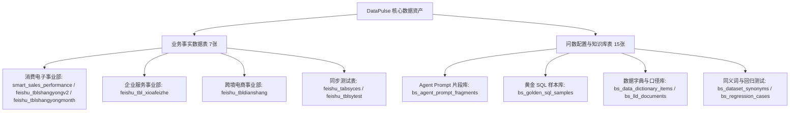
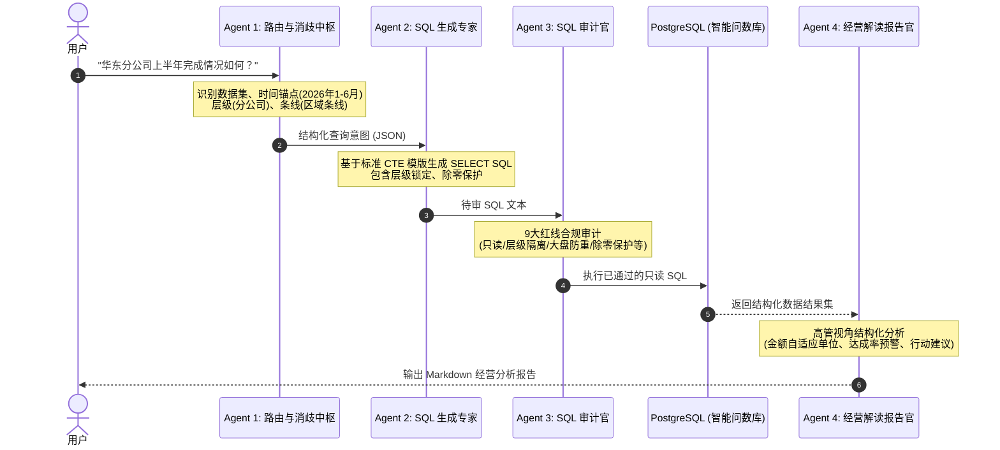

# DataPulse 业务数据资产与 NL2SQL 深度学习沉淀手册

> **文档版本**：v2.0  
> **更新时间**：2026-08-21  
> **适用范围**：DataPulse 智能问数系统、NL2SQL 引擎、飞书多维表格同步与经营分析场景  

---

## 目录
1. [项目数据资产全景矩阵](#一项目数据资产全景矩阵)
2. [各业务域组织架构与口径规范](#二各业务域组织架构与口径规范)
   - [2.1 消费电子事业部（smart_sales_performance / feishu_tblshangyong*）](#21-消费电子事业部)
   - [2.2 企业服务事业部（feishu_tbl_xioafeizhe）](#22-企业服务事业部)
   - [2.3 跨境电商事业部（feishu_tbldianshang）](#23-跨境电商事业部)
3. [多维表格 JSONB 存储与数据清洗映射规范](#三多维表格-jsonb-存储与数据清洗映射规范)
4. [四阶 Agent 协同架构与 Prompt 体系](#四四阶-agent-协同架构与-prompt-体系)
5. [核心指标算法与 SQL 审计九大红线](#五核心指标算法与-sql-审计九大红线)
6. [经典 NL2SQL 黄金用例（Golden SQL）模板库](#六经典-nl2sql-黄金用例golden-sql模板库)

---

## 一、项目数据资产全景矩阵

智能问数数据库包含 22 张核心表，可划分为**业务事实表**与**系统/知识库配置表**两大类：



### 1. 业务事实表清单
| 表名 | 记录数 | 业务域 | 存储形式 | 核心作用 |
| :--- | :--- | :--- | :--- | :--- |
| `smart_sales_performance` | 116 | 消费电子事业部 | JSONB (`fields`) | 2026 年商用销售任务与开单落地表 |
| `feishu_tblshangyongv2` | 5,520 | 消费电子事业部 | 明细关系列 / 视图 | 消费电子事业部全维度明细及细分行业线事实表 |
| `feishu_tblshangyongmonth` | 5,520 | 消费电子事业部 | 明细关系列 | 商用月度维度数据集（支持历史月份/季度穿透） |
| `feishu_tbl_xioafeizhe` | 83 | 企业服务事业部 | JSONB (`fields`) | 企业服务事业部四大业务板块年度业绩表 |
| `feishu_tbldianshang` | 15 | 跨境电商事业部 | 明细/视图 (`v_feishu_tbldianshang`) | 2026 年跨境电商事业部各业务部预算与开单数据 |
| `feishu_tabsyces` | 116 | 商用测试 | JSONB (`fields`) | 飞书双向同步校验表 |
| `feishu_tblsytest` | 116 | 商用测试 | JSONB (`fields`) | 飞书同步基准对照表 |

---

## 二、各业务域组织架构与口径规范

### 2.1 消费电子事业部

#### 组织层级拓扑（四级树）：
```
消费电子事业部 (Level 0 - 事业部)
 ├── 区域条线 (node_level='分公司')
 │    └── 各分公司 (Level 1: 华东分公司、华南分公司、西南分公司、华北分公司)
 │         └── 各代表处 (Level 2: 湖北代表处、浙江代表处、甘青宁代表处...)
 │              └── 业务代表 (Level 3: 于翔彦、王园...)
 └── 行业条线 (条线='行业条线')
      └── 各垂直业务部 (Level 1: 餐饮业务部、公共办公业务部、工业医疗业务部)
           └── 行业业务代表 (Level 3: 直属行业业务员)
```

#### 关键口径与红线：
1. **大盘防重（大盘总额行）**：
   - 数据表中同时存在细分行业线行（`餐饮部`、`公共办公`、`工业医疗`）与大盘总额行。
   - **大盘总览查询必须强制带上**：`business_line = '总额(未拆分)'`，防止总额与细分明细混合二次求和导致翻倍。
2. **条线隔离**：
   - 查“分公司/大区”时：必须限定 `node_level='分公司'`，严禁把行业业务部混入。
   - 查“业务部/行业线”时：限定 `条线='行业条线'`。
3. **权威真相源（Truth of Source）**：
   - 父级组织指标（如消费电子事业部或华东分公司）在表中已有**独立预存汇总行**。
   - 禁止自底向上通过底层业务代表 `GROUP BY SUM` 累加作为父级指标，因为可能存在未分配下派的指标预留额。

---

### 2.2 企业服务事业部

#### 组织层级拓扑（三级树）：
```
企业服务事业部总体 (分公司 IS NULL)
 └── 各分公司 (分公司 IS NOT NULL AND 城市公司/城市分公司 IS NULL)
      └── 各城市分公司 (分公司 IS NOT NULL AND 城市公司/城市分公司 IS NOT NULL)
```

#### 四大业务板块构成：
$$\text{年度target_amount} = \text{线下任务} + \text{燃气定制任务} + \text{地产任务} + \text{新零售任务}$$
$$\text{actual_billing_amount} = \text{线下实际} + \text{燃气定制实际} + \text{地产实际} + \text{新零售实际}$$

- **线下主业务**：核心底盘，各分公司与城市公司均承担。
- **燃气定制**：增值业务，各分公司与城市公司均承担。
- **地产配套**：**仅事业部总体有数据**（分公司及城市公司任务与开单均为 0）。
- **新零售**：线上/创新渠道，目前所有层级实际开单均为 0。

---

### 2.3 跨境电商事业部

#### 组织层级拓扑（四级树）：
```
智问科技集团总部
 └── 跨境电商事业部 (层级级别='事业部')
      └── 各业务部 (层级级别='业务部': 国内业务部、直营零售部...)
           └── 细分业务 (层级级别='业务经理': 平台自营、分销渠道等)
```

#### 关键口径：
- 下级字段为空即为本级独立汇总行，禁止跨层级随意聚合相加。
- 4个季度预算目标权重固定为每季度 25%（`2601`~`2604`）。

---

## 三、多维表格 JSONB 存储与数据清洗映射规范

飞书多维表格直接落库表（`smart_sales_performance`、`feishu_tbl_xioafeizhe` 等）采用 `fields` JSONB 字段存储，存在**文本型金额**、**货币符号 (¥)**、**千分符 (,)** 及**数组嵌套**等特性。

### 标准提取与清洗 SQL 范式：

```sql
-- 1. 字符串提取与空值安全处理
COALESCE(fields ->> '字段名', '')

-- 2. 金额/数值提取与清洗转换范式（去除非数字、小数点、负号的所有字符）
COALESCE(NULLIF(regexp_replace(fields ->> 'target_amount（金额）', '[^0-9.-]', '', 'g'), ''), '0')::NUMERIC

-- 3. 数组/文本复合类型兼容提取
CASE 
    WHEN jsonb_typeof(fields -> '分公司') = 'array' THEN fields -> '分公司' -> 0 ->> 'text'
    ELSE fields ->> '分公司'
END
```

---

## 四、四阶 Agent 协同架构与 Prompt 体系

DataPulse 采用 4 阶流水线协同完成从自然语言到高管报告的转化：



### Agent 核心职责矩阵
| Agent | 角色定位 | 核心输入 | 核心输出 | 关键要求 |
| :--- | :--- | :--- | :--- | :--- |
| **Agent 1** | 语义路由与消歧 | 用户自然语言 + 上下文 | 结构化 Intent JSON | 准确提取 `target_level`、`line_type`、`year`、`months` |
| **Agent 2** | SQL 生成专家 | Intent JSON + 表元数据 | 只读 PostgreSQL SQL | 严格使用 CTE 结构，投影标准中文列 |
| **Agent 3** | SQL 审计官 | 待审 SQL | Approved / Fixed SQL | 逐条检验 9 大红线，阻断危险或逻辑错误 SQL |
| **Agent 4** | 经营分析报告官 | SQL 执行结果 + 业务意图 | Markdown 报告 | 遵循“核心结论 $\to$ 关键数据 $\to$ 风险提示 $\to$ 落地建议” |

---

## 五、核心指标算法与 SQL 审计九大红线

### 1. 核心指标公式

| 指标名称 | 计算公式 | SQL 实现范式 |
| :--- | :--- | :--- |
| **达成率 (%)** | $\frac{\text{actual_billing_amount}}{\text{target_amount}} \times 100$ | `CASE WHEN SUM(target_amount)>0 THEN ROUND(SUM(开单)/SUM(target_amount)*100, 2) ELSE 0 END` |
| **剩余缺口** | $\text{target_amount} - \text{actual_billing_amount}$ | `SUM(target_amount) - SUM(开单)` |
| **同比增速 YoY (%)** | $\frac{\text{今年开单} - \text{去年同期开单}}{\text{去年同期开单}} \times 100$ | `CASE WHEN SUM(去年)>0 THEN ROUND((SUM(今年)-SUM(去年))/SUM(去年)*100, 2) ELSE 0 END` |
| **环比增速 MoM (%)** | $\frac{\text{本月开单} - \text{上月开单}}{\text{上月开单}} \times 100$ | `LAG(SUM(开单)) OVER (ORDER BY 月份)` 窗口函数计算 |

### 2. SQL 审计九大红线

```markdown
1. 【只读安全】：只允许 SELECT / WITH / SHOW 查询，禁止任何 DDL / DML。
2. 【层级锁定】：SUM 聚合必须且只能锁定单一“层级”，严禁跨层级求和导致数据翻倍。
3. 【大盘防重】：查询大盘整体时，必须包含 WHERE business_line = '总额(未拆分)'。
4. 【条线隔离】：分公司必须加 条线 = '区域条线'；业务部必须加 条线 = '行业条线'。
5. 【除零保护】：所有除法必须使用 CASE WHEN 分母 > 0 或 NULLIF。
6. 【比率过滤】：达成率 > 50%、< 30% 等条件必须放在 HAVING 中重算，不能直接在 WHERE 中过滤行级字段。
7. 【时间锚点】：严格转换时间（上半年: 月份 1~6，Q1: 月份 1~3，今年: 2026）。
8. 【Truth of Source】：查询父级指标必须直接读取预存汇总行，严禁子级自底向上累加替代。
9. 【注入防范】：查询参数化，禁止拼接不可控字符串。
```

---

## 六、经典 NL2SQL 黄金用例（Golden SQL）模板库

### 模板 1：消费电子事业部大盘总览与完成率（标准汇总）
```sql
SELECT 
    '消费电子事业部' AS 组织名称,
    SUM(target_amount) AS 全年总指标,
    SUM(actual_billing_amount) AS 全年actual_billing_amount,
    CASE 
        WHEN SUM(target_amount) > 0 THEN ROUND(SUM(actual_billing_amount) / SUM(target_amount) * 100, 2) 
        ELSE 0 
    END AS 整体达成率_百分比,
    SUM(target_amount) - SUM(actual_billing_amount) AS 剩余任务缺口
FROM public.smart_sales_performance
WHERE year = '2026' 
  AND node_level = '事业部' 
  AND business_line = '总额(未拆分)';
```

### 模板 2：各大区销售业绩排名（同层级与条线隔离）
```sql
SELECT 
    region_name AS 分公司,
    SUM(target_amount) AS 任务金额,
    SUM(actual_billing_amount) AS 累计开单金额,
    CASE 
        WHEN SUM(target_amount) > 0 THEN ROUND(SUM(actual_billing_amount) / SUM(target_amount) * 100, 2) 
        ELSE 0 
    END AS 达成率
FROM public.smart_sales_performance
WHERE year = '2026' 
  AND node_level = '分公司' 
  AND 条线 = '区域条线' 
  AND business_line = '总额(未拆分)'
GROUP BY region_name
ORDER BY 累计开单金额 DESC;
```

### 模板 3：下属代表处业绩下钻与 HAVNG 比率筛选
```sql
SELECT 
    region_name AS 代表处,
    SUM(target_amount) AS 任务额,
    SUM(actual_billing_amount) AS 开单额,
    CASE 
        WHEN SUM(target_amount) > 0 THEN ROUND(SUM(actual_billing_amount) / SUM(target_amount) * 100, 2) 
        ELSE 0 
    END AS 累计达成率
FROM public.smart_sales_performance
WHERE year = '2026' 
  AND 层级 = '代表处' 
  AND 上级名称 = '华东分公司'
  AND business_line = '总额(未拆分)'
GROUP BY region_name
HAVING CASE WHEN SUM(target_amount) > 0 THEN SUM(actual_billing_amount) / SUM(target_amount) ELSE 0 END < 0.50
ORDER BY 累计达成率 ASC;
```

### 模板 4：企业服务事业部多板块 JSONB 数据结构化下钻
```sql
WITH base_data AS (
    SELECT
        CASE 
            WHEN COALESCE(fields ->> '分公司', '') = '' THEN '企业服务事业部总体'
            WHEN COALESCE(fields ->> '城市分公司', '') = '' THEN '分公司'
            ELSE '城市分公司'
        END AS 层级,
        CASE 
            WHEN COALESCE(fields ->> '分公司', '') = '' THEN '企业服务事业部'
            WHEN COALESCE(fields ->> '城市分公司', '') = '' THEN fields ->> '分公司'
            ELSE fields ->> '城市分公司'
        END AS region_name,
        COALESCE(NULLIF(regexp_replace(fields ->> 'target_amount（金额）', '[^0-9.-]', '', 'g'), ''), '0')::NUMERIC AS target_amount,
        COALESCE(NULLIF(regexp_replace(fields ->> 'actual_billing_amount', '[^0-9.-]', '', 'g'), ''), '0')::NUMERIC AS actual_billing_amount,
        COALESCE(NULLIF(regexp_replace(fields ->> '线下-actual_billing_amount', '[^0-9.-]', '', 'g'), ''), '0')::NUMERIC AS 线下开单,
        COALESCE(NULLIF(regexp_replace(fields ->> '燃气定制-actual_billing_amount', '[^0-9.-]', '', 'g'), ''), '0')::NUMERIC AS 燃气定制开单,
        COALESCE(NULLIF(regexp_replace(fields ->> '地产-actual_billing_amount', '[^0-9.-]', '', 'g'), ''), '0')::NUMERIC AS 地产开单
    FROM public.smart_sales_performance
)
SELECT 
    层级,
    region_name,
    ROUND(target_amount / 10000, 2) AS target_amount_万元,
    ROUND(actual_billing_amount / 10000, 2) AS 总实际_万元,
    CASE WHEN target_amount > 0 THEN ROUND(actual_billing_amount / target_amount * 100, 2) ELSE 0 END AS 达成率_百分比,
    ROUND(线下开单 / 10000, 2) AS 线下实际_万元,
    ROUND(燃气定制开单 / 10000, 2) AS 燃气定制实际_万元,
    ROUND(地产开单 / 10000, 2) AS 地产实际_万元
FROM base_data
WHERE node_level = '分公司'
ORDER BY 达成率_百分比 DESC;
```

---

## 七、总结与后续演进建议

1. **统一视图层加速**：建议将 `feishu_tbl_xioafeizhe` 等高频 JSONB 表通过物化视图或标准视图预先展平（如 `v_feishu_tbl_xioafeizhe`），避免在运行时反复进行正则替换和类型转换。
2. **Prompt 知识沉淀与对齐**：当飞书多维表格新增业务列时，应同步更新 `bs_data_dictionary_items` 与 `bs_agent_prompt_fragments`，确保 Agent 具备最新的字段认知。
3. **回归用例自测闭环**：通过 `bs_regression_cases` 维护典型高频问答集，在每次更新 Prompt 或数据结构后自动执行回归比对，保障高准确率。
