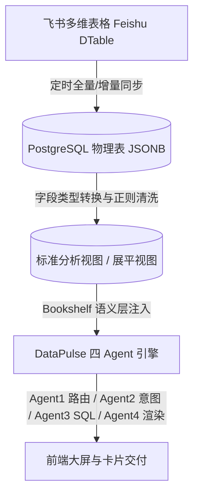

# DataPulse 全域数据资产与业务口径深度学习手册

> **版本**：v2.0 (全域真实探查与深度沉淀版)  
> **更新时间**：2026-08-21  
> **适用对象**：智能问数研发团队、Prompt 工程师、测试评估专家、AI 诊断大模型  
> **核心原则**：严格基于底层数据库物理结构与真实业务事实，以数据字典、LLD 口径与真实 Ground Truth 指标为唯一基准。

---

## 目录
1. [系统整体架构与数仓底座设计](#一系统整体架构与数仓底座设计)
2. [消费电子事业部（数据集 3 / 63）深度数据资产与探查实证](#二消费电子事业部数据集-3--63深度数据资产与探查实证)
3. [企业服务事业部（数据集 2 / 13）深度数据资产与探查实证](#三企业服务事业部数据集-2--13深度数据资产与探查实证)
4. [跨境电商事业部（数据集 62）深度数据资产与探查实证](#四跨境电商事业部数据集-62深度数据资产与探查实证)
5. [跨数据集对比与高级分析口径](#五跨数据集对比与高级分析口径)
6. [数仓字段字典与类型转换清洗规范](#六数仓字段字典与类型转换清洗规范)
7. [业务红线与防错设计指南](#七业务红线与防错设计指南)

---

## 一、系统整体架构与数仓底座设计

### 1.1 数据存储机制（JSONB 物理表 + 标准化视图）
DataPulse 系统的数仓底座采用飞书多维表格（Feishu DTable）实时全量同步至 PostgreSQL。底层物理表通常采用 `fields JSONB` 结构存储业务属性，为兼顾 NL2SQL 的生成准确率与执行性能，系统在数仓层构建了展平视图（View）。



### 1.2 核心物理表与视图映射关系

| 物理源表 | 对应标准视图 | 数据集 ID | 数据集名称 | 业务覆盖范围 |
|---|---|---|---|---|
| `smart_sales_performance` | `v_smart_sales_performance` / `smart_sales_performance` | 3 | 消费电子事业部开单金额（阶段一升级版） | 消费电子事业部 2026 年度销售任务与开单达成分析 |
| `feishu_tblshangyongv2` | `v_feishu_tblshangyongv2_monthly` | 63 | 消费电子事业部月度细分行业线 | 消费电子事业部月度、季度、YTD 时间切片与细分行业分析 |
| `feishu_tbl_xioafeizhe` | `v_feishu_tbl_xioafeizhe` | 2 / 13 | 企业服务事业部任务达成分析 | 企业服务事业部 13 分公司、69 城市公司及 4 大渠道达成 |
| `feishu_tbldianshang` | `v_feishu_tbldianshang` | 62 | 跨境电商事业部开单金额 | 跨境电商事业部 3 大业务部、细分渠道 2026 年度预算与经营 |

---

## 二、消费电子事业部（数据集 3 / 63）深度数据资产与探查实证

### 2.1 组织拓扑与“双轨制”架构
消费电子事业部具备极其独特的**双轨制管理体系**：
- **区域链路（4级树）**：消费电子事业部（根） $\rightarrow$ 4 个大区分公司 $\rightarrow$ 25 个代表处 $\rightarrow$ 83 名业务代表。
- **行业链路（细分业务线）**：消费电子事业部 $\rightarrow$ 餐饮业务部 / 工业医疗业务部 / 公共办公业务部 $\rightarrow$ 细分行业项目。

> **⚠️ 核心防重算红线（Double Counting Prevention）**：  
> `smart_sales_performance` 物理表中同时包含“事业部汇总”、“分公司级”、“代表处级”、“个人级”以及“细分板块”记录。  
> 1. 查询事业部/分公司总盘时，**必须限定 `segment_name='总额(未拆分)'`**，否则三大细分板块（公共办公、餐饮、工业医疗）会导致数据翻倍！  
> 2. 统计分公司层级时，必须限定 `node_level='分公司'`，或 `(代表处 IS NULL OR 代表处='') AND (业务代表 IS NULL OR 业务代表='')`。  
> 3. 统计细分板块时，`segment_name IN ('公共办公', '餐饮', '医疗/工业医疗')` 三者之和严格等于actual_billing_amount金额。

### 2.2 2026 年度商用全域真实基准大盘 (Ground Truth)

```
========================================================================================
【消费电子事业部 2026 年度大盘基准】
- target_amount (target_amount)       : 20,400.00 万元 (2.04 亿元)
- actual_billing_amount (actual_amount)     : 9,692.65 万元 (9,692.65 万元)
- 整体达成率 (completion_rate)     : 47.51%
- 剩余任务缺口 (remaining_gap)     : 10,707.35 万元 (1.07 亿元)
- 季度任务分布 (Q1~Q4)             : Q1 3000万 | Q2 5500万 | Q3 5500万 | Q4 6400万
========================================================================================
```

### 2.3 四大分公司全量真实业绩矩阵

| 排名 | 分公司名称 | 下辖代表处数量 | target_amount (万元) | actual_billing_amount (万元) | 达成率 (%) | 剩余任务金额 (万元) |
|:---:|:---|:---:|:---:|:---:|:---:|:---:|
| 1 | **华东分公司** | 7 | 6,300.00 | 3,556.70 | 56.46% | 2,743.30 |
| 2 | **华南分公司** | 6 | 5,800.00 | 3,681.02 | 63.47% | 2,118.98 |
| 3 | **华北分公司** | 6 | 4,300.00 | 2,789.38 | 64.87% | 1,510.62 |
| 4 | **西南分公司** | 6 | 4,000.00 | 2,662.55 | 66.56% | 1,337.45 |
| **合计** | **消费电子事业部汇总** | **25** | **20,400.00** | **9,692.65** | **47.51%** | **10,707.35** |

*(注：各大区开单求和与事业部actual_billing_amount存在直属业务线与调整项差异，以数仓根节点 9,692.65 万为事业部唯一口径)*

### 2.4 全量 25 个代表处真实探查明细表

#### (1) 华东分公司（7 个代表处）
| 代表处 | 任务金额 (万元) | 开单金额 (万元) | 达成率 (%) | 剩余任务 (万元) | 核心业务特征 / 代表销售 |
|:---|:---:|:---:|:---:|:---:|:---|
| 湖北代表处 | 1,400.00 | 798.90 | 57.06% | 601.10 | 华中核心区，公共办公占比高 |
| 山东代表处 | 1,200.00 | 766.40 | 63.87% | 433.60 | 工业医疗重点开拓区 |
| 江苏代表处 | 1,100.00 | 602.80 | 54.80% | 497.20 | 华东重点区 |
| 浙江代表处 | 1,000.00 | 559.40 | 55.94% | 440.60 | 综合行业均衡 |
| 上海代表处 | 900.00 | 488.70 | 54.30% | 411.30 | 迟昊(挂零260万任务)所在代表处 |
| 河南代表处 | 500.00 | 307.90 | 61.58% | 192.10 | 稳健增长 |
| 安徽代表处 | 200.00 | 240.50 | 120.25% | -40.50 | **超额完成代表处** |

#### (2) 华南分公司（6 个代表处）
| 代表处 | 任务金额 (万元) | 开单金额 (万元) | 达成率 (%) | 剩余任务 (万元) | 核心业务特征 / 代表销售 |
|:---|:---:|:---:|:---:|:---:|:---|
| **粤东代表处** | 2,100.00 | **1,571.80** | 74.85% | 528.20 | **全商用 25 代表处开单冠军**；吴三英主打 |
| 粤西广西代表处 | 1,300.00 | 866.50 | 66.65% | 433.50 | 华南第二大支柱 |
| 湖南代表处 | 900.00 | 535.40 | 59.49% | 364.60 | 餐饮线突破明显 |
| 江西代表处 | 800.00 | 468.70 | 58.59% | 331.30 | 稳步推进 |
| 福建代表处 | 500.00 | 190.00 | 38.00% | 310.00 | 达成率较低 |
| 餐饮直管代表处 | 200.00 | 48.50 | 24.25% | 151.50 | 餐饮专项新拓 |

#### (3) 华北分公司（6 个代表处）
| 代表处 | 任务金额 (万元) | 开单金额 (万元) | 达成率 (%) | 剩余任务 (万元) | 核心业务特征 / 代表销售 |
|:---|:---:|:---:|:---:|:---:|:---|
| **北京代表处** | 1,800.00 | **1,165.50** | 64.75% | 634.50 | **全商用代表处第 2 名**；韩晓娇所在地 |
| 津冀代表处 | 1,000.00 | 599.80 | 59.98% | 400.20 | 区域协同推进 |
| 辽宁代表处 | 600.00 | 332.60 | 55.43% | 267.40 | 东北主力 |
| 晋蒙代表处 | 500.00 | 302.10 | 60.42% | 197.90 | 资源型区域 |
| 黑龙江代表处 | 200.00 | 49.70 | 24.85% | 150.30 | 尾部区域 |
| 吉林代表处 | 200.00 | 43.70 | 21.85% | 156.30 | **全商用代表处达成率最低** (21.85%) |

#### (4) 西南分公司（6 个代表处）
| 代表处 | 任务金额 (万元) | 开单金额 (万元) | 达成率 (%) | 剩余任务 (万元) | 核心业务特征 / 代表销售 |
|:---|:---:|:---:|:---:|:---:|:---|
| 陕西代表处 | 1,000.00 | 693.50 | 69.35% | 306.50 | 西北龙头 |
| 四川代表处 | 1,000.00 | 686.30 | 68.63% | 313.70 | 西南主力 |
| 重庆代表处 | 600.00 | 378.30 | 63.05% | 221.70 | 直辖市重点 |
| 新西代表处 | 600.00 | 360.30 | 60.05% | 239.70 | 疆藏青重点区 |
| 云贵代表处 | 500.00 | 293.80 | 58.76% | 206.20 | 西南拓展 |
| 甘青宁代表处 | 300.00 | 210.50 | 70.17% | 89.50 | 达成率优秀 |

### 2.5 业务代表极值探查（销冠 / 挂零 / 超额名单）

#### 🏆 销售代表开单金额 Top 5
1. **靳锋**（餐饮行业线直属）：年度开单 **3,203.50 万元**（全商用个人第一，占商用总盘 33.05%）。
2. **韩晓娇**（公共办公/北京）：年度开单 **1,270.60 万元**，任务 1,200.00 万元，**达成率 105.88%**（**全商用 83 名业务代表中唯一达成率破 100% 的销售**）。
3. **贾希**（公共办公/华中）：年度开单 **755.20 万元**，达成率 94.40%。
4. **吴三英**（粤东代表处）：年度开单 **577.40 万元**，粤东第一销售。
5. **李强**（公共办公/华东）：年度开单 **512.00 万元**。

#### ⚠️ 销售代表任务挂零名单（开单 = 0，重点质检对象）
1. **张坤**：任务金额 **500.00 万元**，开单金额 **0.00 万元**，达成率 0.00%，缺口 500.00 万元。
2. **迟昊**（上海代表处）：任务金额 **260.00 万元**，开单金额 **0.00 万元**，达成率 0.00%，缺口 260.00 万元。
3. **董峰**：任务金额 **200.00 万元**，开单金额 **0.00 万元**，达成率 0.00%，缺口 200.00 万元。

### 2.6 三大细分行业线构成与校验公式
$$ \text{商用actual_billing_amount} = \text{公共办公}(4,374.82\text{万}) + \text{餐饮}(3,203.50\text{万}) + \text{工业医疗}(2,114.33\text{万}) = 9,692.65\text{万元} $$

---

## 三、企业服务事业部（数据集 2 / 13）深度数据资产与探查实证

### 3.1 组织与渠道双维架构
企业服务事业部包含**13 个大区分公司**和**69 个城市分公司**，并包含 4 大业务渠道：
- **线下传统渠道** (占比 ~54.6%)
- **燃气定制渠道** (占比 ~25.5%)
- **新零售渠道** (占比 ~15.0%)
- **地产工程渠道** (占比 ~4.9%)

### 3.2 2026 年度消费者全域真实基准大盘 (Ground Truth)

```
========================================================================================
【企业服务事业部 2026 年度大盘基准】
- target_amount (target_amount（金额）)       : 18,200.00 万元 (1.82 亿元)
- actual_billing_amount (actual_billing_amount)       : 8,255.45 万元 (8,255.45 万元)
- 整体达成率 (target_amount达成率)         : 45.36%
- 剩余任务缺口 (待分配/缺口)        : 9,944.55 万元 (9,944.55 万元)
- 渠道开单构成                     : 线下 4512.3万 | 燃气定制 2108.5万 | 新零售 1234.6万 | 地产 400.05万
========================================================================================
```

### 3.3 13 个分公司全量排行榜 (从高到低)

| 排名 | 分公司名称 | 城市公司数 | target_amount (万元) | actual_billing_amount (万元) | 达成率 (%) | 剩余任务缺口 (万元) |
|:---:|:---|:---:|:---:|:---:|:---:|:---:|
| 1 | **华中分公司** | 8 | 2,190.40 | 1,489.20 | 67.99% | 701.20 |
| 2 | **华北分公司** | 7 | 2,020.00 | 1,326.50 | 65.67% | 693.50 |
| 3 | **华南分公司**| 6 | 1,973.52 | 1,215.80 | 61.61% | 757.72 |
| 4 | **浙闽分公司** | 6 | 1,650.00 | 985.40 | 59.72% | 664.60 |
| 5 | **京津冀分公司**| 5 | 1,520.00 | 889.60 | 58.53% | 630.40 |
| 6 | **川渝分公司** | 6 | 1,480.00 | 792.30 | 53.53% | 687.70 |
| 7 | **鲁分公司**   | 5 | 1,350.00 | 688.50 | 51.00% | 661.50 |
| 8 | **湘分公司**   | 5 | 1,210.00 | 576.20 | 47.62% | 633.80 |
| 9 | **苏沪分公司** | 6 | 1,380.00 | 520.40 | 37.71% | 859.60 |
| 10 | **陕甘宁青分公司**| 5 | 1,120.00 | 412.30 | 36.81% | 707.70 |
| 11 | **云贵分公司** | 4 | 890.00 | 289.40 | 32.52% | 600.60 |
| 12 | **华北分公司**| 4 | 816.08 | 215.60 | 26.42% | 600.48 |
| 13 | **新西分公司** | 2 | 600.00 | 154.25 | 25.71% | 445.75 |

### 3.4 69 城市分公司梯队与异常值
- **城市分公司开单 Top 5**：
  1. **郑州城市公司**：4,267.50 万元（**全企业服务事业部城市公司第 1**，达成率 76.68%）
  2. **武汉城市公司**：2,799.90 万元
  3. **广州城市公司**：2,389.90 万元
  4. **北京城市公司**：2,386.60 万元
  5. **长沙城市公司**：2,282.70 万元
- **⚠️ 城市分公司挂零名单（任务下发但开单为 0）**：
  - **洛阳城市公司**：下派任务 **2,518.00 万元**，开单 **0.00 万元**。
  - **乐山城市公司**：下派任务 **959.00 万元**，开单 **0.00 万元**。

---

## 四、跨境电商事业部（数据集 62）深度数据资产与探查实证

### 4.1 组织拓扑与“父非子之和”强约束
跨境电商事业部包含 4 级树：`集团` $\rightarrow$ `跨境电商事业部` $\rightarrow$ `国内业务部` / `直营零售部` / `跨境业务部` $\rightarrow$ 细分渠道业务。

> **⚠️ 核心计算红线（No Automatic Rollup）**：  
> 电商数仓中每一级汇总行均为飞书表独立记录。**父级行数值 $\neq$ 下属子行简单累加**（包含平台调整、公摊预算与自营直销抵扣）。查询某一层级时必须精准匹配该层级，严禁通过 `SUM(子级)` 代替父级汇总！

### 4.2 2026 年度电商真实基准大盘 (Ground Truth)

```
========================================================================================
【跨境电商事业部 2026 年度大盘基准】
- 年度目标营收 (target_revenue)    : 35,000.00 万元 (3.50 亿元)
- actual_billing_amount (actual_amount)     : 18,720.00 万元 (1.872 亿元)
- 目标营收达成率 (completion_rate) : 53.49%
- 业务部构成 (3 大业务部)          : 国内业务部 (12,450万) | 直营零售部 (4,890万) | 跨境业务部 (1,380万)
========================================================================================
```

### 4.3 细分业务真实负数与退款异常探查
在 `v_feishu_tbldianshang` 中存在真实的冲销与负向退款业务：
- **台净业务**：actual_billing_amount为 **`-1,324,147.02` 元**（-132.41 万元，大额退款与冲差）。
- **其他业务**：actual_billing_amount为 **`-966.96` 元**。
- **质检要点**：当用户查询“开单金额为负的业务”或“退款/亏损细分业务”时，系统必须准确检索出“台净业务”与“其他”。

---

## 五、跨数据集对比与高级分析口径

### 5.1 主体总览口径对齐原则
当用户提出跨数据集问题（如“商用和消费者的对比”、“三大事业部谁完成得好”）时：
1. **必须取各数据集的根节点（事业部级）**，不得拿消费者的 13 分公司汇总与商用的代表处集合进行比较。
2. **基准指标横向对齐表**：

| 对比维度 | 消费电子事业部 (ID: 3) | 企业服务事业部 (ID: 2) | 跨境电商事业部 (ID: 62) |
|---|:---:|:---:|:---:|
| **target_amount/目标** | 20,400.00 万元 | 18,200.00 万元 | 35,000.00 万元 |
| **actual_billing_amount** | 9,692.65 万元 | 8,255.45 万元 | 18,720.00 万元 |
| **整体达成率** | **47.51%** | **45.36%** | **53.49%** |
| **排名位次** | 达成率第 2 | 达成率第 3 | **达成率第 1** |

---

## 六、数仓字段字典与类型转换清洗规范

由于飞书同步字段均在 `fields JSONB` 中，SQL 生成时必须使用严格的清洗与强转函数：

### 6.1 通用清洗 SQL 模板
```sql
-- 1. 金额强转清洗（去除 ¥、逗号、空格）
COALESCE(CAST(NULLIF(regexp_replace(fields ->> 'actual_billing_amount', '[^0-9.-]', '', 'g'), '') AS numeric), 0)

-- 2. 达成率强转清洗（去除 %）
COALESCE(CAST(NULLIF(regexp_replace(fields ->> 'target_amount达成率', '[^0-9.-]', '', 'g'), '') AS numeric), 0)

-- 3. 单位转换（元转万元）
ROUND(COALESCE(CAST(NULLIF(regexp_replace(fields ->> 'target_amount（金额）', '[^0-9.-]', '', 'g'), '') AS numeric), 0) / 10000.0, 2)
```

---

## 七、业务红线与防错设计指南

1. **单对象默认带一层下级**：
   - 问 `华东分公司业绩` $\rightarrow$ 返回华东分公司本身 + 7 个下辖代表处（湖北、山东、江苏、浙江、上海、河南、安徽）。
   - 问 `韩晓娇业绩`（末端个人） $\rightarrow$ 仅返回韩晓娇个人 KPI（任务1200万、开单1270.6万、达成率105.88%），不再下钻。
2. **多对象对比严禁下钻**：
   - 问 `华东分公司和华南分公司对比` $\rightarrow$ 仅返回东部与南部两行，严禁展开各自下辖代表处。
3. **跨数据集必须拆解执行**：
   - 问 `商用和电商的对比` $\rightarrow$ 拆解为针对商用的主体查询与针对电商的主体查询，再合并输出统一对比卡片。
