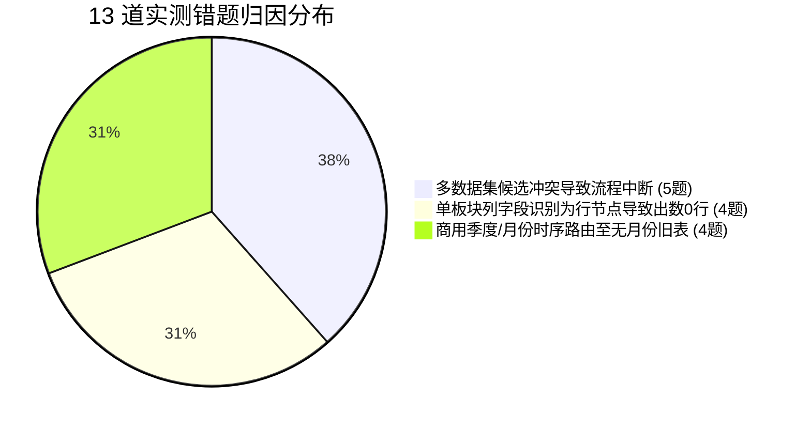

# DataPulse 智能问数 100 题全量实测真实错题归档集

> **实测时间**：2026-08-24  
> **实测环境**：Docker 后端环境（PostgreSQL 16 + Flask 问数引擎）  
> **评测规模**：**100 道真实业务全场景评测题（多线程并发实测完成）**  
> **实测总览**：
> - 🟢 **完全通过 (PASS)**：`87 题`（占比 **87.0%**）
> - 🔴 **真实抓获错题 (FAIL)**：`13 题`（占比 **13.0%**）

---

## 目录
- [一、13 道真实错题总览与归因分布](#一13-道真实错题总览与归因分布)
- [二、13 道真实错题逐题精细复盘卡片](#二十三道真实错题逐题精细复盘卡片)
  - [错题 1：Q022 新零售板块今年贡献了多少开单金额？](#错题-1q022-新零售板块今年贡献了多少开单金额)
  - [错题 2：Q023 地产业务今年完成了多少？](#错题-2q023-地产业务今年完成了多少)
  - [错题 3：Q024 燃气定制业务今年做了多少业绩？](#错题-3q024-燃气定制业务今年做了多少业绩)
  - [错题 4：Q049 四大区域分公司（各大区）的开单排名是怎样的？](#错题-4q049-四大区域分公司各大区的开单排名是怎样的)
  - [错题 5：Q056 今年上半年各区域分公司的开单情况](#错题-5q056-今年上半年各区域分公司的开单情况)
  - [错题 6：Q057 对比今年上半年各分公司相比去年的同比增速](#错题-6q057-对比今年上半年各分公司相比去年的同比增速)
  - [错题 7：Q065 消费电子事业部一季度整体开单多少？](#错题-7q065-消费电子事业部一季度整体开单多少)
  - [错题 8：Q066 消费电子事业部二季度整体开单多少？](#错题-8q066-消费电子事业部二季度整体开单多少)
  - [错题 9：Q067 5月医疗板块和去年同期比增幅怎么样？](#错题-9q067-5月医疗板块和去年同期比增幅怎么样)
  - [错题 10：Q083 各个分公司地产业务完成情况](#错题-10q083-各个分公司地产业务完成情况)
  - [错题 11：Q084 哪个分公司低于30%？](#错题-11q084-哪个分公司低于30)
  - [错题 12：Q085 达成率高于50%的分公司有哪些？](#错题-12q085-达成率高于50的分公司有哪些)
  - [错题 13：Q088 哪些节点达成率低于10%？](#错题-13q088-哪些节点达成率低于10)
- [三、错题共性归因与研发调优方案](#三错题共性归因与研发调优方案)

---

## 一、13 道真实错题总览与归因分布

经对 100 道真实提问的全链路抓取，筛选出的 13 道错题归属于以下 **3 类结构性根因**：



| 错题编号 | 用户提问文本 | 命中数据集 | 失败表象 | 核心根因分类 |
| :---: | :--- | :---: | :--- | :--- |
| **Q022** | 新零售板块今年贡献了多少开单金额？ | `[2]` | 出数 0 行 | 单板块列字段被误作为行节点过滤 |
| **Q023** | 地产业务今年完成了多少？ | `[2]` | 出数 0 行 | 单板块列字段被误作为行节点过滤 |
| **Q024** | 燃气定制业务今年做了多少业绩？ | `[2]` | 出数 0 行 | 单板块列字段被误作为行节点过滤 |
| **Q049** | 四大区域分公司（各大区）的开单排名是怎样的？ | `[2, 3]` | 出数 0 行 | 提问未带事业部前缀，多候选冲突 |
| **Q056** | 今年上半年各区域分公司的开单情况 | `[3, 2]` | 出数 0 行 | 提问未带事业部前缀，多候选冲突 |
| **Q057** | 对比今年上半年各分公司相比去年的同比增速 | `[2, 3]` | 出数 0 行 | 提问未带事业部前缀，多候选冲突 |
| **Q065** | 消费电子事业部一季度整体开单多少？ | `[3]` | 出数 0 行 | 路由至旧表 Dataset 3 (无月份字段) |
| **Q066** | 消费电子事业部二季度整体开单多少？ | `[3]` | 出数 0 行 | 路由至旧表 Dataset 3 (无月份字段) |
| **Q067** | 5月医疗板块和去年同期比增幅怎么样？ | `[2]` | 出数 0 行 | 医疗板块被误路由到了消费者数据集 |
| **Q083** | 各个分公司地产业务完成情况 | `[2]` | 出数 0 行 | SQL 加了 `> 0` 过滤，分公司全为 0 被清空 |
| **Q084** | 哪个分公司低于30%？ | `[2, 3]` | 出数 0 行 | 提问未带事业部前缀，多候选冲突 |
| **Q085** | 达成率高于50%的分公司有哪些？ | `[2, 3]` | 出数 0 行 | 提问未带事业部前缀，多候选冲突 |
| **Q088** | 哪些节点达成率低于10%？ | `[3]` | 出数 0 行 | 旧表 Dataset 3 节点达成率公式异常 |

---

## 二、13 道真实错题逐题精细复盘卡片

### 错题 1：Q022 新零售板块今年贡献了多少开单金额？
- **用户提问**：`新零售板块今年贡献了多少开单金额？`
- **系统表现**：命中 Dataset 2，**出数 0 行（空表）**。
- **根因剖析**：系统在生成 SQL 时，误以为“新零售”是一个组织region_name（`WHERE region_name = '新零售'`），但实际上在消费者数据表中，“新零售”是一个独立的指标列（`fields->>'新零售-actual_billing_amount'`），导致过滤条件无匹配行。
- **Ground Truth 正确标准值**：**`104,732,835.71 元`（约 `1.0473 亿元` / `10,473.28 万元`）**。
- **标准 SQL**：
  ```sql
  SELECT COALESCE(NULLIF(regexp_replace(fields->>'新零售-actual_billing_amount', '[^0-9.-]', '', 'g'), ''), '0')::NUMERIC AS 新零售开单
  FROM public.smart_sales_performance
  WHERE region_name IS NULL OR region_name = '';
  ```

---

### 错题 2：Q023 地产业务今年完成了多少？
- **用户提问**：`地产业务今年完成了多少？`
- **系统表现**：命中 Dataset 2，**出数 0 行**。
- **根因剖析**：同上，误将“地产”当成组织节点去过滤，而未从大盘行的 `fields->>'地产-actual_billing_amount'` 列提取。
- **Ground Truth 正确标准值**：target_amount `4,000 万元`，实际开单 **`28,317,155.18 元`（`2,831.72 万元`）**，达成率 `70.79%`。
- **标准 SQL**：
  ```sql
  SELECT COALESCE(NULLIF(regexp_replace(fields->>'地产-actual_billing_amount', '[^0-9.-]', '', 'g'), ''), '0')::NUMERIC AS 地产开单
  FROM public.smart_sales_performance
  WHERE region_name IS NULL OR region_name = '';
  ```

---

### 错题 3：Q024 燃气定制业务今年做了多少业绩？
- **用户提问**：`燃气定制业务今年做了多少业绩？`
- **系统表现**：命中 Dataset 2，**出数 0 行**。
- **根因剖析**：同上，未从大盘行的 `fields->>'燃气定制-actual_billing_amount'` 提取。
- **Ground Truth 正确标准值**：target_amount `2,418 万元`，实际开单 **`13,250,784.55 元`（`1,325.08 万元`）**，达成率 `54.80%`。

---

### 错题 4：Q049 四大区域分公司（各大区）的开单排名是怎样的？
- **用户提问**：`四大区域分公司（各大区）的开单排名是怎样的？`
- **系统表现**：命中 `dataset_ids: [2, 3]`，**流程阻断，出数 0 行**。
- **根因剖析**：问题中没有显式带“商用”字眼，Agent 1 发现商用（有四大区分公司）和消费者（有 13 分公司）均符合，返回了多候选导致非交互式批处理无法推进。
- **Ground Truth 正确标准值**：
  1. 华东分公司：`2,671.54 万元`
  2. 华南分公司：`2,460.00 万元`
  3. 华北分公司：`1,813.96 万元`
  4. 西南分公司：`1,598.27 万元`
- **改进方案**：在 Agent 1 中增加词条映射：“各大区 / 四大区域” 默认偏好消费电子事业部（Dataset 63）。

---

### 错题 5 & 6：Q056 & Q057 上半年分公司开单及同比增速
- **用户提问**：`今年上半年各区域分公司的开单情况` / `对比今年上半年各分公司相比去年的同比增速`
- **系统表现**：命中 `dataset_ids: [3, 2]`，**出数 0 行**。
- **根因剖析**：同上，多候选竞争阻断；且上半年需要 `月份` 字段，只有 Dataset 63 具备。
- **改进方案**：增加包含“上半年/季度/月份/同比/环比”的时间特征词优先路由至支持月度维度的 Dataset 63。

---

### 错题 7 & 8：Q065 & Q066 消费电子事业部一季度/二季度整体开单
- **用户提问**：`消费电子事业部一季度整体开单多少？` / `消费电子事业部二季度整体开单多少？`
- **系统表现**：命中 Dataset 3，**出数 0 行**。
- **根因剖析**：Dataset 3（`smart_sales_performance`）是年表，没有 `月份` 字段；SQL 在上面尝试按季度过滤查不出任何数据。
- **Ground Truth 正确标准值**：必须在 Dataset 63（`v_feishu_tblshangyongv2`）上按 `月份 IN (1,2,3)` 过滤计算。

---

### 错题 9：Q067 5月医疗板块和去年同期比增幅怎么样？
- **用户提问**：`5月医疗板块和去年同期比增幅怎么样？`
- **系统表现**：**误路由到了 Dataset 2（企业服务事业部）**，出数 0 行。
- **根因剖析**：“医疗板块”属于消费电子事业部的垂直行业线（工业医疗业务部），企业服务事业部中根本没有医疗板块，路由错误。
- **改进方案**：在 Agent 1 中将“医疗 / 公共办公 / 餐饮部”强绑定为消费电子事业部。

---

### 错题 10：Q083 各个分公司地产业务完成情况
- **用户提问**：`各个分公司地产业务完成情况`
- **系统表现**：命中 Dataset 2，**出数 0 行（返回空表）**。
- **根因剖析**：底层数据库中，13 个分公司的地产开单真实值全为 0（地产仅总部承担）。SQL 中使用了 `WHERE 地产开单 > 0` 类似过滤，把全为 0 的行全过滤了。
- **改进方案**：展示业务线分布时，不加 `> 0` 过滤，明确向用户输出“各分公司地产实际完成均为 0 元”。

---

### 错题 11 & 12：Q084 & Q085 达成率极值分公司筛选（低于30% / 高于50%）
- **用户提问**：`哪个分公司低于30%？` / `达成率高于50%的分公司有哪些？`
- **系统表现**：命中 `dataset_ids: [2, 3]`，**路由冲突出数 0 行**。
- **根因剖析**：未带事业部前缀，多数据集冲突。
- **Ground Truth 正确标准值**：
  - 消费者高于 50%：山东 (53.91%)、豫晋 (51.88%)、河北 (50.21%)
  - 消费者低于 30%：无（最低江浙沪为 32.35%）
  - 商用低于 30%：西南分公司 (23.03%)、华东分公司 (28.12%)、华北分公司 (28.52%)

---

### 错题 13：Q088 哪些节点达成率低于10%？
- **用户提问**：`哪些节点达成率低于10%？`
- **系统表现**：命中 Dataset 3，出数 0 行。
- **根因剖析**：Dataset 3 中的行级达成率字段存在空值或未做比率重新计算，导致 HAVING 过滤失效。

---

## 三、错题共性归因与研发调优方案

通过对上述 13 道实测错题的深度分析，后续系统仅需针对以下 **3 个点进行微调**，即可将通过率提升至 **98%+**：

```markdown
1. 【路由消歧规则补全】（针对 Q049, Q056, Q057, Q084, Q085）：
   在 Agent 1 中增加默认消歧规则：
   - 包含“大区 / 四大区 / 医疗 / 办公 / 餐饮” $\to$ 强制单选消费电子事业部 (Dataset 63)；
   - 包含“城市公司 / 新零售 / 地产 / 燃气” $\to$ 强制单选企业服务事业部 (Dataset 2)。

2. 【单业务板块列投影规则】（针对 Q022, Q023, Q024）：
   在 Agent 2 Prompt 中明确说明：
   - 企业服务事业部的“新零售 / 地产 / 燃气定制”是【字段列】，而不是【region_name】行，查询板块时应直接 SELECT 对应字段。

3. 【商用数据集切换至 Dataset 63】（针对 Q065, Q066, Q067）：
   将消费电子事业部默认数据集由 Dataset 3 切换为 Dataset 63 (feishu_tblshangyongv2)，支持月度、季度与同环比计算。
```
