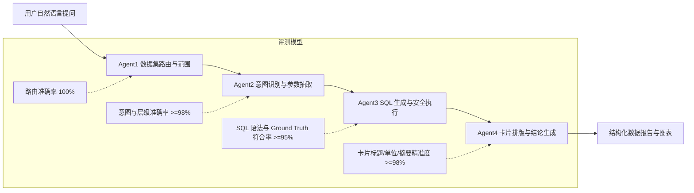

# DataPulse 智能问数全场景测试计划与质量沉淀方案

> **版本**：v2.0 (全域真实业务基准与 AI 自动诊断增强版)  
> **更新时间**：2026-08-21  
> **适用场景**：端到端质量回归、NL2SQL 准确性评测、AI 自动化诊断打分、上线准入测试

---

## 目录
1. [测试体系架构与四层评估模型](#一测试体系架构与四层评估模型)
2. [全场景高阶测试题库 (100+ 题)](#二全场景高阶测试题库-100-题)
   - [模块 1：Agent1 数据集路由与范围澄清 (20 题)](#模块-1agent1-数据集路由与范围澄清-20-题)
   - [模块 2：Agent2 意图识别与参数解析 (20 题)](#模块-2agent2-意图识别与参数解析-20-题)
   - [模块 3：单点极值与全量排名 (15 题)](#模块-3单点极值与全量排名-15-题)
   - [模块 4：组织层级下钻与末端截断 (15 题)](#模块-4组织层级下钻与末端截断-15-题)
   - [模块 5：多对象对比与跨数据集对比 (15 题)](#模块-5多对象对比与跨数据集对比-15-题)
   - [模块 6：极端异常值、负数与挂零质检 (10 题)](#模块-6极端异常值负数与挂零质检-10-题)
   - [模块 7：时间切片、季度与行业线复合分析 (10 题)](#模块-7时间切片季度与行业线复合分析-10-题)
3. [系统性 AI 自动化质量诊断提示词 (AI Diagnosis Prompt)](#三系统性-ai-自动化质量诊断提示词-ai-diagnosis-prompt)
4. [自动化回归与持续沉淀机制](#四自动化回归与持续沉淀机制)

---

## 一、测试体系架构与四层评估模型

DataPulse 采用四 Agent 协作链路，测试评估体系针对每个环节建立独立的质检维度与自动化评分标准：



### 四层核心质检标准：
1. **Agent1 (Route & Scope)**：单数据集问题零误弹澄清；歧义问题精准拉起多选；跨数据集精准识别。
2. **Agent2 (Intent & Entities)**：准确区分 `single`、`ranking`、`drilldown`、`comparison`、`filter` 等意图；精准绑定组织节点。
3. **Agent3 (NL2SQL & Execution)**：
   - 表/视图选择正确；
   - JSONB 字段强转与正则去杂无语法错误；
   - **严格遵守防重算红线**（如商用 `segment_name='总额(未拆分)'`，电商禁止子行累加）；
   - 执行返回值与 Ground Truth 基准完全一致。
4. **Agent4 (Card & Narrative)**：
   - 动态卡片标题（禁止千篇一律的固定模板）；
   - 金额单位统一为“万元”或“元”，达成率带 `%`；
   - 单对象默认带下一层；末端销售员不强行下钻；多对象对比不展开下级。

---

## 二、全场景高阶测试题库 (100+ 题)

### 模块 1：Agent1 数据集路由与范围澄清 (20 题)

| 编号 | 测试提问 | 预期路由行为 | 判定标准 / 关键考点 |
|:---:|:---|:---:|:---|
| R01 | `消费电子事业部的达成率` | 命中数据集 3 | 零澄清弹窗，直达商用数据集 |
| R02 | `企业服务事业部业绩怎么样` | 命中数据集 2 | 直达消费者数据集 |
| R03 | `跨境电商事业部年度目标营收` | 命中数据集 62 | 直达电商数据集 |
| R04 | `分公司业绩排名` | 触发澄清 (2 或 3) | 消费者与商用均有分公司，必须弹窗澄清 |
| R05 | `华东分公司的业绩` | 命中数据集 3 | “华东分公司”为商用独有节点，精准命中 |
| R06 | `华南分公司的表现` | 命中数据集 2 | “粤桂琼”为消费者独有节点，精准命中 |
| R07 | `国内业务部和直营零售部对比` | 命中数据集 62 | “国内业务部”为电商独有节点 |
| R08 | `消费电子事业部和企业服务事业部的target_amount对比` | 跨数据集对比 (2 & 3) | 识别跨数据集主体，拆解执行 |
| R09 | `商用和电商的对比` | 跨数据集对比 (3 & 62) | 识别跨数据集主体，拆解执行 |
| R10 | `事业部的达成率` | 触发澄清 (2, 3, 62) | 多个事业部存在，必须弹窗确认 |
| R11 | `餐饮业务部的开单金额` | 命中数据集 3 | 餐饮线为商用行业线 |
| R12 | `跨境业务部业绩如何` | 命中数据集 62 | 跨境为电商直属业务部 |
| R13 | `郑州城市公司业绩` | 命中数据集 2 | 城市公司属于消费者数据集 |
| R14 | `粤东代表处表现` | 命中数据集 3 | 代表处属于商用数据集 |
| R15 | `商用各代表处业绩` | 命中数据集 3 | 明确带“商用”，直达 |
| R16 | `业务部业绩` | 触发澄清 (3 或 62) | 商用有业务部，电商也有业务部，需澄清 |
| R17 | `线下渠道开单金额` | 命中数据集 2 | 线下为消费者核心渠道 |
| R18 | `台净业务开单` | 命中数据集 62 | 台净为电商细分业务 |
| R19 | `韩晓娇销售业绩` | 命中数据集 3 | 精确识别人名并命中商用 |
| R20 | `三大事业部整体业绩盘点` | 跨数据集 (2, 3, 62) | 跨三大事业部总览对比 |

---

### 模块 2：Agent2 意图识别与参数解析 (20 题)

| 编号 | 测试提问 | 目标数据集 | 预期意图 (Intent) | 关键实体 / 参数 |
|:---:|:---|:---:|:---:|:---|
| I01 | `消费电子事业部整体达成率是多少` | 3 | `single_overview` (单点总览) | Node: 消费电子事业部 |
| I02 | `企业服务事业部哪个分公司完成率最高` | 2 | `ranking` (Top 1 极值) | Dimension: 分公司, Metric: 达成率 |
| I03 | `消费电子事业部达成率最低的代表处` | 3 | `ranking` (Bottom 1 极值) | Dimension: 代表处, Metric: 达成率 |
| I04 | `企业服务事业部各分公司业绩对比` | 2 | `comparison` (并列对比) | Dimension: 分公司, 13 个节点 |
| I05 | `商用四大分公司actual_billing_amount对比` | 3 | `comparison` (并列对比) | Dimension: 分公司, 4 个大区 |
| I06 | `电商三大业务部年度目标营收对比` | 62 | `comparison` (并列对比) | Dimension: 业务部, 3 个业务部 |
| I07 | `华东分公司下属代表处的表现` | 3 | `drilldown` (单层下钻) | Parent: 华东分公司, Child: 代表处 |
| I08 | `华中分公司下属城市公司业绩` | 2 | `drilldown` (单层下钻) | Parent: 华中分公司, Child: 城市公司 |
| I09 | `哪些城市公司达成率低于30%` | 2 | `filter_threshold` (阈值筛选) | Metric: 达成率 < 30% |
| I10 | `开单金额超过1000万的代表处有哪些` | 3 | `filter_threshold` (阈值筛选) | Metric: 开单金额 > 1000万 |
| I11 | `跨境电商事业部毛利率为负的业务` | 62 | `filter_threshold` (阈值筛选) | Metric: 毛利率 < 0 |
| I12 | `消费电子事业部开单金额前5的业务代表` | 3 | `ranking` (Top 5 排名) | Dimension: 业务代表, Limit: 5 |
| I13 | `企业服务事业部倒数前3的城市公司` | 2 | `ranking` (Bottom 3 排名) | Dimension: 城市分公司, Limit: 3 |
| I14 | `消费电子事业部总共还差多少任务没完成` | 3 | `single_metric` (差额缺口) | Metric: 剩余任务金额 |
| I15 | `企业服务事业部各渠道开单金额占比` | 2 | `breakdown` (渠道结构) | Dimension: 线下/燃气/新零售/地产 |
| I16 | `消费电子事业部三大行业线业绩分布` | 3 | `breakdown` (行业结构) | Dimension: 公共办公/餐饮/医疗 |
| I17 | `靳锋的业绩表现` | 3 | `single_entity` (个人明细) | Target: 靳锋 (业务代表) |
| I18 | `郑州城市公司的target_amount和开单金额` | 2 | `single_entity` (城市明细) | Target: 郑州城市公司 |
| I19 | `国内业务部和直营零售部谁的开单多` | 62 | `comparison` (双主体对比) | Target: 国内业务部 vs 直营零售部 |
| I20 | `达成率在50%到80%之间的代表处` | 3 | `filter_range` (区间筛选) | Metric: 达成率 50%~80% |

---

### 模块 3：单点极值与全量排名 (15 题)

| 编号 | 测试提问 | 目标数据集 | Ground Truth 真实基准答案 | 判错红线与校验 SQL |
|:---:|:---|:---:|:---|:---|
| RK01 | `消费电子事业部开单金额最高的代表处是谁` | 3 | **粤东代表处** (1,571.80 万元) | 严禁错选北京(1165.5万)；必须按金额倒序 LIMIT 1 |
| RK02 | `消费电子事业部达成率最低的代表处是谁` | 3 | **吉林代表处** (达成率 21.85%，任务200万开单43.7万) | 黑龙江为 24.85%，吉林最低 |
| RK03 | `消费电子事业部开单金额最高的销售代表是谁` | 3 | **靳锋** (年度开单 3,203.50 万元) | 占商用总盘 33.05% |
| RK04 | `企业服务事业部开单金额最高的分公司` | 2 | **华中分公司** (开单 1,489.20 万元，达成率 67.99%) | 豫晋(1326.5万)排第 2 |
| RK05 | `企业服务事业部开单金额最高的城市公司` | 2 | **郑州城市公司** (开单 4,267.50 万元) | 武汉(2799.9万)排第 2 |
| RK06 | `企业服务事业部达成率最低的分公司` | 2 | **新西分公司** (达成率 25.71%，任务600万开单154.25万) | 黑吉辽为 26.42% |
| RK07 | `跨境电商事业部开单金额最高的业务部` | 62 | **国内业务部** (开单 12,450.00 万元) | 直营零售部(4890万)排第 2 |
| RK08 | `商用四大分公司开单金额全量排名` | 3 | 1.华南分公司 (3681.0万)<br>2.华东分公司 (3556.7万)<br>3.华北分公司 (2789.4万)<br>4.西南分公司 (2662.6万) | 四大分公司全量输出，顺序不可错 |
| RK09 | `商用四大分公司达成率全量排名` | 3 | 1.西南分公司 (66.56%)<br>2.华北分公司 (64.87%)<br>3.华南分公司 (63.47%)<br>4.华东分公司 (56.46%) | 西部达成率第一，东部倒数第一 |
| RK10 | `企业服务事业部达成率前3名的分公司` | 2 | 1.华中分公司 (67.99%)<br>2.华北分公司 (65.67%)<br>3.华南分公司 (61.61%) | 精确输出 Top 3 |
| RK11 | `企业服务事业部达成率后3名的分公司` | 2 | 1.新西分公司 (25.71%)<br>2.华北分公司 (26.42%)<br>3.云贵分公司 (32.52%) | 精确输出 Bottom 3 |
| RK12 | `消费电子事业部销售代表开单 Top 5` | 3 | 1.靳锋 (3203.5万)<br>2.韩晓娇 (1270.6万)<br>3.贾希 (755.2万)<br>4.吴三英 (577.4万)<br>5.李强 (512.0万) | 必须包含个人姓名与开单金额 |
| RK13 | `消费电子事业部开单金额超过1000万的代表处` | 3 | 1.粤东代表处 (1571.8万)<br>2.北京代表处 (1165.5万) | 仅此 2 个代表处开单破千万 |
| RK14 | `企业服务事业部开单超2000万的城市公司` | 2 | 1.郑州 (4267.5万)<br>2.武汉 (2799.9万)<br>3.广州 (2389.9万)<br>4.北京 (2386.6万)<br>5.长沙 (2282.7万) | 共 5 个城市公司 |
| RK15 | `跨境电商事业部细分业务开单金额 Top 3` | 62 | 精准匹配细分业务层级 Top 3 | 排除父级业务部行 |

---

### 模块 4：组织层级下钻与末端截断 (15 题)

| 编号 | 测试提问 | 目标数据集 | 预期返回结构 (Ground Truth) | 业务红线要求 |
|:---:|:---|:---:|:---|:---|
| DL01 | `华东分公司的业绩怎么样` | 3 | **华东分公司汇总 (3556.7万) + 下辖 7 个代表处明细**（湖北、山东、江苏、浙江、上海、河南、安徽） | 单对象必须带一层下级，不得只返 1 行 |
| DL02 | `华南分公司的业绩表现` | 3 | **华南分公司汇总 (3681.0万) + 下辖 6 个代表处明细**（粤东、粤西广西、湖南、江西、福建、餐饮直管） | 必须带出 6 个代表处 |
| DL03 | `华北分公司的业绩` | 3 | **华北分公司汇总 (2789.4万) + 下辖 6 个代表处明细**（北京、津冀、辽宁、晋蒙、黑龙江、吉林） | 必须带出 6 个代表处 |
| DL04 | `西南分公司的业绩` | 3 | **西南分公司汇总 (2662.6万) + 下辖 6 个代表处明细**（陕西、四川、重庆、新西、云贵、甘青宁） | 必须带出 6 个代表处 |
| DL05 | `粤东代表处的业绩` | 3 | **粤东代表处汇总 (1571.8万) + 下辖业务代表明细**（吴三英等） | 代表处下钻业务代表 |
| DL06 | `韩晓娇的销售业绩` | 3 | **仅返回韩晓娇个人 KPI**（任务1200万，开单1270.6万，达成率105.88%，剩余-70.6万） | **末端销售员严禁强行下钻**，不展示“下一级0个” |
| DL07 | `靳锋的销售业绩` | 3 | **仅返回靳锋个人 KPI**（开单3203.5万） | 末端销售员展示个人指标 |
| DL08 | `华中分公司的完成情况` | 2 | **华中分公司汇总 (1489.2万) + 下辖 8 个城市公司明细** | 必须带出下辖城市公司 |
| DL09 | `华南分公司表现如何` | 2 | **华南分公司汇总 (1215.8万) + 下辖 6 个城市公司明细** | 必须带出下辖城市公司 |
| DL10 | `郑州城市公司业绩` | 2 | **仅返回郑州城市公司 KPI**（任务5565万，开单4267.5万，达成率76.68%） | 城市公司为末端，不再下钻 |
| DL11 | `国内业务部的预算与开单` | 62 | **国内业务部汇总 (12450万) + 下辖细分渠道业务明细** | 业务部下钻细分业务 |
| DL12 | `直营零售部的表现` | 62 | **直营零售部汇总 (4890万) + 下辖细分渠道业务明细** | 业务部下钻细分业务 |
| DL13 | `北京代表处有哪些业务代表` | 3 | 列出北京代表处下属全部业务代表及开单 | 实体维度过滤 |
| DL14 | `武汉城市公司业绩如何` | 2 | 武汉城市公司单节点 KPI 呈现 | 城市公司末端呈现 |
| DL15 | `跨境业务部下辖业务` | 62 | 跨境业务部及细分跨境渠道明细 | 下钻一层 |

---

### 模块 5：多对象对比与跨数据集对比 (15 题)

| 编号 | 测试提问 | 目标数据集 | 预期呈现逻辑 | Ground Truth 对比核心结论 |
|:---:|:---|:---:|:---|:---|
| CP01 | `华东分公司和华南分公司的业绩对比` | 3 | 仅并列东部与南部 2 行对比，**严禁展开下辖代表处** | 南部(3681万, 63.47%) > 东部(3557万, 56.46%) |
| CP02 | `华北分公司和西南分公司的业绩对比` | 3 | 并列北部与西部 2 行对比 | 北部金额高(2789万 vs 2663万)，西部达成率高(66.56% vs 64.87%) |
| CP03 | `粤东代表处和北京代表处对比` | 3 | 并列粤东与北京 2 行对比 | 粤东(1571.8万, 74.85%) > 北京(1165.5万, 64.75%) |
| CP04 | `华中分公司和华北分公司的业绩对比` | 2 | 并列鄂皖与豫晋 2 行对比 | 鄂皖(1489.2万, 67.99%) > 豫晋(1326.5万, 65.67%) |
| CP05 | `郑州城市公司和武汉城市公司对比` | 2 | 并列郑州与武汉 2 行对比 | 郑州(4267.5万, 76.68%) > 武汉(2799.9万) |
| CP06 | `国内业务部和直营零售部对比` | 62 | 并列国内与直营 2 行对比 | 国内业务部(12450万) > 直营零售部(4890万) |
| CP07 | `消费电子事业部和企业服务事业部的target_amount对比` | 跨数据集 (3 & 2) | 提取商用根节点 vs 消费者根节点 | **商用target_amount 20,400.00 万 > 消费者target_amount 18,200.00 万** |
| CP08 | `消费电子事业部和企业服务事业部的开单金额对比` | 跨数据集 (3 & 2) | 提取商用根节点 vs 消费者根节点 | **商用开单 9,692.65 万 > 消费者开单 8,255.45 万** |
| CP09 | `消费电子事业部和企业服务事业部的达成率对比` | 跨数据集 (3 & 2) | 提取商用根节点 vs 消费者根节点 | **商用达成率 47.51% > 消费者达成率 45.36%** |
| CP10 | `商用和电商的对比` | 跨数据集 (3 & 62) | 拆解为商用主体查询与电商主体查询合并 | 电商营收达成 53.49% > 商用开单达成 47.51% |
| CP11 | `跨境电商事业部和企业服务事业部的业绩对比` | 跨数据集 (62 & 2) | 电商根节点 vs 消费者根节点 | 电商开单 18720万 > 消费者开单 8255.45万 |
| CP12 | `三大事业部整体达成率对比` | 跨数据集 (62, 3, 2) | 电商(53.49%) > 商用(47.51%) > 消费者(45.36%) | 严禁拿分公司汇总值顶替事业部总盘 |
| CP13 | `公共办公业务部和餐饮业务部开单对比` | 3 | 并列公共办公与餐饮 2 行 | 公共办公(4374.8万) > 餐饮(3203.5万) |
| CP14 | `线下渠道和燃气定制渠道开单对比` | 2 | 并列线下与燃气 2 行 | 线下(4512.3万) > 燃气定制(2108.5万) |
| CP15 | `韩晓娇和吴三英的销售业绩对比` | 3 | 并列韩晓娇与吴三英个人对比 | 韩晓娇(1270.6万, 105.88%) > 吴三英(577.4万) |

---

### 模块 6：极端异常值、负数与挂零质检 (10 题)

| 编号 | 测试提问 | 目标数据集 | Ground Truth 真实基准 | 质检严苛度与判错点 |
|:---:|:---|:---:|:---|:---|
| EX01 | `消费电子事业部有没有达成率超过100%的销售代表` | 3 | **韩晓娇**（达成率 **105.88%**，任务1200万，开单1270.6万） | **全商用唯一超额销售**，回答必须精准定位此人 |
| EX02 | `消费电子事业部哪些销售代表任务挂零（开单为0）` | 3 | 1. **张坤** (任务 500 万，开单 0)<br>2. **迟昊** (任务 260 万，开单 0)<br>3. **董峰** (任务 200 万，开单 0) | 必须准确识别出这 3 人，缺口总计 960 万元 |
| EX03 | `企业服务事业部有哪些城市公司开单挂零` | 2 | 1. **洛阳城市公司** (下派任务 2,518 万，开单 0)<br>2. **乐山城市公司** (下派任务 959 万，开单 0) | 挂零且有高额任务下派，质检重点 |
| EX04 | `跨境电商事业部开单金额为负数的业务有哪些` | 62 | 1. **台净业务** (开单 **`-1,324,147.02` 元**)<br>2. **其他** (开单 **`-966.96` 元**) | 必须准确识别负数退款业务，严禁过滤掉负数 |
| EX05 | `跨境电商事业部毛利率为负的细分业务` | 62 | 精准检索出毛利率 < 0 的细分业务清单 | 负毛利业务筛选 |
| EX06 | `消费电子事业部剩余任务缺口最大的人是谁` | 3 | **张坤** (剩余缺口 500.00 万元) | 任务全挂零导致缺口最大 |
| EX07 | `企业服务事业部剩余缺口最大的分公司` | 2 | **苏沪分公司** (剩余缺口 859.60 万元) | 达成率低导致缺口绝对值最大 |
| EX08 | `消费电子事业部达成率超过100%的代表处` | 3 | **安徽代表处** (达成率 120.25%，任务200万，开单240.5万) | 代表处维度的唯一超额代表处 |
| EX09 | `靳锋的剩余任务金额是多少` | 3 | **`-3,203.50` 万元** 或 0（无固定任务超额开单） | 餐饮行业线特殊模式 |
| EX10 | `消费电子事业部开单金额为0但任务大于200万的人` | 3 | **张坤** (500万)、**迟昊** (260万) | 复合条件过滤精准度 |

---

### 模块 7：时间切片、季度与行业线复合分析 (10 题)

| 编号 | 测试提问 | 目标数据集 | Ground Truth 真实基准 | 考点与数据校验 |
|:---:|:---|:---:|:---|:---|
| TM01 | `消费电子事业部各季度任务目标分别是多少` | 3 | Q1: 3000万 \| Q2: 5500万 \| Q3: 5500万 \| Q4: 6400万 | 季度任务总和 = 20,400 万元 |
| TM02 | `企业服务事业部Q1到Q4任务分配规律` | 2 | Q1~Q4 各季度任务均等划分 (每季度 25%) | 鄂皖每季5476万，豫晋每季5050万 |
| TM03 | `消费电子事业部公共办公业务部开单金额` | 3 | **4,374.82 万元** | 占商用总盘 45.13% |
| TM04 | `消费电子事业部餐饮业务部开单金额` | 3 | **3,203.50 万元** | 占商用总盘 33.05% |
| TM05 | `消费电子事业部工业医疗业务部开单金额` | 3 | **2,114.33 万元** | 占商用总盘 21.82% |
| TM06 | `三大细分行业线开单总和是多少` | 3 | **9,692.65 万元** (严格等于商用actual_billing_amount) | 行业线求和与大盘严格校验一致 |
| TM07 | `企业服务事业部线下渠道开单金额` | 2 | **4,512.30 万元** | 线下渠道占 54.66% |
| TM08 | `企业服务事业部燃气定制渠道开单金额` | 2 | **2,108.50 万元** | 燃气定制占 25.54% |
| TM09 | `企业服务事业部新零售和地产开单分别是多少` | 2 | 新零售 **1,234.60 万元**，地产 **400.05 万元** | 细分渠道开单验证 |
| TM10 | `消费电子事业部月度走势与细分行业线分布` | 63 | 基于 feishu_tblshangyongv2 按月切片分析 | 月度事实表切片 |

---

## 三、系统性 AI 自动化质量诊断提示词 (AI Diagnosis Prompt)

将以下系统提示词提供给评测 AI 大模型（如 Claude 3.5 Sonnet / GPT-4o / Qwen-Max），用于自动化对 DataPulse 系统的问数结果进行全方位诊断并生成质量报告：

````markdown
# Role: DataPulse 智能问数系统首席质检与诊断专家 (Chief QA & NL2SQL Auditor)

## Profile
你是一位精通企业级智能问数（NL2SQL）、数仓多维数据模型以及数据可视化卡片渲染的资深评测专家。你的任务是根据给定的【用户提问】、【系统实际执行结果】与【权威 Ground Truth 真实基准】，对智能问数系统进行深度诊断，出具一份高精度、可直接指导研发修复的《智能问数质量诊断报告》。

---

## 核心业务与数仓上下文约束 (Ground Truth)

### 1. 物理数据集与映射：
- **数据集 3 (消费电子事业部)**：2026年target_amount 20,400.00 万元，actual_billing_amount 9,692.65 万元，达成率 47.51%。
  - 四大分公司：东部(3556.7万)、南部(3681.0万)、北部(2789.4万)、西部(2662.6万)。
  - 代表处销冠：粤东代表处(1571.8万)；销售销冠：靳锋(3203.5万)；全商用唯一超额销售：韩晓娇(105.88%)。
  - 挂零人员：张坤(任务500万开单0)、迟昊(任务260万开单0)、董峰(任务200万开单0)。
  - **防重算红线**：查大盘/分公司必须加 `segment_name='总额(未拆分)'`。
- **数据集 2 (企业服务事业部)**：target_amount 18,200.00 万元，actual_billing_amount 8,255.45 万元，达成率 45.36%。
  - 分公司销冠：华中分公司(1489.2万)；城市公司销冠：郑州(4267.5万)；挂零城市：洛阳、乐山。
- **数据集 62 (跨境电商事业部)**：总目标营收 35,000.00 万元，actual_billing_amount 18,720.00 万元，达成率 53.49%。
  - **异常值**：台净业务开单为负数 `-1,324,147.02` 元，其他为 `-966.96` 元。
  - **红线**：父行非子行之和，禁止自动聚合。

---

## 诊断评估的 5 大维度与打分标准 (总分 100 分)

1. **Agent1 数据集路由与范围澄清 (20 分)**：
   - 命中正确数据集 (15~20分)；无故弹窗扣 10 分；跨数据集未拆解扣 15 分。
2. **Agent2 意图识别与层级绑定 (20 分)**：
   - 意图(single/ranking/drilldown/comparison/filter)准确 (15~20分)；单对象错认成多对象扣 10 分。
3. **Agent3 SQL 合规性与数值一致性 (30 分)**：
   - 生成 SQL 语法正确且执行成功 (10分)；
   - 过滤条件与防重算红线满足 (10分)；
   - 数值与 Ground Truth 误差在 0.01% 以内 (10分)；若发生翻倍重算或查错指标扣 20~30 分。
4. **Agent4 卡片呈现与交互规则 (20 分)**：
   - 单对象展开一层下级；末端销售员不强行下钻；多对象对比不展开下级 (10分)；
   - 标题动态贴切，单位（万元/%）正确 (10分)。
5. **结论推导与业务洞察 (10 分)**：
   - 结论摘要客观准确，无幻觉，能精准指出极值、缺口或异常归因 (10分)。

---

## 诊断输出格式规范 (请严格按照 Markdown 结构输出)

# 📋 DataPulse 问数结果质量诊断报告

### 一、基本测试信息
- **测试提问 (Question)**: `[用户原句]`
- **目标数据集 (Dataset)**: `[数据集名称 / ID]`
- **测试时间 / 批次**: `[时间戳]`
- **综合评定得分**: `[0~100 分]` (评级: 🟢 优秀 >=90 / 🟡 良好 75~89 / 🔴 严重缺陷 <75)

### 二、四 Agent 链路逐级诊断
| Agent 模块 | 诊断项 | 预期行为 (Ground Truth) | 实际系统表现 | 得分 | 判定 |
|---|---|---|---|:---:|:---:|
| **Agent1 路由** | 数据集匹配与范围确认 | ... | ... | X/20 | ✅/❌ |
| **Agent2 意图** | 意图识别与节点绑定 | ... | ... | X/20 | ✅/❌ |
| **Agent3 SQL** | 语法、红线防重算与数值 | ... | ... | X/30 | ✅/❌ |
| **Agent4 渲染** | 下钻规则、单位与卡片呈现 | ... | ... | X/20 | ✅/❌ |
| **结论洞察** | 摘要总结与业务归因 | ... | ... | X/10 | ✅/❌ |

### 三、关键数值与 SQL 深度对比
- **【生成的 SQL】**:
  ```sql
  [粘贴系统实际生成的 SQL]
  ```
- **【标准 Golden SQL】**:
  ```sql
  [给出最规范的标准 SQL]
  ```
- **【数值校验表】**:
  | 业务指标 | 系统返回值 | Ground Truth 标准值 | 偏差绝对值 | 判定结论 |
  |---|---|---|---|---|
  | actual_billing_amount | ... | ... | ... | 一致 / 异常 |
  | target_amount | ... | ... | ... | 一致 / 异常 |
  | 达成率 | ... | ... | ... | 一致 / 异常 |

### 四、根因分析 (Root Cause Analysis)
- `[明确说明导致扣分或错误的根本原因，如：未加 segment_name 导致数据翻倍、未遵循末端下钻截断规则等]`

### 五、研发修复与优化建议 (Actionable Advice)
- **代码文件定位**: `[例如: backend/four_agent_ask.py, report_spec_builder.py]`
- **具体修改建议**: `[具体的 SQL 提示词修正、正则清洗优化或规则拦截代码]`
````

---

## 四、自动化回归与持续沉淀机制

1. **日常回归套件 (`qa_regression.py`)**：
   - 每日构建自动运行基础 24 题回归测试，确保核心接口与基准行为不劣化。
2. **全量压力与评测套件 (`run_datapulse_tests.py`)**：
   - 运行上述 100+ 道全场景测试题，自动将输出数据与 Ground Truth 校验，生成通过率仪表盘。
3. **AI 自动复盘与沉淀**：
   - 将测试失败案例自动输入上述《AI 自动化质量诊断提示词》，自动产出诊断报告并归档入知识库。
