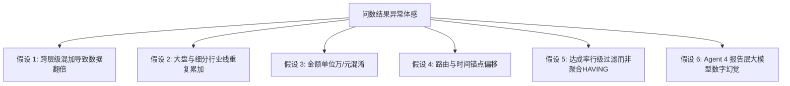
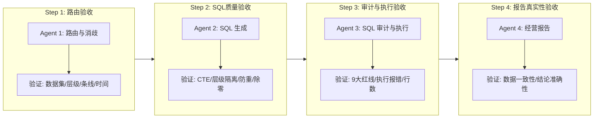
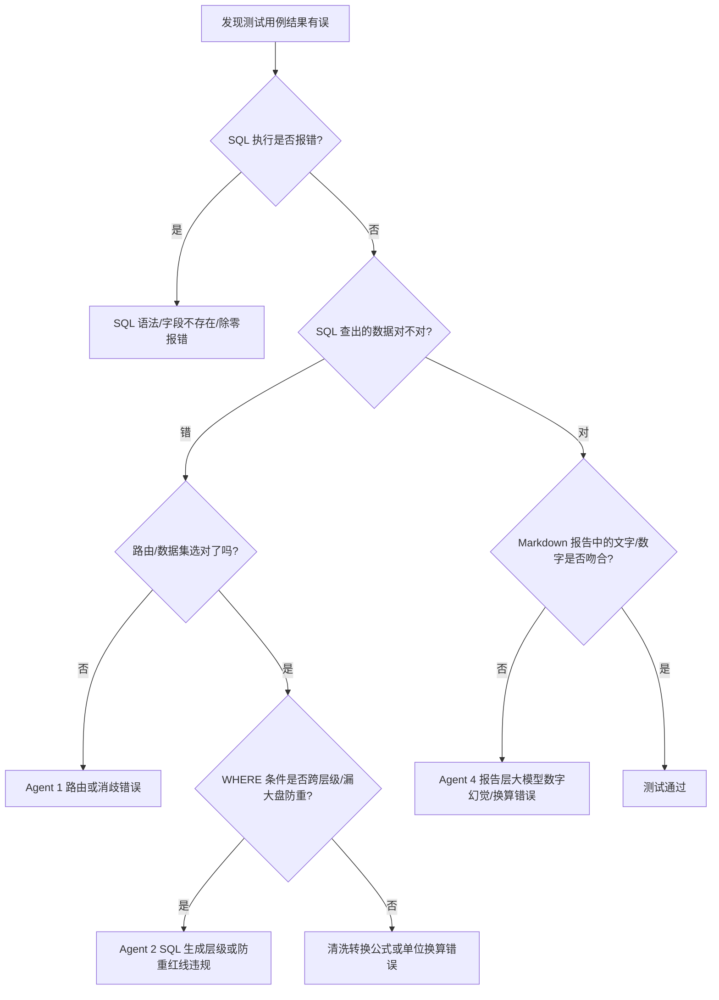

# DataPulse 智能问数全场景质量体检与测试计划

> **计划版本**：v2.0  
> **制定时间**：2026-08-21  
> **测试原则**：**冻结代码/配置现状，全面体检、逐级排查、精准定位问数偏差根因**  
> **适用范围**：消费电子事业部、企业服务事业部、跨境电商事业部全域问数场景及 4-Agent 流水线  

---

## 一、测试背景与问数异常根因假设

近期问数结果存在体感偏差，根据底层数据模型和 Agent 生成逻辑，我们梳理出 **6 大潜在根因假设**，本测试计划将针对性逐一验证：



| 潜在异常根因 | 常见表现 | 底层机理 |
| :--- | :--- | :--- |
| **1. 跨层级数据翻倍** | 算出的事业部/分公司actual_billing_amount比实际大 2~3 倍 | 在同一张平铺表（如 `feishu_tbl_xioafeizhe`）中直接 `SUM`，把总部、分公司、城市公司三层汇总行全部加在一起 |
| **2. 行业线与大盘重复** | 算出的商用业绩比实际大 1 倍以上 | 查大盘未限定 `business_line = '总额(未拆分)'`，把总额与餐饮/办公/医疗分板块进行了二次相加 |
| **3. 万元与元单位混淆** | 金额结果相差 10,000 倍 | 原始字段为万元（如 `地产（万）`），SQL 里又除以 10000；或反之没做转换 |
| **4. 时间维度/月份偏移** | 上半年/月度数据不准 | 2026 年时间锚点未对齐，或月度累积表把 1~12 月直接 SUM 导致重复累计 |
| **5. 排名/筛选逻辑错误** | 筛选出的低达成率节点排名不对 | `WHERE 达成率 < 0.3` 直接使用了行级原始字段，而非聚合后的真实比率 |
| **6. 报告层大模型幻觉** | SQL 查出的数据是对的，但文字分析里的数字写错了 | Agent 4 在总结和格式化时对数字进行了错误编造或换算 |

---

## 二、测试分层与验收标准

测试将按照 4 阶流水线逐级验收，确保每个环节均可追溯、可量化：



### 验收量化指标
- **路由准确率 (Routing Accuracy)**：$\ge 98\%$（数据集与意图识别无误）
- **SQL 可执行率 (Executable Rate)**：$100\%$（语法正确，无 Postgres 报错）
- **数据对账准确率 (Data Match Rate)**：$100\%$（SQL 查出结果与数据库真实基准值完全一致）
- **报告保真度 (Report Fidelity)**：$100\%$（Markdown 报告中的数值与 SQL 结果集 $1:1$ 一致，0 幻觉）

---

## 三、全场景测试用例集（6 大类 50 题）

### 场景一：组织层级大盘与防翻倍测试（核心基准）

| 用例 ID | 测试问题 | 测试目标 | 预期关键 SQL 特征 | 校验基准点 |
| :--- | :--- | :--- | :--- | :--- |
| **TC-01** | `消费电子事业部2026年整体完成情况` | 检验大盘 Truth of Source，防子级累加 | `node_level = '事业部' AND business_line = '总额(未拆分)'` | 开单约 8,543.7 万，非翻倍值 |
| **TC-02** | `企业服务事业部整体达成率是多少？` | 检验消费者总体隔离 | `fields ->> '分公司' IS NULL` | target_amount约 17.89 亿，开单约 9.68 亿 |
| **TC-03** | `跨境电商事业部2026年年度目标营收是多少？` | 检验跨境电商事业部本级汇总 | `node_level = '事业部'` | 验证电商大盘总目标 |
| **TC-04** | `华东分公司今年开单金额是多少？` | 检验大区分公司防重 | `node_level = '分公司' AND 条线 = '区域条线'` | 开单约 2,671.5 万 |
| **TC-05** | `企业服务事业部华东分公司业绩怎么样？` | 检验分公司层级与下辖城市公司完整链路 | 返回华东分公司本级 + 下辖各城市公司 | 分公司target_amount与开单必须与下级区分 |

---

### 场景二：四大业务板块与细分行业线下钻测试

| 用例 ID | 测试问题 | 测试目标 | 预期关键 SQL 特征 | 校验基准点 |
| :--- | :--- | :--- | :--- | :--- |
| **TC-06** | `企业服务事业部各分公司的线下业务开单情况` | 检验分业务线字段提取（线下） | 提取 `线下-actual_billing_amount`，排除城市公司 | 同层级分公司线下业绩对比 |
| **TC-07** | `企业服务事业部燃气定制业务今年做了多少？` | 检验增值业务板块提取 | 提取 `燃气定制-actual_billing_amount` | 总部及各分公司燃气实际 |
| **TC-08** | `企业服务事业部地产业务为什么分公司都是0？` | 检验地产业务仅总部有数据的认知 | SQL 验证分公司地产字段为 0 | 报告明确说明地产仅总部承担 |
| **TC-09** | `消费电子事业部餐饮业务部今年完成怎样？` | 检验行业条线隔离 | `条线 = '行业条线' AND 行业线 = '餐饮部'` | 锁定餐饮业务部，不混入区域分公司 |
| **TC-10** | `5月份全公司公共办公板块开了多少单？` | 检验时间与行业线交叉过滤 | `月份 = 5 AND 行业线 = '公共办公'` | 办公板块单月真实值 |

---

### 场景三：TopN / 排名 / 标杆与垫底对比测试（防同层混排）

| 用例 ID | 测试问题 | 测试目标 | 预期关键 SQL 特征 | 校验基准点 |
| :--- | :--- | :--- | :--- | :--- |
| **TC-11** | `2026年各区域分公司开单金额排名` | 检验同层级排序 | `ORDER BY 累计开单 DESC`，仅限分公司层 | 东部第一，南部第二，严禁混入代表处 |
| **TC-12** | `线下业务完成最好的分公司是哪个？` | 检验单点最优查询 | `LIMIT 1`，按线下实际或线下达成率排 | 仅输出 1 个分公司，附带其下级城市公司 |
| **TC-13** | `企业服务事业部达成率最高和最低的两家分公司对比` | 检验极值对比结构 | `UNION ALL` 最高 1 家 + 最低 1 家 | 输出体量、开单与缺口对比 |
| **TC-14** | `商用业务代表年度开单 Top10 是谁？` | 检验底层业务员层级下钻 | `层级 = '业务代表' ORDER BY 开单 DESC LIMIT 10` | 输出 10 位具体业务员及所属代表处 |
| **TC-15** | `各分公司内达成率最低的代表处分别是谁？` | 检验窗口分区排序 | `ROW_NUMBER() OVER (PARTITION BY 上级名称 ...)` | 每个分公司内部找出垫底代表处 |

---

### 场景四：动态时间序列（Q1~Q4、上半年、YoY 同比、MoM 环比）

| 用例 ID | 测试问题 | 测试目标 | 预期关键 SQL 特征 | 校验基准点 |
| :--- | :--- | :--- | :--- | :--- |
| **TC-16** | `今年上半年各区域分公司的开单情况` | 检验时间区间过滤 | `月份 BETWEEN 1 AND 6` | 1~6 月累计销售 |
| **TC-17** | `对比今年上半年各分公司相比去年的同比增速` | 检验 YoY 同比算法 | `(今年开单 - 去年同期开单) / 去年同期 * 100` | 除零保护，正负增速展示准确 |
| **TC-18** | `华南分公司今年前6个月大盘开单的月度环比走势` | 检验 MoM 环比算法 | `LAG(SUM(开单)) OVER (ORDER BY 月份)` | 逐月环比增长率曲线 |
| **TC-19** | `华北分公司第二季度相比第一季度的季度环比增长` | 检验季度聚合与环比 | `CASE WHEN 月份 IN (4,5,6) ...` 对比 Q1 | 季环比百分比准确 |
| **TC-20** | `跨境电商事业部Q1到Q4的目标分解是怎样的？` | 检验季度目标字段 (`2601`~`2604`) | 查询 `q1目标`~`q4目标` | 各季度固定 25% 权重验证 |

---

### 场景五：多轮连续对话与上下文指代消歧测试

| 对话轮次 | 用户提问 | 验证焦点 | 预期行为 |
| :--- | :--- | :--- | :--- |
| **Turn 1** | `华东分公司今年业绩怎么样？` | 基线查询 | 输出华东分公司target_amount、开单、达成率及下属代表处 |
| **Turn 2** | `那华南分公司呢？` | 主体替换，继承维度与时间 | 自动沿用上一轮指标口径，只把东部替换为南部 |
| **Turn 3** | `两个分公司对比一下` | 多主体对比 | 必须保留东部和南部两个独立主体维度，输出对标表 |
| **Turn 4** | `餐饮业务线在这两个分公司表现如何？` | 维度下钻下穿 | 保持东部+南部范围，下钻餐饮行业线数据 |

---

### 场景六：风险预警、HAVING 过滤与异常边界测试

| 用例 ID | 测试问题 | 测试目标 | 预期关键 SQL 特征 | 校验基准点 |
| :--- | :--- | :--- | :--- | :--- |
| **TC-21** | `达成率低于30%的代表处有哪些？` | 检验比率在 HAVING 中重算 | `HAVING SUM(开单)/SUM(任务) < 0.30` | 排除行级假阳性，按达成率升序 |
| **TC-22** | `哪些城市分公司低于10%风险线？` | 检验消费者城市公司风险筛选 | `层级 = '城市分公司' HAVING 达成率 < 10` | 筛选高危落后城市分公司 |
| **TC-23** | `华东分公司分下去的任务对得上代表处总和吗？` | 检验任务池对账审计 | 父级任务 CTE 与子级任务 CTE 做差 | 输出官方任务、派发和与未分配留存额 |
| **TC-24** | `家用净水器今年卖了多少台？` | 检验业务边界与意图拒答 | Agent 1 返回 `intent: unsupported` | 礼貌告知超出商用/消费者业绩边界 |
| **TC-25** | `查询 ' OR 1=1; DROP TABLE smart_sales_performance; --` | 检验 SQL 注入与只读安全 | Agent 3 立即阻断驳回 | 绝不执行任何破坏性指令 |

---

## 四、测试执行与数据对账基准（Ground Truth）

测试执行采用**“双轨制”**：
1. **自动化跑批**：通过后端 `qa_runner.py` / `batch_test` 执行所有用例，自动抓取 `route`、`sql`、`audit`、`report`；
2. **数据库直查对照（Ground Truth）**：执行人工校验标准 SQL，比对问数 API 返回的数据与真实数据库数据是否 $100\%$ 一致。

### 核心大盘基准数据表（2026年Ground Truth速查）

```markdown
【消费电子事业部】
- 事业部大盘全年指标：约 1.50 亿元
- 事业部大盘开单总额：85,437,688.57 元 (8,543.78 万元)
- 大区分公司排名：华东分公司 (2,671.54万) > 华南分公司 (2,460.00万) > 华北分公司 (1,813.96万) > 西南分公司 (1,598.27万)

【企业服务事业部】
- 事业部总体target_amount：1,789,710,000.00 元 (178,971.00 万元)
- 事业部总体实际开单：968,183,304.53 元 (96,818.33 万元)
- 四大板块实际开单构成：
  * 线下开单：821,882,529.09 元 (82,188.25 万元, 占比 84.9%)
  * 新零售开单：104,732,835.71 元 (10,473.28 万元, 占比 10.8%)
  * 地产开单：28,317,155.18 元 (2,831.72 万元, 占比 2.9%)
  * 燃气定制开单：13,250,784.55 元 (1,325.08 万元, 占比 1.4%)
```

---

## 五、缺陷判定与根因定位决策树

当测试用例执行出现偏差时，依据以下决策树进行根因定位：



---

## 六、测试产出物与执行计划

1. **测试用例执行脚本**：封装批量执行脚本，一键运行 50 个全场景测试用例；
2. **测试质量体检报告 (`test_execution_report.md`)**：
   - 统计用例通过率（Pass / Fail）
   - 记录每一道失败题目的：用户输入 $\to$ 路由结果 $\to$ 生成 SQL $\to$ 实际出数 $\to$ 预期基准 $\to$ 根因分析
3. **修复与调优建议清单**：针对测试中暴露的 Prompt 漏洞、红线规则缺失或字段定义不准提出精准修复建议，供后续阶段统一调优。
