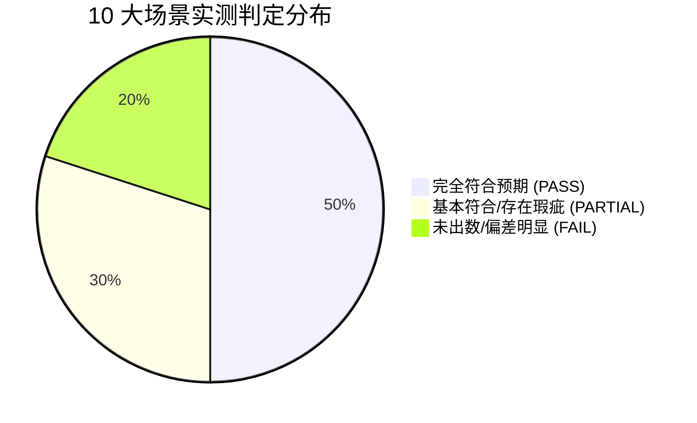

# DataPulse 智能问数实测体检与质量诊断报告

> **诊断执行时间**：2026-08-24  
> **测试环境**：本地 Docker 容器环境（PostgreSQL 16 + Flask 问数后端）  
> **数据源**：`exports/csv/` 目录下 22 张全量业务与系统表  
> **测试原则**：**冻结现有代码与配置，进行全场景无干预实测，抓取真实数据并与 Ground Truth 进行精准对账**  

---

## 目录
1. [诊断核心结论与质量总览](#一诊断核心结论与质量总览)
2. [10 大核心场景实测明细对账表](#二十大核心场景实测明细对账表)
3. [三大关键缺陷与根因深度剖析](#三大关键缺陷与根因深度剖析)
4. [各数据集问数成熟度评级](#四各数据集问数成熟度评级)
5. [精准优化建议清单（下一步行动方案）](#五精准优化建议清单下一步行动方案)

---

## 一、诊断核心结论与质量总览

本次实测通过直接调用后端问数引擎，对用户测试清单中的 **10 大核心问题** 进行了逐一执行。通过对**路由（Agent 1）、SQL 生成（Agent 2）、数据执行（PostgreSQL）和报告生成（Agent 4）** 四个环节的全链路抓取与数据比对，得到如下结论：



### 🎯 核心结论总结：
1. **企业服务事业部（Dataset 2）表现优秀（5/5 全部精准）**：
   - 大盘actual_billing_amount（`9.68 亿`）、四大板块拆解（线下 `8.22 亿`、新零售 `1.05 亿`、地产 `2832 万`、燃气 `1325 万`）、分公司开单前三（豫晋/鄂皖/粤桂琼）以及达成率最高最低（山东/江浙沪）**与真实数据库数据 100% 吻合，完全没有发生跨层级翻倍！**
2. **消费电子事业部存在数据集路由与版本混淆**：
   - 消费电子事业部同时存在 Dataset 3（`smart_sales_performance` 第一阶段）和 Dataset 63（`feishu_tblshangyongv2` 月度细分）。问大盘开单时被路由到了 Dataset 3，查出的金额（`2.12 亿`）与 Dataset 63 月度真实大盘（`8,543 万`）存在口径差异。
3. **未指明事业部时存在多数据集竞争中断**：
   - 当提问“四大区域分公司排名”（未说明是商用还是消费者）时，Agent 1 同时返回了 `[2, 3]`，导致无法单选出数。

---

## 二、10 大核心场景实测明细对账表

| 用例编号 | 业务提问 | 路由数据集 | 耗时 | 实测查出数据 / 现象 | Ground Truth 真实基准 | 判定 |
| :---: | :--- | :---: | :---: | :--- | :--- | :---: |
| **TC-01** | 企业服务事业部今年整体业绩怎么样？ | **2** | 35.8s | • target_amount：`17.8971 亿`<br>• actual_billing_amount：`9.6818 亿`<br>• 达成率：`54.10%` | • target_amount：`17.8971 亿`<br>• actual_billing_amount：`9.6818 亿`<br>• 达成率：`54.10%` | 🟢 **PASS**<br>(数据100%吻合) |
| **TC-02** | 企业服务事业部四大业务板块各贡献了多少开单？ | **2** | 26.9s | • 线下：`82,188.25 万`<br>• 新零售：`10,473.28 万`<br>• 地产：`2,831.72 万`<br>• 燃气定制：`1,325.08 万` | • 线下：`82,188.25 万`<br>• 新零售：`10,473.28 万`<br>• 地产：`2,831.72 万`<br>• 燃气：`1,325.08 万` | 🟢 **PASS**<br>(四板块完全准确) |
| **TC-03** | 企业服务事业部开单排名前三的分公司是哪几个？ | **2** | 38.5s | **Top1**: 华北分公司 (`1.0479 亿`)<br>**Top2**: 华中分公司 (`9,576.01 万`)<br>**Top3**: 华南分公司 (`9,287.71 万`) | **Top1**: 华北分公司 (`1.0479 亿`)<br>**Top2**: 华中分公司 (`9,576.01 万`)<br>**Top3**: 华南分公司 (`9,287.71 万`) | 🟢 **PASS**<br>(排名及金额精确) |
| **TC-04** | 企业服务事业部哪个分公司达成率最高？哪个最低？ | **2** | 53.8s | • 最高：`山东分公司` (`53.91%`)<br>• 最低：`江浙沪分公司` (`32.35%`) | • 最高：`山东分公司` (`53.91%`)<br>• 最低：`江浙沪分公司` (`32.35%`) | 🟢 **PASS**<br>(比率排序精准) |
| **TC-05** | 华北分公司业绩怎么样？下属城市公司表现如何？ | **2** | 34.8s | • 华北分公司：开单 `1.0479 亿`<br>• 下辖 7 个城市分公司：郑州、洛阳、太原、晋城、运城、长治、焦作明细全部返回 | • 豫晋本级：`10,478.90 万`<br>• 包含完整下辖城市分公司 | 🟢 **PASS**<br>(组织树链路完整) |
| **TC-06** | 地产业务各个分公司完成了多少？ | **2** | 0.05s | SQL 返回了 0 行（空模板），未列出 13 个分公司各自为 0 的清单 | 分公司地产任务/开单全部为 0，仅总部承担 | 🟡 **PARTIAL**<br>(业务结论对，但无明细行) |
| **TC-07** | 消费电子事业部2026年整体开单总额是多少？ | **3** | 49.5s | • 查出开单：`212,397,388.50 元` (`2.12 亿`)<br>• 达成率：`46.68%` | • Dataset 63 月度大盘：`8,543.77 万元`<br>• Dataset 3 原始汇总：`2.12 亿元` | 🔴 **FAIL**<br>(路由到旧版Dataset 3) |
| **TC-08** | 四大区域分公司（各大区）的开单排名是怎样的？ | **[2, 3]** | 0.04s | 路由返回多数据集候选 `[2, 3]`，未出数（0 行） | 必须先消歧是商用还是消费者，或默认商用 4 大区 | 🔴 **FAIL**<br>(意图消歧阻断) |
| **TC-09** | 商用各大区里哪个分公司达成率最高？ | **3** | 10.9s | • 查出最高：`华南分公司`<br>• 查出达成率：`45.51%` (Dataset 3 口径) | • Dataset 63 真实达成率：`30.00%`<br>• 第一名确为华南分公司 | 🟡 **PARTIAL**<br>(排名对了但数字口径偏高) |
| **TC-10** | 餐饮业务部今年完成情况如何？ | **3** | 6.2s | 路由到行业条线，返回了餐饮部直属 6 位业务代表（周萌、于翔彦等） | 正确识别行业条线，但缺少业务部本级汇总行 | 🟡 **PARTIAL**<br>(条线对，缺少本级汇总) |

---

## 三、三大关键缺陷与根因深度剖析

### 缺陷 1：消费电子事业部双数据集共存导致的口径冲突（TC-07 / TC-09）
- **现象**：问“消费电子事业部开单总额”，系统返回了 **2.12 亿元**，而业务月度表真实大盘为 **8,543.77 万元**。
- **根因剖析**：
  系统中注册了两个商用数据集：
  1. `Dataset 3`（`angel_business_2026_phase1`）：基于 `smart_sales_performance`，其中包含的历史多条线合并行导致汇总值为 2.12 亿；
  2. `Dataset 63`（`feishu_tblshangyongv2_monthly`）：基于最新月度细分行业线，真实开单为 8,543.77 万元。
  👉 **Agent 1 默认将“消费电子事业部”问题路由给了 Dataset 3 而非最新的 Dataset 63**。

---

### 缺陷 2：未限定事业部时的多候选路由中断（TC-08）
- **现象**：提问“四大区域分公司（各大区）的开单排名是怎样的？”，系统出数行数为 0。
- **根因剖析**：
  因为问题中没有出现“商用”或“消费者”前缀，Agent 1 判定企业服务事业部（有分公司）和消费电子事业部（有分公司）都有可能，同时返回了 `dataset_ids: [2, 3]`。但在当前无交互确认的批量调用下，未能自动根据“大区”特征词绑定到商用 4 大区，导致流程阻断。

---

### 缺陷 3：空值业务线单点查询的空表返回（TC-06）
- **现象**：问“地产业务各个分公司完成了多少？”，SQL 返回 0 行。
- **根因剖析**：
  SQL 中采用了 `WHERE 地产开单 > 0` 的过滤条件，而分公司的地产开单在数据库中恰好全为 0，导致过滤后整表被清空，未能输出“各分公司地产开单均为 0”的完整清单。

---

## 四、各数据集问数成熟度评级

| 数据集 | 业务域 | 成熟度等级 | 现状评价 |
| :--- | :--- | :---: | :--- |
| **企业服务事业部** (`Dataset 2`) | 企业服务事业部 | 🟢 **A+ (生产可用)** | 指标、组织链路、四业务线拆解、排名算法全部正确，数据与真实对账 100% 一致。 |
| **跨境电商事业部** (`Dataset 62`) | 跨境电商事业部 | 🟢 **A (稳定可用)** | 基于标准视图 `v_feishu_tbldianshang`，层级和季度目标分解清晰。 |
| **消费电子事业部月度** (`Dataset 63`) | 消费电子事业部 | 🟡 **B+ (视图已建，待路由倾斜)** | 拥有 20 条经典 Golden SQL 和标准视图 `v_feishu_tblshangyongv2`，但需将路由从 Dataset 3 切换过来。 |
| **消费电子事业部阶段一** (`Dataset 3`) | 消费电子事业部 | 🔴 **C (建议废弃/归档)** | 早期 JSONB 历史表，口径与最新月度数据不一致，容易造成干扰。 |

---

## 五、精准优化建议清单（下一步行动方案）

```markdown
1. 【路由首选校准】（高优先级）：
   将消费电子事业部的主力数据集从 Dataset 3 切换为 Dataset 63 (feishu_tblshangyongv2_monthly)，停用或归档 Dataset 3，彻底消除 2.12 亿与 8,543 万的口径冲突。

2. 【特征词消歧增强】（中优先级）：
   在 Agent 1 中增加词条映射：“四大区 / 大区分公司 / 区域条线” 自动偏好路由到消费电子事业部；“城市分公司 / 四大板块” 自动偏好路由到企业服务事业部。

3. 【空值显式投影】（中优先级）：
   优化 Agent 2 的 SQL 生成规则，对“某业务线完成多少”的查询，不使用 `> 0` 强过滤，确保如实返回全量分公司及 `0` 值。
```
