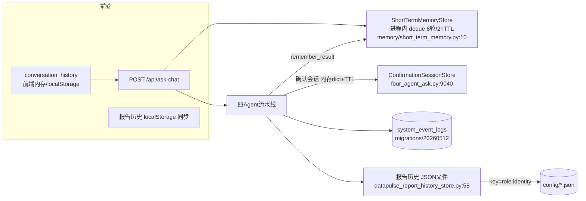

# A2. 上下文 / 记忆 / 书架资产 / 安全 / 反馈闭环审计（代码证据）

- 审计日期：2026-10-20
- 与 A1 互补：本文件只覆盖"状态与记忆、资产配置实际生效、反馈学习、安全与可观测"四条线

## 1. 上下文与记忆现状图

## 2. 会话与多轮上下文（结论：消息历史式，非结构化状态）

- **消息来源双轨**：前端每请求携带 `conversation_history`（ask_chat.py:489/612）；后端以 `session_id` 查进程内 `ShortTermMemoryStore`（four_agent_ask.py:9804）。
- **追问处理=问句改写**：`resolve_followup`(short_term_memory.py:95-117) 用启发式（长度≤12、特定助词、比较词）判断是否追问，然后**字符串拼接**上一代问题或附加上轮 SQL 提示。保存的记忆条目含 question/dataset_ids/sql/columns 摘要/query_intent（32-72 行）——有结构化苗头，但消费方式是拼文本而非状态机。
- **条件继承**：金额单位继承有专门处理（105-117）；数据集沿用有 `_followup_dataset_hint_from_memory`(four_agent_ask.py:7955) + 锁定/释放判定（9944-9980）。**无法表达"去掉上一轮某个过滤条件"**，只能靠"不要保留上一轮筛选条件"的自然语言叮嘱（116 行）。
- **已知时间词缺陷**：dataset 2"上个月"被当作组织节点名→0 行。根因：`_question_subject_names`/`_node_index_matches` 类规则把未识别片段当节点候选，时间词未在解析管线中被显式消费。修复方向见主报告差距矩阵 G-05。

## 3. 跨会话持久化与恢复（结论：基本不存在）

| 场景 | 现状 | 证据 |
|------|------|------|
| 页面刷新 | 靠前端 localStorage/内存恢复消息列表 | 前端 DataPulse.vue（未细读，接口侧无会话拉取端点） |
| 会话切换 | 后端无会话实体，无法恢复 | ask_chat.py 无 /sessions CRUD |
| 隔日续问 | 短期记忆 TTL 2h 过期；报告历史可回看 | short_term_memory.py:10；report-history 端点 |
| 服务重启 | 短期记忆+确认会话全丢 | 均为进程内 dict |
| 任务检查点/失败恢复 | 不存在 | 全库无 checkpoint/resume 实现 |
| 并发冲突检测 | 无（内存 deque 追加，无版本） | short_term_memory.py:140-145 |

报告历史是唯一"持久化产物"：JSON 文件按 `role:identity` 分桶（datapulse_report_history_store.py:39-51），带 `_is_stale_history_snapshot` 过期检测(181)。**注意身份键用 role+username，同角色换人会读到他人历史（若 username 相同）**——正式环境需注意。

## 4. 书架资产配置"实际生效"核查表

数据源：`bs_*` 表（migrations/20260330_bookshelf_schema.sql）+ `get_dataset_context`(bookshelf_repository.py:131-246)。

| 界面配置项 | 存储表 | 链路是否真实使用 | 使用位置与方式 |
|---|---|---|---|
| 数据集编码/名称/业务域/来源/状态/描述 | bs_datasets | ✅ 使用 | Agent1 catalog(:108)；context(:135) |
| 路由词/别名 | bs_dataset_synonyms | ✅ 使用 | catalog 聚合进 dataset_text 打分(four_agent_ask.py:3590)；层级别名分(3403) |
| 常见问题 | bs_common_questions | ✅ 使用 | dataset_text 打分(:3574)；Agent1 prompt(:3930/3961)；context 装载(:4991 附近) |
| 标准题集 | 无独立表 | ⚠️ 未发现 | 迁移文件无 bs_standard_questions；界面"标准题集"实际可能指常见问题；**建议产品侧核对** |
| LLD 文档 | bs_lld_documents | ✅ 使用 | 取 is_active 最新版本(:147-157)；Agent2/Agent4 prompt(_get_lld_content:258) |
| 数据字典 | bs_data_dictionary_items | ✅ 使用 | context(:159)；字段白名单校验(:358) |
| DDL/表结构 | bs_schema_definitions | ✅ 使用 | context(:170)；表白名单校验 |
| 表关联 | bs_table_relations | ✅ 使用 | context(:181) |
| Golden SQL | bs_golden_sql_samples | ✅ 使用 | top80 按 quality_score→token 排序取5(:192-203)；golden 路径(_select_sql_strategy:1527) |
| Agent 提示片段 | bs_agent_prompt_fragments | ✅ 使用 | 按 agent_no 1-4 注入(:205-223；Agent4 示例 four_agent_ask.py:8961-8966) |
| 飞书/外部配置 | feishu_sync_* | ✅ 使用但**仅同步链路** | feishu_sync_service.py（入库/索引），不进问数 prompt |
| 数据转换 | dataset_transforms(20260630) | ✅ 使用但**仅同步链路** | feishu_sync_service.py:795、bootstrap.py:354；问数路径不消费 |
| 书架健康度 | 代码计算(report_contract_health.py) | ✅ 使用 | 控制台展示与保存校验(_validate_full_payload) |
| 解析条候选/修正 | bs_user_alias_feedback(20260829) | ✅ 使用 | record_feedback(controllers/ask_chat.py:1063-1139；parse_spans.py) |

**版本/审核/冲突策略**：LLD 有 version 列但无审核流；Golden SQL 有 quality_score 但无版本；**所有资产无 is_reviewed/生效区间/冲突仲裁字段**。Agent1 与 Agent2 片段若冲突，靠 prompt 顺序硬叠加，无显式优先级协议。

## 5. 反馈与学习闭环（结论：半闭环）

- ✅ 有：全量执行日志（question/sql/thinking/confidence/token 落 system_event_logs）；解析条修正学习（别名反馈表，下次命中标 learned）；低置信度标记(_is_low_confidence, ask_chat.py:222)。
- ❌ 无：用户显式点赞/点踩端点（未发现 /feedback 路由）；错题自动归类；Golden SQL 回流审核流；回归测试集。`exports/` 存在手工"错题库"markdown，但无自动关联 task_id 的机制。

## 6. 安全与资源控制（结论：校验前置有、执行层裸奔）

| 控制项 | 现状 | 证据 |
|---|---|---|
| 只读约束 | 正则白名单（select/with 开头+禁用词） | ask_engine_sql.py:54-71 |
| 表/字段白名单 | JSONB key 白名单+带 schema 限定表白名单，命中即阻断执行 | four_agent_ask.py:358-407 |
| 数据集级权限 | allowed_dataset_ids_for_user 过滤 | ask_chat.py:115-131；data_permission_store.py |
| 组织行级安全 | row_security 上下文+org_mention_permission_check 拦截 | four_agent_ask.py:9075-9121 |
| **执行超时** | ❌ 无 | datasource_router.py:192-201 |
| **返回行数上限** | ❌ 无 | 同上 |
| **成本/扫描量预算** | ❌ 无 | 同上 |
| DB 只读账号 | ❌ 使用数据源属主连接(_connect_raw_database) | datasource_router.py:196-199 |
| 敏感字段脱敏 | ❌ 未发现列级脱敏 | 字典有 semantic_name 但执行结果直出 |
| 审计日志 | ✅ system_event_logs + jsonl | system_log_store.py |

## 7. 可观测性与测试（结论：可观测强、测试为零）

- Trace：每阶段 `_append_trace`（four_agent_ask.py:205），SSE 实时透传，末帧 summary；trace 含 sql/token/耗时/风险。
- 日志：`system_event_logs` 表（含 thinking_process、rows_preview、confidence）；`logs/ask_chat_controller.jsonl` debug 流。
- 指标：token 统计(_extract_token_usage, ask_chat.py:309) 有估算兜底；无准确率/命中率指标计算。
- 测试：**backend 无 tests 目录**（ls 无结果；无 pytest 配置）；仓库根 README/验收手册为人工验收。
