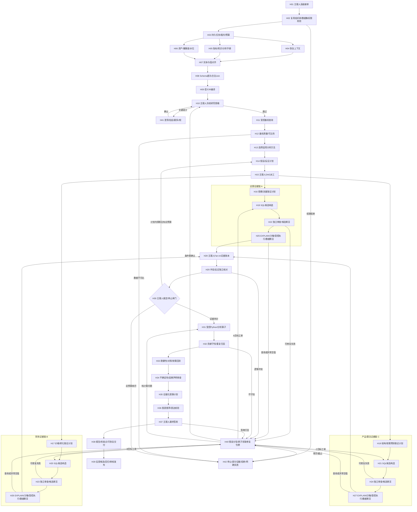
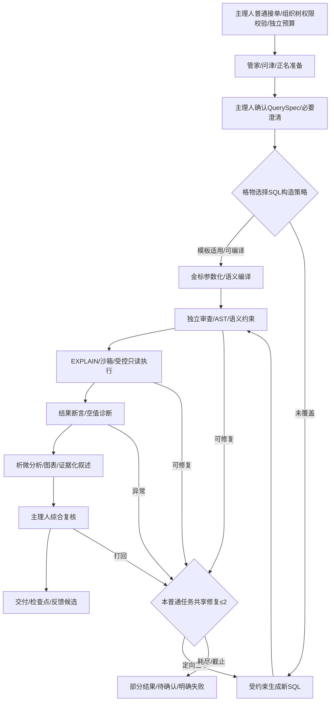

# DataPulse：由受治理语义与证据驱动的 Agentic BI 升级规格

版本：2026-10-21 / 高级 42 节点版。本文重新以外部一手机制和当前代码差距推导，不以旧项目规划中的流程与技能名称作为能力证据。配套文件：[外部机制调研与决策记录](Agentic_BI外部机制调研与决策记录.md)、[交互流程图](问数流程图_专业流程版.html)。

本次产物是架构规格、节点契约和前端流程图，后端运行时未改造，SLO 与质量指标均待验收。

## 1. 结论：先建“能执行、能验证”的中间层，再扩专家

保留一个总主理人和既有专家心智，但把其能力建立在四种正式产物上：

1. **SemanticPlan**：机器可读的批准指标、粒度、时间、关联与权限约束。主理人和专家不能通过改 Prompt 重新定义公司指标。
2. **ExecutableDAG**：节点依赖、输入输出、验收条件、必要证据、资源和停止条件。不能用一张任务清单冒充调度系统。
3. **Query/Analysis TestPack**：SQL、执行结果和分析算子的硬规则检查回执。不能用“专家都觉得对”替代测试。
4. **EvidenceLedger**：事实、推导、假设、查询和数据快照的引用图。结论必须能定位到真实数值与规则，可信度总分不替代证据。

普通与高级分别建独立工作流、入口、任务状态和预算。普通保留语义、受约束 SQL、审查、结果断言、专业解读和主理人复核；高级增加可证伪假设、多路取证、独立反证和受控统计分析。二者可使用同一能力服务，但不互相跳转，不以 basic 为 advanced 失败兜底。

### 1.1 外部机制如何变成项目方案

| 机制与一手出处 | 当前差距 | 本项目的新工程决策 | 可观察的验收结果 |
|---|---|---|---|
| [WrenAI 语义/上下文契约](https://docs.getwren.ai/oss/concepts/what_is_context) | 书架资产按问句拼上下文，缺少统一可编译契约 | 增加 SemanticRelease + SemanticPlan，把公式、粒度、Join、单位、日历、版本编成数据，不是加长 Prompt | 相同指标/版本在普通和高级中编译出一致定义；口径冲突阻断 |
| [CHESS 分层检索与候选验证](https://arxiv.org/html/2405.16755v3) | Schema/实体/候选验证未形成明确分工 | 目录召回、值对齐、Schema 子图、最多2个初始候选与独立 TestPack 分开；模型建议不覆盖硬失败 | 同义字段混淆、重复 Join、日期边界差异可被定位，减少无关 Schema 输入 |
| [MAC-SQL 工具反馈修正](https://arxiv.org/html/2312.11242v6) | 重试散落多处，错误缺少统一工单 | 结构化 ErrorEnvelope → RepairTicket → 指定节点重跑 → 后续闸门重新验证 | 失败节点与改动可追溯，全任务修复合计≤2，成功分支不重跑 |
| [ThoughtSpot 受治理查询](https://docs.thoughtspot.com/cloud/26.9.0.cl/semantic-layer/) | 模型生成和执行之间缺正式语义编译约束 | 指标编译优先；生成 SQL 必须证明满足 IR，数据库安全独立执行 | LLM不能更改公式/单位/权限，缓存命中不免鉴权 |
| [Data Agent 深度研究与分析知识](https://docs.volcengine.com/docs/DataAgentPrivate/DepthResearchAgent-1?lang=zh) | 意图正则 + Pandas 排序不等于研究计划 | 把分析手册编成方法适用条件、假设与反证、算子计划和报告契约 | 分析选择可说明、计算可重算、报告逐条引用证据 |

这是机制组合与本项目的工程推导，不声称任何厂商采用本文的42节点，也不声称其私有实现可直接复制。CHESS 自然语言测试仍含模型判断，本项目的确定性断言是额外工程约束；Wren 当前文档对不同上下文能力的交付阶段也有区别，不能将其整体视为已交付的安全运行时。

## 2. 代码差距：不是再给现有技能换名称

| 优先级 | 直接证据（相对 backend） | 问题 | 新模块与接入点 |
|---|---|---|---|
| P0 | `ask_flow/controller.py:163/171` | 高级异常可回普通，结果能力与用户选择不一致 | 模式锁定，返回高级终态；`advanced_workflow` 不调用完整普通服务 |
| P0 | `datasource_router.py:192`、`ask_engine_sql.py:54` | 执行函数无显式超时/行字节预算/取消；只读依赖正则 | `QueryRuntime` 统一 AST/plan gate/readonly executor，所有正式或基线查询都必经 |
| P1 | `datapulse_advanced/skills/planner.py:7` | `infer` 产意图、TopN、组织层级，未产生执行依赖 | `PlanCompiler` 输出 schema 验证后的 DAG，与 worker 调度分离 |
| P1 | `datapulse_advanced/skills/evidence_vote.py:9` | 按权重累加 score，不能证明某个业务声明 | 保留告警作为观测，新增 EvidenceLedger + HardCheckSet + ConflictResolver |
| P1 | `datapulse_advanced/skills/sql_quality.py` | 字符串/字段/表匹配不是方言 AST 和业务正确性证明 | 规则迁移 TestPack；新增语义 IR、AST 和独立检查器 |
| P1 | `datapulse_advanced/skills/pandas_analyze.py:22` | 能加工排序，但缺算子权限、输入血缘和研究检验契约 | 复用计算函数，包成注册算子与受控执行回执；禁止直接暴露任意 Python exec |
| P1 | `four_agent_ask.py:9072` | 数据集逐个执行，缺专家多分支汇合屏障 | 高级取证 DAG 持久化，三路依赖就绪并发，required 分支屏障 |
| P1 | `bookshelf_repository.py:131/248` | 最新 LLD 和相似样例尚不是固定版本的语义计划 | 书架发布成不可变语义资产；精确适用条件后才可复用金标 |

以上是静态代码检查。数据库真实账户、连接池、部署拓扑和模型限额仍需现场验证；不将推测写为已发生的生产事故。

### 2.1 已有组织树权限隔离：两种模式共同复用

**权限校验是普通和高级都必须执行的前置条件与执行约束。系统已经有组织树维护和数据权限隔离，本方案不重新建设组织树、人员授权或另一个业务权限引擎。**

| 已实现能力 | 当前代码证据（backend相对路径） | 普通/高级改造约束 |
|---|---|---|
| 组织树维护与节点层级 | `organization_tree_store.py:154`、`controllers/organization_trees.py:62`；前端 `OrganizationTrees.vue` | 沿用现有树类型、节点、编码和维护入口 |
| 数据集权限规则 | `data_permission_store.py:61/251`、`controllers/data_permissions.py:70` | 沿用 public/restricted/org_tree/disabled 规则及现有 super_admin 处理，不自行重定义 |
| 问数入口数据集准入 | `controllers/ask_chat.py:115/533/758` | 普通与高级在分派前取得 allowed_dataset_ids，专家路由必须受其约束 |
| 用户与数据集组织范围计算 | `data_permission_store.py:225/364` | 复用既有树类型/组织节点/编码的范围计算，各高级分支不得放宽范围 |
| 问题中的越权组织拦截 | `data_permission_store.py:425`、`four_agent_ask.py:9086` | 组织名提及先核验，用户澄清或模型改写不能新增授权 |
| 查询执行前组织行过滤 | `data_permission_store.py:472`、`four_agent_ask.py:9520` | 普通SQL、高级各分支、基线和对照查询均调用现有过滤能力 |
| 修复SQL重新过滤 | `four_agent_ask.py:9570` 附近 | 新DAG/返工执行器继续保留此行为，不能因修复/并发绕过 |

因此图中普通L0和高级H02都显式校验权限，随后各自的查询执行节点继续应用组织过滤。主理人、专家和Skills只消费现有授权结果，不能审批扩大权限；元数据检索、缓存读取、证据恢复也须承接同一范围。

本次静态核查确认的是**现有数据集与组织范围隔离**；不能由此推断已具备独立的列级权限策略、数据库原生RLS或工具capability票据。AST/函数限制、资源预算与未来工具沙箱是运行安全加固，不能与既有业务权限混为一套待新建系统。

## 3. 五层目标架构与职责

| 层 | 责任 | 关键约束 |
|---|---|---|
| 独立体验层 | 普通入口、高级研究入口、澄清/进度/报告 | 运行中模式不改变，主理人唯一对外负责 |
| 主理人控制面 | 规格、规划批准、派工、屏障、返工、裁定、签收 | 不直接执行任意 SQL/Python；依据契约与检查结果决策 |
| 专家执行面 | 问津/正名/格物/析微与运营、财务、产品/算法专家 | 输入最小化，输出交接包，禁止使用其他专家未批准的中间结论 |
| 确定性能力面 | 语义编译、检索、SQL运行时、分析算子、图表校验 | 所有模型产物视作待验证候选；权限与硬规则不能被投票豁免 |
| 耐久与治理层 | 任务/租约/outbox、语义版本、证据对象、回归发布 | 幂等、断点恢复、可取消、审计和候选审核 |

普通控制流与高级控制流分开，能力面服务复用。每任务必须有 tenant/owner/mode/task_id/semantic_release/scope_hash。共享基础设施不允许跨任务读取未批准产物或放宽权限。

### 3.1 语义资产的最小可落地结构

以下为**本项目契约示例，不是 Wren MDL 原生格式**。若选用 Wren 引擎，需编写适配器并验证表达覆盖。

```yaml
semantic_release: sales_v3
model: governed_orders
metric:
  id: net_revenue
  expression: sum(paid_amount - refunded_amount)
  currency: CNY
  unit: yuan
  grain: [order_id]
  additive_dimensions: [channel, region, product]
  excluded_statuses: [cancelled]
  time_column: paid_at
  calendar: calendar_month
  timezone: Asia/Shanghai
relationships:
  - from: governed_orders.customer_id
    to: customers.customer_id
    cardinality: many_to_one
    approved: true
security:
  organization_filter: existing_data_permission_store.apply_row_level_filter
quality:
  unique_key: order_id
  max_null_rate: configured_by_owner
  reconciliation_tolerance: configured_by_owner
```

率类指标分别声明 numerator/denominator 与 rollup，禁止直接平均比率；跨币种必须声明汇率日期/来源；退款归属支付月还是退款月属于指标定义，不能由模型自行选择。

资产发布流程：现有书架导出 → 字段/表达式/关系校验 → 指标 owner 确认 → 固定题回归 → immutable release → 缓存与索引绑定 release hash → 灰度。旧任务始终固定旧 release，不能中途读“最新启用”资产。

### 3.2 检索和 Schema Linking 的真实实现

离线建立三类索引：批准元数据/字段说明、受权脱敏枚举与别名、批准金标/分析手册。在线先鉴权过滤，再元数据 BM25+向量召回；实体值用精确/别名/近似匹配，输出明确 `column/value`；关系图补齐合法 Join、键和粒度，保留时间与权限字段。

索引键至少带 tenant/source/schema_version/semantic_release。小 Schema 允许保留更多字段；剪枝缺关键信息时受控扩大召回，不盲追 token 最少。指标 owner 规定字段歧义与低置信策略，关键歧义进入澄清。向量相似只产生候选，不能决定指标公式、访问权限或可执行 SQL。

### 3.3 查询与分析候选如何验证

每个 QueryIntent 明确 grain、time_window、filters、measures、expected_shape 和事实来源。模板/编译优先；复杂查询初始最多2个去重候选，候选全部计入全局 token/计划/试跑预算。

检查依次为：

1. AST/方言、单语句、读写、副作用函数、表列/行权限硬门禁。
2. 与 SemanticPlan 对照公式、Join、过滤、聚合、TopN、单位和日期闭开区间。
3. 非执行式 EXPLAIN 与成本预算；必要时脱敏只读沙箱限时试跑。EXPLAIN ANALYZE 会执行，不能默认使用。
4. 正式只读执行，真实数据库超时与 cancel、行/字节预算、截断标识。
5. 结果唯一键、基数、空值、分母、时间、单位和总分容差断言。
6. 候选差异测试与软解释：模型可提出测试点和说明差异，但不能覆盖前5层失败。多个候选都过硬规则但含义不同，要补业务定义或澄清，不以投票“选正确”。

TestPack 示例：`sum(net_revenue_by_region)≈overall_net_revenue`；`period_start<=date<period_end`；`ratio = sum(numerator)/sum(denominator)`；`joined_fact_unique_key_count=base_fact_unique_key_count`。这些规则从指标与规格推导，需考虑可加性和容差；缺统计证据返回 UNKNOWN，不当 PASS。

### 3.4 分析手册与受控计算

Playbook 不是一段“请深度思考”。最小字段为 `id/version/applicability/required_metrics/method/operators/hypotheses/counter_evidence/stop_rules/report_requirements`。选择方法先验证适用性：量价分解、渠道贡献、漏斗、分群或预测各有约束。

计算优先通过 `AnalysisIR` 调用登记算子，例如 `group_contribution`、`symmetric_price_volume`、`funnel_dropoff`、`rolling_backtest`。Python 仅在隔离容器/作业运行器中执行，无网、只挂载已核验证据、CPU/内存/时间限制、依赖白名单、无生产凭证。记录代码/算子版本、输入哈希和数值输出。MVP 不直接开放任意代码生成。

预测按需启用：固定训练截止日、特征可用时点、滚动回测、季节/朴素基线、评价指标与区间；历史不足或基线不胜出时返回趋势与限制。观察相关性/贡献分解不等于因果识别。

## 4. 高级 42 节点：13 阶段、3条完整取证链

39 个主流程节点 + 自愈/澄清/停止 3 个条件节点。节点数量不是模型调用数量；一条任务只执行适用节点，普通任务仍独立走自己的完整流程。A/B/C 为收入类问题示例，可按方法选择其他专家。三条链在H16分发、H19候选、H22独立审查、H25执行取证四排纵向保持独立，直到H28正式汇合。

| 阶段 | 节点 | 负责人 | 独立产物 | 失败出口 |
|---|---|---|---|---|
| 01 接单与权限 | H01 高级接单与目标建档 | 总主理人 | ResearchRequest + objective_id | 问题超出已授权数据/方法边界时停止或要求用户明确范围。 |
| 01 接单与权限 | H02 鉴权与组织树权限校验 | 总主理人调用权限服务 | allowed_dataset_ids + dataset_org_scopes + scope_hash | 权限拒绝立即终止，不进入重试；撤销权限使后续检查点失效。 |
| 01 接单与权限 | H03 创建研究任务与持久预算 | 总主理人 / 编排运行时 | task_id + immutable_mode + lease + budget | 状态库不可用不查数；任务取消传播到所有租约与数据库连接。 |
| 02 并行研究准备 | H04 恢复工作区与可信上下文 | 管家 · 上下文专家 | ContextPacket + inherited_conditions | 指代未解析交 H41 澄清；过期证据仅作线索。 |
| 02 并行研究准备 | H05 检索指标、业务规则与分析手册 | 正名 · 语义专家 | DefinitionPack + playbook_candidates | 缺权威定义返回主理人，不把过时报告当现行口径。 |
| 02 并行研究准备 | H06 检索资产、健康度与数据水位 | 问津 · 数据资产专家 | AssetPack + source_watermarks | 源不可用时识别必要/可选证据，不自动改查其他模式。 |
| 03 链接与语义编译 | H07 实体与数据库值对齐 | 问津 · 实体链接专家 | EntityBindings + unresolved_entities | 多候选会改变结果则转 H41；不能静默把数量改成金额。 |
| 03 链接与语义编译 | H08 Schema 子图与合法 Join 路径 | 问津 · Schema 专家 | SchemaSubgraph + join_cardinality | 无合法路径明确不支持；扩大检索也受原权限范围限制。 |
| 03 链接与语义编译 | H09 编译语义查询计划 | 正名 + 语义编译器 | SemanticPlan + release_hash + required_slots | 冲突必须澄清或拒绝；不能仅按文本相似选口径。 |
| 04 规格与可信基线 | H10 主理人消歧与冻结研究规格 | 总主理人 | AnalysisSpec + snapshot_policy + success_criteria | 歧义未解则等待，不自动开查；安全拒绝直达 H42。 |
| 04 规格与可信基线 | H11 建立当前值与比较基线 | 格物 · 基线查询专家 | BaselineArtifact + current_ref + prior_ref | 同比基期缺失或源未同步时标明不可比；重做需共享令牌。 |
| 04 规格与可信基线 | H12 基线质量与可比性验证 | 审衡 · 数据质量专家 | BaselineQuality + comparability_status | 不可比转 H42 部分/阻断状态，或 H40 修复可纠正查询错误；禁止补造基期。 |
| 05 方法与假设派单 | H13 选择可复用分析方法 | 筹策 · 规划专家 | MethodContract + applicability + exclusions | 没有适用方法请求主理人限定目标，不能硬套模板。 |
| 05 方法与假设派单 | H14 构建可证伪假设与反证计划 | 筹策 + 垂直领域专家 | HypothesisTree + falsification_rules | 不可检验假设标为未验证线索；不能写成已确认原因。 |
| 05 方法与假设派单 | H15 主理人编译 DAG 与资源派单 | 总主理人 / 调度器 | ExecutableDAG + required_flags + work_orders | 环依赖、无预算、无执行能力均拒绝派单；不调用 basic_service.ask。 |
| 06 专家取证计划 | H16 A 组 · 规模与流量取证计划 | 运营领域专家 | QueryIntent_A + expected_grain_A | 无法与批准指标匹配时提交缺口，不自行扩大查询范围。 |
| 06 专家取证计划 | H17 B 组 · 价格与转化取证计划 | 财务领域专家 | QueryIntent_B + ratio_contract_B | 零分母标不可计算，不能用0顶替；口径冲突交主理人。 |
| 06 专家取证计划 | H18 C 组 · 结构与预测取证计划 | 产品 / 算法领域专家 | QueryIntent_C + optional_forecast_spec | 预测不适用时仅做结构分析；不为满足三路示例编造预测需求。 |
| 07 SQL 候选构造 | H19 A 组 · 构造与去重 SQL 候选 | 格物 · Worker A | Candidates_A + origin_refs | 无候选通过约束时走 H40，不无限采样。 |
| 07 SQL 候选构造 | H20 B 组 · 构造与去重 SQL 候选 | 格物 · Worker B | Candidates_B + denominator_refs | 错误候选不可因能执行而被批准；修复走 H40。 |
| 07 SQL 候选构造 | H21 C 组 · 构造与去重 SQL 候选 | 格物 · Worker C | Candidates_C + feature_time_constraints | 权限或未来字段越界立即拒绝，非修复放宽权限。 |
| 08 独立候选验证 | H22 A 组 · 独立审查与候选断言 | 审衡 · Checker A | ApprovedCandidates_A + check_receipts | 危险SQL拒绝；业务/语法缺陷由主理人定向 H40。 |
| 08 独立候选验证 | H23 B 组 · 独立审查与候选断言 | 审衡 · Checker B | ApprovedCandidates_B + test_results | 两个安全候选业务含义仍不同则澄清/复核，不多数投票。 |
| 08 独立候选验证 | H24 C 组 · 独立审查与候选断言 | 审衡 · Checker C | ApprovedCandidates_C + cohort_checks | 分群不可加时改用适用方法并记录，不能强凑总量。 |
| 09 受控执行取证 | H25 A 组 · 计划、沙箱、执行与回执 | 格物 Worker A 调用 Stability Runtime | Evidence_A + execution_receipt + assertions | 超时取消；异常空值 H40 核验，合法空结果保留 EMPTY_VALID。 |
| 09 受控执行取证 | H26 B 组 · 计划、沙箱、执行与回执 | 格物 Worker B 调用 Stability Runtime | Evidence_B + numerator_ref + denominator_ref | 执行成功但断言失败不可进入可信证据账本；修复计入 H40。 |
| 09 受控执行取证 | H27 C 组 · 计划、沙箱、执行与回执 | 格物 Worker C 调用 Stability Runtime | Evidence_C + coverage_receipt + snapshot_ref | 截断/缺失必需历史则 PARTIAL，不伪造完整贡献或预测。 |
| 10 汇合、反证与裁定 | H28 主理人 Fan-in 与证据账本 | 总主理人 / Evidence Ledger | EvidenceLedger + branch_status + missing_required | 跨水位不可比则阻断相应结论；不以其余专家赞成掩盖缺口。 |
| 10 汇合、反证与裁定 | H29 独立核对冲突与反证 | 审衡 · 全局核验专家 | ConflictReport + counter_evidence + hard_checks | 可修正问题进入 H40；真实未决差异明确保留，不平均出折中答案。 |
| 10 汇合、反证与裁定 | H30 主理人研究裁定与停止闸门 | 总主理人 | ResearchDecision + hypothesis_status + stop_reason | 证据不足不强行归因；预算耗尽走 H42 的部分/失败终态。 |
| 11 计算与稳健性 | H31 受控 Python / 分析算子执行 | 析微 · 算法分析专家 | DerivedArtifacts + operator_version + input_refs | 非法算子/超限拒绝；不把Python eval或exec直接放进Flask进程。 |
| 11 计算与稳健性 | H32 贡献守恒与重复归因检查 | 审衡 + 析微 | ReconciledContributions + residuals | 无法守恒则返工或展示未解释部分；不把残差抹平。 |
| 11 计算与稳健性 | H33 稳健性、对照与预测回测 | 审衡 / 算法专家 | RobustnessReport + forecast_validation_if_needed | 样本不足/回测不达标仅输出观察或趋势，标限制。 |
| 12 声明、叙事与图表 | H34 置信边界与因果声明审查 | 审衡 · 结论边界专家 | ClaimSet + limitations + evidence_grade | 缺证据声明删除或降为待验证假设，不用高分掩盖。 |
| 12 声明、叙事与图表 | H35 生成可追溯叙事计划 | 析微 · 业务分析专家 | StoryPlan + claim_refs + action_hypotheses | 叙述无法回链则删除或用确定性模板。 |
| 12 声明、叙事与图表 | H36 图表推荐与表达校验 | 析微 · 可视化专家 | ValidatedChartSpec + chart_evidence_refs | 图表失败不阻塞已核实数据交付，但标降级表格；不能画未核验数值。 |
| 13 签收与质量闭环 | H37 主理人最终签收 | 总主理人 · 唯一交付责任人 | SignedAnswer + final_status + audit_signature | 必需证据缺失仅 PARTIAL/BLOCKED；不调用普通模式兜底。 |
| 13 签收与质量闭环 | H38 交付报告与恢复检查点 | 总主理人 + 管家 | AnswerEnvelope + checkpoint + event_cursor | 存储/交付异常记录明确状态，不能重连就重查数据。 |
| 13 签收与质量闭环 | H39 反馈候选、离线回归与发布 | 资产治理负责人 / 运行时 | ApprovedCandidate 或 review_queue + eval_run | 回归失败保留旧版本；研究任务已结束，发布流程是异步治理而非无限研究。 |
| 条件旁路 | H40 错误分型与有界自愈 | 总主理人 + 对应专家 | RepairTicket + target_node_ids + remaining | 耗尽/重复错误/deadline→H42；权限和危险SQL直接拒绝，不修改安全范围。 |
| 条件旁路 | H41 主理人澄清与挂起恢复 | 总主理人 + 用户 | ConfirmedSlots 或 WAITING_INPUT | 两轮未解保留待确认状态，不猜测、不后台继续查询。 |
| 条件旁路 | H42 明确停止与部分证据交付 | 总主理人 | DENIED / FAILED / PARTIAL / WAITING_INPUT | 不回退普通服务；不新建子任务重置两次修复额度。 |

每个节点的输入依赖、机制、Skills、验收条件和一手依据均在 HTML 点击详情中；不能用一张没有执行契约的节点清单代替实现。

### 4.1 高级完整 Mermaid（42 节点）



图中 H40 的多条箭头是依据工单目标选择的条件路径，不是每次同时重跑。安全拒绝也可从任意执行闸门直接到H42。正常路径不经过 H40/H41/H42。H39 是结束后的异步资产治理，不能拖住报告交付，也不能成为无限延长分析的借口。

### 4.2 普通完整闭环（保持独立）



普通模式模板未命中可生成新SQL，不等于进入高级。两模式使用相同指标/安全契约，但预算、状态、工作流完全独立。普通模板加速档可将完整答案 p95<2s 作为压测目标，仍逐次鉴权和结果断言；新SQL/多模型审查任务另测完整SLO，不牺牲验证来满足数字。

## 5. Stability Skills：从输入到失败出口的可执行清单

| Skill/挂载点 | 输入 | 干预与输出 | 兜底 |
|---|---|---|---|
| SCOPE / 普通L0与高级H02 | current_user/既有组织树/数据集规则 | 复用允许数据集、组织范围、提及校验与SQL行过滤；不另建权限体系 | 既有规则拒绝即DENIED，不重试 |
| STATE / H03/H38 | task/mode/version | 事务任务+outbox、租约、cursor | 不持久就不宣称可恢复 |
| RETRIEVE / H05–07 | 问题/版本/受权索引 | 目录/知识/实体值分别召回，附来源 | 缺项澄清，不全库扫值 |
| SCHEMA / H08 | 候选列/关系图 | 最小合法子图、Join基数、必保键 | 扩大受权召回或拒绝 |
| SEMANTIC / H09–10 | 指标/时间/单位/维度 | SemanticPlan与冲突表 | 主理人澄清，禁模型改公式 |
| BASELINE / H11–12 | 批准规格/水位 | 完整受控基线取数、可比性回执 | 未同步不归因，缺基期不补造 |
| METHOD / H13–15 | 规格/方法手册 | 适用方法、假设、反证与DAG | 无方法就限定目标或停止 |
| CANDIDATE / H19–21 | QueryIntent/IR | ≤2初始去重候选与参数 | 超预算停止，失败改写计修复 |
| SQL_GATE / H22–24 | SQL/IR/权限 | AST/粒度/语义/TestPack硬检查 | 硬失败不可被加分抵消 |
| EXECUTE / H25–27 | 批准候选/deadline | EXPLAIN/沙箱/只读执行/真实取消 | 超限取消，安全拒绝 |
| RESULT / H25–29 | 结果/基数/指标契约 | Join/空值/分母/单位/总分断言 | EMPTY_VALID与异常分开；UNKNOWN不当PASS |
| LEDGER / H28–30 | 专家证据/回执/反证 | required屏障、事实/推导/假设分层 | 必要证据缺失只PARTIAL |
| ANALYSIS / H31–33 | 验证数据/算子版本 | 受控计算、守恒、稳健性/按需回测 | 不达标保留残差/历史趋势 |
| CLAIM / H34–37 | 证据/叙事/图表 | 声明类型、数值引用、图表与最终签收 | 无证据声明删除/降级 |
| REPAIR / H40 | ErrorEnvelope/预算 | 原子令牌、失效传播、定向重跑 | 合计≤2；耗尽到H42 |
| GOVERN / H39 | 候选/回归题/审核 | 脱敏、盲测隔离、版本发布 | 不审核不自动晋升线上资产 |

## 6. 运行契约：预算、证据与失败不能靠 Prompt 管理

### 6.1 查询/分析交接包

```json
{
  "task_id": "advanced-001",
  "mode": "advanced",
  "work_order_id": "hypothesis-price",
  "node_id": "H26",
  "status": "SUCCEEDED",
  "semantic_release": "sales_v3",
  "scope_hash": "tenant-user-org-columns-hash",
  "query_artifact": "sql://q26",
  "evidence_refs": ["result://r26#row=0&column=avg_price"],
  "checks_ref": "checks://q26-testpack",
  "source_watermark": "2026-10-20T23:59:59+08:00",
  "snapshot_ref": "snap://source-01/consistent-read-id",
  "claim_type": "FACT",
  "counter_evidence_refs": [],
  "limitations": [],
  "repair_ticket_id": null
}
```

EvidenceLedger 存“引用+元数据”，大结果放加密对象存储/受控结果表；读取证据仍鉴权。LLM只接必要摘要或脱敏结果。推导值记录算子、版本、参数和父证据，不能只留下 Markdown。

### 6.2 预算与调度

初始建议值（待压测）：活动假设并发≤3、单源并发≤2、业务假设≤6、总查询≤12、每个QueryIntent初始候选≤2、澄清≤2轮、全任务返工≤2次。模型token与总时长另配置，不能用42架构节点直接推导时延。大部分节点是服务/检查/调度调用。

“修复”定义为失败后的重新尝试，不是每节点两次。SQL改写、异常空值重查、冲突复核、签收打回都进入同一 RepairLedger。初始候选和计划内新调查虽不算失败重试，仍计查询/候选/token总额；禁止把修复包装成新假设重置额度。

原子领取：在同一事务里检查任务状态/模式/权限/版本/deadline，`repair_remaining>0` 才扣减并写唯一 failure_event 的工单。工单可以指定多专家配合，但其中禁止各自隐式再试；下一次失败再次领取令牌。AUTH_DENIED/UNSAFE_SQL不重试。SDK/网络/驱动隐式重试也必须受此预算控制。

### 6.3 耐久状态与失效传播

建议实体：`ask_tasks`、`task_nodes`、`work_orders`、`node_attempts`、`repair_tickets`、`outbox_events`、`semantic_releases`、`query_artifacts`、`evidence_items`、`claim_links`、`analysis_runs`、`eval_runs`。统一存储但强制mode/tenant/owner隔离。

状态机：`CREATED → WAITING_INPUT / READY → RUNNING → VERIFYING → SUCCEEDED / PARTIAL / FAILED / DENIED / CANCELLED`。节点有独立状态，worker租约过期后由幂等键接管；不能靠进程内线程池实现持久恢复。SSE断开只断展示，不新建任务或重查；按事件cursor重放。

改变指标/过滤/SQL会使其后代结果、图表与声明失效，沿DAG标记 stale 后重过闸门。纯表达修改不使数据库结果失效。恢复前权限撤销则拒绝，水位/版本变化则不能拼接旧证据。

数据库只读角色+事务、AST函数白名单、资源门禁共同生效；只读事务本身不能替代危险函数限制。跨源快照不能假定天然一致，按水位容差校验，不可比就限制结论。

## 7. 一道可验收的高阶案例

**以下数值为验收夹具，不是本项目真实业务数据。** 问“本月收入为什么下降？”：基期100单、均价10元，收入1000元；本期90单、均价9元，收入810元，减少190元。

1. H09固定收入、订单、退款、单位、业务日历与组织范围；H11–12确认没有同步缺口、统计重复或退款口径改变。
2. H14提出量变化、价变化、结构变化假设；H15明确哪些证据是必要，结构链只是另一解释视角。
3. A/B/C各自完成候选与验证，H28只收到带执行/断言回执的事实。
4. H31采用对称量价分解：数量贡献 `(90-100)×(10+9)/2=-95`；价格贡献 `(9-10)×(100+90)/2=-95`。
5. H32检验 `-95-95=-190`，残差0。若渠道贡献也合计-190，它是同一变化的另一分解，不能与量价相加成-380。
6. H33检查异常订单/比较窗口等适用性；H34仅能说“变化由量价贡献解释”，不能从这组聚合数证明某活动导致了下降。
7. H37签收，报告每个数可回链。若A/B分母或水位不一致，H40定向修复；两次后仍失败，H42只交付可比的事实与未验证原因。

这类夹具能验证数学正确性、重复归因、证据完整性与循环停止，比“专家给出高可信分”更可落地。

## 8. 分阶段实施与发布门槛

| 阶段/初始排期假设 | 真正要实现的内容 | 接入与验收 |
|---|---|---|
| P0，约1周 | 统一QueryRuntime：复用现有权限隔离，增加AST、计划、只读执行、超时/行字节限制/取消 | 接公共执行函数，覆盖正式/基线/对照查询；危险SQL/越权全拒绝，各方言真实取消通过；安全失败不回裸执行 |
| P1，约1–2周 | 语义Release/IR、实体值和Schema图检索、20–30个批准指标与普通完整闭环 | 指标owner审批、金标/编译/新SQL三策略回归；版本失效、单位、比率、条件patch正确；普通不跨高级 |
| P2，约2周 | 高级控制面、持久DAG、42节点类型中的MVP子集、三个QueryIntent→候选→审查→取证链、证据账本 | 禁用高级→basic兜底；必要屏障、原子总修复≤2、幂等、取消、重启恢复、权限撤销与失效传播验收 |
| P3，约1–2周 | 登记量价/贡献等分析算子、交叉验证、声明与图表契约；再按需开放预测 | 上述-190夹具与更多盲测通过；无双重归因、所有发布数值有证据；预测回测门槛独立配置 |
| P4，持续迭代 | 人审候选→回归→语义/金标/方法版本发布，灰度与回滚 | 监控质量/成本/SLO；异常版本回滚，任务维持固定release，安全闸门不能随回滚撤掉 |

节点是目标架构，不要求第一天42项一次上线。MVP先实现一业务域、一个分析手册、一个数据源方言和三路取证；外部数据/MCP/任意Python暂不开放，减少工程变量。不要因为流程图详细就直接开展全域多源预测平台建设。

推荐模块边界：`semantic/release_compiler.py`、`retrieval/entity_schema.py`、`query_runtime/gates.py`、`query_runtime/executor.py`、`advanced/plan_compiler.py`、`advanced/control_plane.py`、`advanced/worker.py`、`evidence/ledger.py`、`analysis/operator_registry.py`、`report/claim_chart_validator.py`、`eval/runner.py`。旧代码先以适配器抽公共能力，避免一次替换超大 four_agent_ask.py。

### 8.1 测试与指标

- 分层盲测：指标/明细/多轮/跨表/归因/预测/异常/权限；示例和金标与盲测严格隔离。对比数值、口径、粒度、状态，不仅比SQL字符串。
- 检索评估：正确字段/值/Join路径召回、错误剪枝、输入token与延迟；消融“仅向量/向量+图/加入值对齐”。
- 查询验证：错误Join、平均比率、时间闭区间、空值/单位错误、截断数据的检出率；候选机制的增益与额外成本同时报告。
- 研究评估：假设可检验率、必要证据覆盖、错误因果声明、贡献守恒、未解释残差、任务完成率；拒绝或部分答案单独计，不能隐藏。
- 运行验收：三个分支同时失败仍只有两次修复；取消释放连接；SSE重连幂等；worker崩溃后恢复；权限/版本变化使旧证据失效。
- 性能：全量普通、普通热模板、新SQL、高级不同深度分开测p50/p95、费用、查询/模型次数和失败率；不承诺未测的整体<2s。

质量门槛先建立基线：安全用例必须全通过；批准发布的数值证据引用覆盖率目标100%；盲测业务正确率不低于当前基线；额外候选/反证只有在消融显示增益时扩大使用。禁止直接拿BIRD论文准确率填项目验收目标。

## 9. HTML 交付与验证边界

单文件内联CSS/JS/SVG，普通15节点保留完整流程，高级默认展示42节点；详情提供负责人、输入、机制、Skills、输出、兜底、实现点、一手依据及验收条件。三路链直到H28汇合，条件旁路与正常路径区分。模拟演示只体现设计，不发SQL，不运行后端分析。

本轮浏览器/静态核查见 `Agentic_BI流程图验收记录.md`。架构实施、数据库安全、真实质量和SLO仍须上述工程验收。
