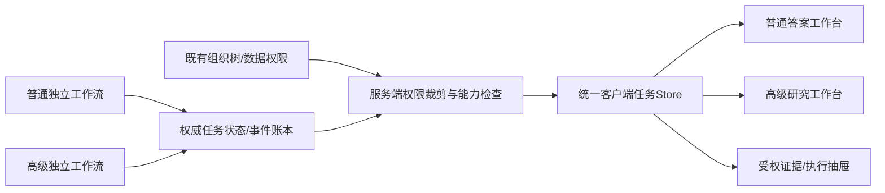

# E. 双路径问数交互升级：适配评估与实施前规格

- 日期：2026-10-21；版本：E v3 / 视觉感官方向 + 代码走读与一手资料复核版。
- 状态：**2026-10-21 用户已确认启动实施。** 方案与流程图基线 `62de789` 已推送 GitHub。代码实施范围、验证记录及尚未承诺的能力见《F_双路径问数工作台实施与验收记录.md》；下文保留批准前的评审依据，不代表每项目标能力已经实现。
- 约束：普通15节点（L0–L13与LR）与高级42节点（H01–H42）为独立任务流程，无自动跨档；两者均复用系统现有组织树权限隔离。节点数是目标架构，不能当作当前后端已实现能力。
- 审阅依据：当前 AskDesk 页面及会话/历史/组件/SSE代码、最新双路径架构规格、官方产品文档。原E稿已备份到 `/private/tmp/E_问数交互展示调研与升级方案_评估前原稿.md`。

## 0. 评估结论与建议批准范围

**原方案适合做方向稿，尚不适合原样启动整站大改。** 保留“业务区与技术区分工”“可编辑理解条件”“过程完成后收敛”“失败原位保留”；必须重写状态协议、真取消/恢复、并发聚合、结果验证和权限投影，并把两模式的核心展示分开。

推荐产品结构是：**普通答案工作台 + 高阶研究工作台 + 共用证据/执行抽屉**。共用设计语言、输入/历史外壳和事件状态模型，中心区按任务性质组织内容。

| 评估项 | 结论 | 原因 |
|---|---|---|
| 普通完整流程适配 | 方向可保留，需要补边界 | 普通也有生成、审查、执行、断言与主理人签收，不能只呈现模板快答 |
| 高级42节点适配 | 需要加强 | 只把42节点压成7行进度，仍看不见假设、反证、证据缺口和结论如何成立 |
| 当前组件适配 | 可复用部分较多 | 已有 ParseBar、PlanCard、LiveExecutionFeed、ReasoningPanel、ComposerArea、ResultDigestCard，不是空白项目 |
| 当前事件流适配 | 需要协议层改造 | 不能仅增加5个展示字段就获得并发尝试、真取消、回放恢复和计划批准 |
| 组织权限适配 | 复用现有能力，前后端全路径承接 | 中间区、右侧、候选值、历史、导出都不能超出当前用户组织范围 |
| 是否现在开始改业务代码 | **本轮不开始** | 先确认本稿的布局/状态/契约与分期，再按纵向切片实施，避免前后端各做一套假进度 |

### 0.1 推荐默认决策（供评审）

1. 普通中心区以答案与条件核对为主，高级中心区以研究计划、假设证据和报告为主。
2. 右侧默认收起，需要时显示“证据 / 执行”两个标签；技术详情访问权限沿用系统授权，不能靠前端“专家模式”开关授予。
3. 高级研究在H15派单前显示可审阅计划并等待“开始取证”；H01–H12包含的预检/受控基线查询必须明确告知，不承诺批准前完全没有SQL。
4. 条件编辑采用“暂存多项→查看变化→应用并重新查询”，保留旧答案与版本，不边点边反复查库。
5. 取消和恢复先做真实后端契约，再让按钮声称“任务已停止”或“后台继续运行”。
6. 优先做条件变化对照、结论证据卡、假设矩阵和图表动作菜单；双等待风格切换、任意CTE预览和时间轴播放器后置。

这些是建议值，用户确认后才进入开发；未回复不视为批准。

### 0.2 整体视觉方向：安静、清楚、可信，有专业分析的质感

**普通问数像一页精致的经营快报；高级研究像一份逐渐成形的研究案卷。** 用户的第一感觉应是“这个系统懂业务、信息有条理、数值有依据”，然后才意识到背后有主理人和多位专家。整套产品保持一个品牌和一套操作习惯。

本轮核对 `frontend/src/styles/datapivot-theme.css`：真实主色为翡翠青 `#0D9488`，现有背景为灰绿系 `#F2F5F4`，文字为深墨色；不是原始E稿所称的紫色主题。视觉升级在这个品牌基础上细化，不把产品突然换成另一套紫色科技风。

#### A. 打开页面的第一眼

屏幕像一张安静的工作桌：浅灰绿背景托住白色内容面，左边会话列表压低对比度，中间留出充足空间。顶栏只保留品牌、普通/高阶模式和必要账户状态。视线首先落在“今天想了解哪项业务？”和输入框，然后看到两到四个具体问题建议。

首页不堆满统计仪表盘、工具按钮与功能入口。输入框是主角：白底、细边框、轻阴影，右下角一枚翡翠青发送按钮；数据集选择、模型、语音等现有功能收在安静的底部工具条。权限提示是一行小字或锁定chip，不把组织树后台管理界面搬到问数首页。

#### B. 一套视觉语言，两种阅读气质

| 感官维度 | 普通答案工作台 | 高阶研究工作台 |
|---|---|---|
| 第一感受 | 轻快、直接、易核对 | 沉稳、连续、有研究深度 |
| 主体形态 | 问题之后是一张结果稿，图与结论紧密组织 | 一份有标题、目录和章节层次的研究案卷 |
| 信息密度 | 先显示结论/指标/一张主图，细节按需展开 | 显示计划、几条实际研究方向、假设证据、报告层次 |
| 视觉重心 | 一个核心数字或一段明确结论 | 研究问题及支撑它的证据关系 |
| 空间 | 行距舒展，组件少，响应到位即收敛 | 章节之间有呼吸，段落对齐，支持长时间阅读 |
| 颜色 | 翡翠青聚焦当前操作和主数据系列 | 同样使用翡翠青；通过排版与密度体现研究感 |
| 过程 | 一两行清楚的当前动作，完成后让位于答案 | 计划原地变进度，证据方向逐个更新，未决项持续可见 |

高阶不通过整页变黑、增加发光线和大量彩色专家头像来表现复杂度。专业感来自清楚的方法、严整的章节和能展开的证据。

#### C. 画面构成与视觉材料

以下是拟议视觉规格，待概念稿评审和真实页面适配，不是本轮CSS改动。

| 元素 | 建议规格 | 用户感受 |
|---|---|---|
| 大背景 | 沿用浅灰绿 `#F2F5F4`，局部可接近 `#F8FAFC` | 安静、不刺眼，内容层级自然 |
| 内容面 | 白色，边框比现有默认更轻；仅悬浮面板保留明显阴影 | 像干净纸页，不是满屏套盒子 |
| 主色 | `#0D9488`；浅选中面 `#F0FDFA`；辅助青少量使用 | 品牌稳定，操作焦点明确 |
| 文字 | 标题深墨、正文深灰，辅助说明灰绿；避免关键文字过浅 | 长时间看报告也清楚 |
| 标题 | 普通结果约20–22px；高级研究题目24–28px | 层次来自字号与间距，不靠所有内容加粗 |
| 正文 | 13–14px，报告正文可14–15px，行距约1.7–1.85 | 是读业务报告的节奏 |
| 核心数字 | 每个结果只选一个视觉主数，约32–40px；单位独立弱化 | 一眼抓住“多少、变了多少” |
| 数字排版 | 明细/对照用等宽数字，单位、正负号和小数位统一 | 对比快速，金额不会视觉跳动 |
| 图表 | 细网格、少刻度、直接标重要值；主系列翡翠青、对照灰色 | 数据本身突出，图表不像装饰品 |
| 圆角 | 普通卡片8–10px，输入框10–12px，chip4–6px | 精致但不软萌，不堆巨大胶囊按钮 |
| 间距 | 内容面内20–24px、区块间20–28px、正文与图约16px | 画面有呼吸，但不空洞 |
| 图标 | 统一细线图标；角色与状态以文字为主 | 像成熟业务工具，不像游戏控制台 |
| 警示 | 琥珀用于待确认/局限，红仅用于真实错误与拒绝 | 问题清楚可见，不制造整屏紧张感 |
| 阴影 | 内容卡仅极轻投影；抽屉比页面高一层 | 能感知层级，不出现大片漂浮玻璃 |

不要把每个角色、每张卡、每条假设都设为不同彩色。不要在图表上堆渐变与动画；图表系列色只表达真实比较含义。

#### D. 普通问数：从提问到答案的一段体验

以“9月各战区净收入，和8月对比”为例，数字均为概念示例。

1. **提问前**：大块留白、简短欢迎语和清楚的输入焦点，用户无需先理解系统结构。
2. **发送后**：自己的问题成为右对齐的小气泡；下方“我理解为”逐项呈现净收入、9月、战区、授权组织。它是轻薄条件条，不是一张很高的表单卡。
3. **处理中**：一枚小状态点加一句当前动作，例如“正在核对结果中的金额单位与粒度”。已完成动作收在一行摘要里；页面不会不断吐出整屏“思考过程”。
4. **结果出来**：白色结果稿自然落位，首先看到“9月净收入81万元，较8月下降19%”。核心数字更大；两三个必要辅助值在同一横排，不做七八个等权重指标卡。
5. **看图**：主图紧随结论，9月翡翠青、8月灰色，末端直接写数。点某战区可以看操作菜单；用户感觉是在顺手分析图，而不是重新开始一轮聊天。
6. **有疑问**：点“口径与证据”才展开依据；关掉后仍是一份简洁快报。修改时间或指标先暂存，确认后出现前后条件对照，旧答案保留。

整体节奏是“问一句→核对理解→快速看懂→顺手继续查”。普通完整后台流程仍在，前台不要求用户陪着看完全部节点。

#### E. 高阶研究：有研究过程，也有阅读秩序

同样问收入下降，高阶不是把普通的过程面板拉长，而是把中心区组织成“研究案卷”：

1. **立题**：页面上方出现清楚的研究题目、比较范围和数据时点，像一份报告的开头；输入气泡缩为背景上下文。
2. **计划**：一张有编号、留白和短说明的计划卡，展示实际研究方向。底部只有“调整重点”“开始取证”等必要主次操作；不把SQL/AST等内部步骤交给业务用户编辑。
3. **取证**：同一张计划卡变为工作中的研究目录。每条方向独立呈现“取数中/核验中/有证据支持/仍待核验”，不用转圈代替所有状态，也不虚构百分比进度。
4. **分歧出现**：待确认或被反证的假设留在画面上，以琥珀文字和简短边界说明呈现。系统给人的感受是“正在认真核验”，而不是只展示成功的故事。
5. **形成报告**：主标题、结论段、关键贡献图和建议逐层出现。量价各解释9.5万元时两项明确并列，总变化19万元；页面同时留出“贡献解释不等于因果证明”的清楚位置。
6. **深入依据**：右侧目录帮助读章节，证据入口指向关键数值。技术执行轨迹再深一层展开，业务用户不被42个节点打断阅读。

整体节奏是“明确问题→共同确认研究方向→看到证据积累→读一份可验证的结论”。用户感到专业协作在推进，而不是被迫看一群Agent轮流发言。

#### F. 动效与时间感：短动作，稳信息

| 转场 | 感官处理 | 边界 |
|---|---|---|
| 发送问题 | 小气泡约120–160ms到位，焦点自然转向理解条 | 不整屏跳转，不放大头像 |
| 理解条件出现 | 状态就绪后约120–180ms轻淡入，出现顺序与真实数据一致 | 没有后端产物不能提前演出“理解完成” |
| 等待动作变更 | 当前行替换或小范围高度过渡；只一个低强度活动标记 | 不连续闪动，不把耗时伪装成推理深度 |
| 结果落位 | 约180–240ms短淡入/极小位移，先突出标题，再稳定显示图表 | 正式结论以签收为门槛，不是为动画提前发数 |
| 完成过程收敛 | 摘要行保留“已完成、查看过程”；用户正在读展开内容时不抢收起 | 不打断阅读位置 |
| 打开依据 | 桌面约180–220ms侧向展开，窄屏为可关闭面板 | 只影响局部，主报告不突然挤成窄栏 |
| 条件变化对照 | 新旧值短暂弱强调后变为静态可读 | 不靠反复闪光提示变更 |
| 错误/澄清 | 活动状态停止，替换成明确待办卡，保留上下文 | 不抖动、不弹一串错误Toast |

页面默认静音；减少动画偏好下立即呈现静态结果。以上时长是视觉过渡建议，不是请求SLA或预估倒计时。

#### G. 异常画面的感受也要统一

- **无数据**：一张信息充分的小解释稿，明确查询范围和已知事实，下面给可确认的调整建议；不放巨大的哭脸或空白图。
- **等待确认**：理解条中的问题项变琥珀，旁边给简短选择；输入区和任务状态明确“等你确认”，不继续转圈。
- **部分结果**：报告顶部就写“部分分析”，已核实事实正常呈现，缺口就近标注；不把限制藏进最末一行。
- **失败**：保留问题、条件和已得证据，在发生问题的区域说明原因与下一步；画面仍保持秩序，不整页刷红。
- **权限拒绝**：说明当前范围不足和可查询范围，不显示其他组织的树或样例数据，不让用户认为这是系统故障。

#### H. 这一轮视觉评审看什么

本轮提供会话内概念预览，可切普通/高阶以及初次进入/分析中/结果呈现；示例数据不来自生产，不发起查询。它用于判断气质、布局、密度与阅读节奏，不代表业务功能已实现，也不替换现有页面。

建议先评审：是否保留翡翠青品牌；普通快报感是否清楚；高阶案卷感是否有秩序；页面是否足够轻；关键数字和证据入口是否容易找到。确认后再做真实业务页面的细化设计与代码实施。

## 1. 现状代码：哪些已有，哪些不能假设

以下代码路径相对 `datapivot-demo/`。行号来自本次走读快照。

| 真实位置 | 当前实现 | 应如何升级 |
|---|---|---|
| `frontend/src/views/AskDesk.vue:190/423`附近 | 中间区有计划/过程，右侧用 ReasoningPanel 展示同一批 displayLogs | 收敛重复投影，页面降为容器，避免继续向超大组件塞所有状态逻辑 |
| `components/askdesk/ParseBar.vue:1`、`AskDesk.vue:1520` | 数据集/对象/指标token可编辑，多项暂存；应用时编译新问句并重新发送 | 复用编辑体验，逐步升级为结构化QuerySpec patch；增加时间/维度/筛选和版本对照，不再计划从零造UnderstandingChips |
| `components/askdesk/PlanCard.vue:1` | 从route文本解析编号步骤，主要为静态展示 | 改为结构化PlanArtifact和同一计划的待确认/运行/完成状态；不能把原文字列表直接当可执行DAG |
| `components/askdesk/LiveExecutionFeed.vue:105`附近 | 完成/取消后已有默认折叠，按日志分类聚合阶段，带耗时 | 保留可读信息密度；新阶段用注册映射，不能宣称“完成折叠”完全未实现 |
| `components/askdesk/ReasoningPanel.vue:1` | 已有业务/技术标签、四阶段步进与节点详情 | 右侧改为证据优先、执行按需展开；四阶段序号推演不适合真实并发与返工 |
| `components/askdesk/ComposerArea.vue:1` | 有数据集/模型选择、发送/停止事件、运行中禁编辑 | 保留已有功能权限与语音等配置；补模式锁定、取消确认态、草稿/运行态分离 |
| `state/askDeskSession.js:1194`、`api/index.js:225`附近 | POST fetch读取SSE，主要消费trace/heartbeat/result，日志有归一化与结果后补建事件 | 先做v1事件适配，再接v2任务事件；后补摘要不得冒充真实逐节点轨迹 |
| `state/askDeskSession.js:2116` | stopAsk调用AbortController并本地标为取消 | 这是终止前端接收，不能证明数据库/模型/worker已停；需要task cancel协议与回执 |
| `backend/controllers/ask_chat.py:787/917`附近 | 后端线程运行任务，用queue发送ready/heartbeat/trace/summary/result/done | 真实取消、持久事件、重连序号、任务快照需要控制面配合；断开HTTP不能等同线程与数据库取消 |
| `state/askDeskTaskView.js:1` | 有运行、待确认、完成、失败和只读历史视图状态 | 迁移到任务级状态来源，避免UI各层独立推断任务状态 |
| `state/askDeskHistory.js:1` | 历史按用户scope隔离，localStorage压缩，并接报告历史接口 | 可复用历史列表/恢复UI；不把历史快照当天然完整的持久事件账本 |
| `backend/data_permission_store.py:251/364/425/472/534` | 数据集准入、组织范围、越权组织提及和SQL行过滤 | 普通/高级都复用；右侧证据、候选值、回看/导出也承接同一范围 |

### 1.1 原E稿待确认项的处理

- Q1组件边界：已定位以上真实文件，不再作为要求用户提供的信息。
- Q2事件字段：已核实当前v1形态；node/attempt/plan版本与任务恢复不能假设已具备。
- Q3痛点权重：尚无用户实测，先按“正确与可控→可理解→流畅→动效”排序，不把假设当用户研究结论。
- Q4本期范围：两模式都纳入产品设计；交付按纵向切片，不承诺两套生产编排一次上线。
- Q5用户构成：默认业务为主、抽屉按需；最终仍需使用者验证，偏好记忆不影响访问授权。
- Q6持久化：历史快照已有，完整任务事件与断线恢复仍需另行设计。

## 2. 原稿必须先纠正的规格

| 原稿做法 | 风险/不适配点 | 本稿替代规格 |
|---|---|---|
| “增加5个字段，后端1–2天” | 把展示适配与任务控制面混成一件小改造 | 分开旧流适配和新协议：task/node/attempt/plan/spec/权限投影/取消/恢复均有契约，排期按能力逐项评估 |
| 停止键=SSE abort | 浏览器不接收后任务可能继续查库 | `cancel_requested→cancelling→cancelled`；只断流时文案只能是“已停止接收，执行状态待确认” |
| group耗时=Σ节点耗时 | 并行三路各10s被显示为30s | 主耗时用group wall time；累计计算/查询耗时单独标“累计工作量” |
| 任一failed则group failed | 已修复的历史失败让阶段永远失败 | 当前有效尝试决定运行状态，失败尝试保留为历史；必要分支与可选分支分别处理 |
| pending/running/done五态覆盖一切 | 缺计划待确认、取消中、阻断、部分结果、断线待同步 | 任务/节点/连接/结果有效性四种状态分开，见第7节 |
| 澄清两轮后带假设继续 | 与既定“关键歧义不猜测”冲突 | 挂起或明确未解决；不执行依赖缺失槽位的查询 |
| confirmed=用户确认/高置信 | 把模型置信度包装成用户确认 | 分开“是否解析完成”和“来源”；只有用户明确操作才标“用户确认” |
| 命中Golden即金色已验证答案 | 模板批准不证明参数、权限、水位、执行结果和结论都正确 | 分开“模板已审核”“本次检查通过”“数据截至”“主理人签收” |
| 结论先于图表和明细落位 | 未经断言/签收的数值可能先被复制引用 | 已验证事实可预览并标“阶段结果”；完整结论在签收后发布，草稿不能看起来已完成 |
| payload/错误堆栈全量下发右侧 | 同一事件给所有用户会泄露敏感参数、字段和内部栈 | 服务端裁剪业务事件，详情用受权detail_ref按需获取；无原始CoT/敏感堆栈外发 |
| 点“放宽条件”立即重跑 | 隐式删条件，可能改变业务含义或权限范围 | 展示patch差异并确认，组织权限过滤永不可编辑，仍走同模式查询 |
| 任意CTE逐步执行≤500行 | CTE提取未必语义等价，行数限制也不等于低成本 | 首期只做静态逻辑解释；登记中间产物或批准子查询才可预览，并再次过权限与资源闸门 |
| 42节点按3路固定呈现 | 真实DAG不一定总是规模/价格/结构，也可能增减依赖 | 分支来自计划；演示可用A/B/C，生产按业务名称和实际数量展示 |
| 已完成步骤200ms自动折叠、滚动追随 | 打断阅读，辅助技术用户丢焦点 | 完成且用户未展开阅读时收敛；保留摘要与异常提示，不抢焦点、不滚离用户当前位置 |
| 逐个节点进度百分比 | 42节点含条件/异步治理，执行成本差异大 | 显示阶段、已验证证据/必要证据、已耗时；无可信模型不展示剩余倒计时或“完成95%” |
| 第N位排队 | 当前没有可验证全局队列顺序 | 只有调度器提供position/as_of时显示；否则“等待执行资源，已等待Xs” |

## 3. 本轮官方调研：借什么，改什么

核对日期2026-10-21。仅以已核对的一手页面支持对应能力；原稿缺链接或主要来自第三方的精确刷新频率、统一行业收敛、播放倍率等，不进入本次实施依据。

| 编号/官方资料 | 已确认的交互 | 对本项目的取舍 |
|---|---|---|
| U1 [ThoughtSpot Spotter](https://docs.thoughtspot.com/cloud/26.9.0.cl/spotter-getting-started) | 查询token可编辑、追问变化高亮、图表/表切换、停止及请求复核入口 | 普通重点采用条件token与变化对照；请求复核按本项目任务/预算和权限设计，不直接等同对方实现 |
| U2 [Gemini Deep Research](https://support.google.com/gemini/answer/15719111?hl=en) | 生成研究计划，可编辑后开始研究，报告可恢复查看 | 高级借鉴“计划→运行→报告”的连续工作区；本项目预检/基线读取边界单独声明，不承诺与其执行时序相同 |
| U3 [Metabase Drill-through](https://www.metabase.com/docs/latest/questions/visualizations/drill-through) | 点击图、表头或单元格，通过菜单继续过滤/拆分/查看记录；原生SQL有能力限制 | 新增“图表即追问入口”；采用后端结构化动作，不默认任意SQL都能自动下钻 |
| U4 [Metabase Dashboard Interactivity](https://www.metabase.com/docs/latest/dashboards/interactive) | 图表可设置过滤/导航等点击行为，SQL和查询构建器能力不同 | 限定每张图可用动作；不可重写查询时只给批准的关联查询/过滤动作 |
| U5 [Databricks Genie Agent配置](https://docs.databricks.com/aws/en/genie-agents/set-up) | 配置数据/SQL示例/业务规则与可信资产，数据访问按最终用户权限判断 | 借鉴“配置可信资产仍按用户权限求值”；不从可信模板推导当前答案绝对正确，也不新建替代组织树权限 |
| U6 [Data Agent深度研究](https://docs.volcengine.com/docs/DataAgentPrivate/DepthResearchAgent-1?lang=zh) | 规划分析、SQL/Python研究、图表报告与场景知识 | 高级以分析计划和成果为中心；具体假设矩阵、结论证据卡是本项目设计组合，不声称厂商已有相同界面 |

WrenAI复杂SQL分步展示可作为后续研究候选，但原E稿“每步≤500行、任意方言切换”等精确UI规格本轮未重新核实，不作为首期承诺。原稿列出的Cursor/Manus/Perplexity特定界面行为也不作为本方案成立的必要前提。

### 3.1 更适配两路径的展示候选与优先级

| 展示方式 | 适用路径 | 用户真正得到什么 | 本项目做法/代价 | 建议 |
|---|---|---|---|---|
| **条件变化对照条** | 两者，普通优先 | 看清“这轮改了什么、保留什么” | 基于ParseBar升级，显示时间/指标/维度/过滤的前后版本；依赖结构化patch | 首期核心 |
| **图表动作菜单** | 普通、高级证据卡 | 不重写问题，点“看明细/按地区拆分/换时间粒度” | U3/U4启发；每图返回allowlisted actions，执行仍鉴权 | 首期选少量图型 |
| **答案/结论的证据卡** | 两者 | 点击关键数字知道口径、时间、来源和检查状态 | EvidenceLedger投影；每个claim关联result cell与query_ref | 首期先做数值来源，逐步完整 |
| **计划与进度一体卡** | 高级 | 自己确认的研究方向原地变进度，不用理解42节点 | U2启发；PlanArtifact版本与任务进度绑定 | 高级核心 |
| **假设—证据—结论矩阵** | 高级 | 同时看到支持/被推翻/未解决，避免只看成功故事 | 本项目原创组合；基于hypothesis_id、反证、required证据，不用AI生成百分比 | 高级核心 |
| **研究报告/证据/执行三级深度** | 高级 | 从决策结论逐步下探到原始查询，不被技术噪音淹没 | 中心报告，证据抽屉，授权执行标签；统一artifact引用 | 高级核心 |
| **结果分支对照** | 两者，分析师优先 | 原答案与新条件结果并排，理解差异而非覆盖历史 | 只比较相容口径/水位；保留任务关系与差异原因 | 第二阶段 |
| **贡献瀑布 + 残差卡** | 高级归因 | 看得见总变化如何被解释，哪些仍未解释 | 只对适用分解显示；不同分解视角不可相加 | 算子完成后上 |
| **任务驻留条** | 高级 | 离开当前对话仍可回到执行任务，显示待确认/断线 | 依赖持久worker与事件恢复；当前不能纯前端宣称后台继续 | 控制面具备后上 |
| **节点尝试对照** | 专家执行视图 | 看SQL/检查项改了什么，失败现场不消失 | work_order/attempt/repair_ticket关联，权限裁剪 | 排障优先，不占业务区 |
| **任意情景滑块/预测模拟器** | 高级特定场景 | 可探索参数变化 | 只有已登记、校准模型才可算；拖动要节流，不逐像素查库 | 远期，不做装饰功能 |
| **全量时间轴播放器/实时电脑屏幕** | 本项目低适配 | 对只读取数价值有限 | 成本高且增加敏感信息展示 | 不纳入本次 |

“新颖”优先体现在能核对、能继续分析、能发现未解决问题；不以更复杂的动画或显示更多模型文字为目标。

## 4. 信息架构：两个中心工作台，共用外壳与证据抽屉

### 4.1 普通答案工作台

```text
会话列表（可折叠） │ 普通问数：问题 + 当前授权范围提示
                  │ 我的理解：指标 / 时间 / 维度 / 筛选
                  │ 条件变更：上月→本月；其他条件沿用
                  │ 进展摘要：正在核验结果；已耗时Xs
                  │ 已签收答案：指标/一句解读/图表↔表格
                  │ [点数据看明细] [按维度拆分] [查看证据]
                  │ 口径、数据时间、验证状态、局限
                  │ 后续问题与输入框
                  └ 按需打开：证据抽屉 / 授权执行记录
```

- 默认不弹批准计划，不要求用户逐步确认安全检查；普通也展示主理人签收与结果断言状态。
- 短任务不强制播放每个阶段；可短暂显示当前动作，完成即显示答案，不能为动效人为拖慢。
- 明细/排行/对比有不同结果模板，不能一律先给“大数字”；无数据时不渲染空图。
- 对条件编辑、图表下钻、重试和历史恢复，保持mode=basic，重新调用既有权限检查。

### 4.2 高阶研究工作台

```text
会话列表 │ 研究目标 / 高级任务 / 组织范围 / 数据时点
         │ 研究计划 v1：目标、假设、范围、方法、预计查询上限
         │ [调整计划] [开始取证]    ← 确认后原地变执行状态
         │ 取证方向：规模    价格    结构（实际来自DAG）
         │ 假设矩阵：假设 | 必要证据 | 反证 | 状态 | 查看证据
         │ 已验证事实（阶段结果） / 尚未解决的缺口
         │ 最终报告：结论→证据→图表/方法→建议→限制
         └ 证据抽屉：声明→结果→查询→授权执行详情
```

- 高级中心页保留计划、假设与报告的连续关系，不把42节点平铺在聊天气泡。
- 报告成为主产物；聊天用于补充目标、澄清和继续研究，不能用长篇过程文字淹没报告。
- 分支状态独立；一个失败不能把另外两路有效事实清空，但必要证据缺失必须明确限制结论。
- 所有模型候选/分析草稿有“草稿/待核验”状态，不能提前显示“主理人已签收”。
- H39治理为报告交付后的异步候选处理，不应让已交付报告永远停在99%。

### 4.3 共用抽屉与响应式

默认抽屉展示业务可理解的“证据”，授权用户再切“执行”。证据包括定义、数据时点、查询范围、数值单元格、适用检查与局限；执行包括节点/尝试/SQL/成本与脱敏错误。两区均不展示隐藏CoT或未裁剪原始payload。

桌面优先保持中心可读宽度，侧栏可收起；窄屏会话列表和证据均变抽屉，高级矩阵提供卡片式替代。断点以可用空间测试，不强制小屏常驻三区。抽屉开合、状态变化不抢键盘焦点，色彩之外提供文本/图标，减少动画模式关闭脉冲和闪动。

## 5. 42节点如何映射成业务体验

保留13个工程阶段供执行视图使用；业务区用8个稳定阶段，异常为旁路而非第9个必须执行的步骤。

| 路径 | 业务阶段 | 节点 | 展示产物与判定 |
|---|---|---|---|
| 普通 | 接入与权限 | L0 | “已按当前组织权限限定范围”；拒绝时直接说明，无敏感组织枚举 |
| 普通 | 理解与规格 | L1–L4 | ParseBar/QuerySpec与待澄清项，准备工作可并行 |
| 普通 | 查询准备 | L5/L6、L7 | 策略择一，显示模板来源或新查询及审查状态 |
| 普通 | 取数与验证 | L8–L10 | 当前取数动作、数据断言、空结果类型 |
| 普通 | 解读与签收 | L11–L12 | 叙事/图表待签收；通过后才发布结论 |
| 普通 | 交付 | L13 | 答案、口径、时间、追问；LR只在返工出现 |
| 高级 | 立项与权限 | H01–H03 | 独立任务、现有授权、预算和可用能力 |
| 高级 | 理解与范围 | H04–H10 | 检索/实体/语义，冻结AnalysisSpec；H41承载澄清 |
| 高级 | 基线核验 | H11–H12 | “本期与基期是否可比”，只发布已验证基线事实 |
| 高级 | 研究计划 | H13–H15 | 方法、假设、必要证据和资源范围，计划批准后才大规模派工 |
| 高级 | 分支取证 | H16–H27 | 动态业务分支卡；四排worker依赖在技术视图保留 |
| 高级 | 核验与计算 | H28–H34 | 证据矩阵、冲突/反证、贡献与不确定性；可返回有预算探索 |
| 高级 | 报告与签收 | H35–H37 | 叙事/图表草稿→主理人签收，声明级引用 |
| 高级 | 交付与沉淀 | H38；H39异步 | 报告/检查点；候选审核排队不阻塞答案 |
| 高级 | 条件旁路 | H40–H42 | 自愈/澄清/停止有独立视觉与事件，不伪装成正常完成阶段 |

同一事件可关联业务阶段、工程阶段、hypothesis与artifact；单一group字段不足以表达这些关系。映射应版本化注册，界面不从自然语言正则猜阶段。

## 6. 关键交互的具体规则

### 6.1 我的理解、条件编辑与版本对照

保留ParseBar已有的多项暂存/撤销，再补足时间、维度、用户过滤。区分两条轴：

- `resolution_state=resolved/ambiguous/unresolved`：目前是否已经解析明确。
- `origin=user/catalog/inherited/model` 与 `user_confirmed`：从哪里来、用户是否真正确认。

模型高置信只显示“已解析/来自口径库”，不能写“你已确认”。悬停或点击提供口径解释、来源、绝对时间范围与沿用关系；移动端用点击，不仅hover。

用户改多项→显示结构化diff→点“应用并重新查询”。固定组织过滤显示锁定标识且不可编辑，任何候选列表由服务端按既有权限裁剪。只改时间就仅替换时间，保留经确认的其余条件；旧答案保持原版本，不原位篡改。

若任务正在运行，修改先保存草稿；用户明确应用时取消旧执行并等待结果/取消回执，再创建关联的新版本/任务。自动修复沿用原任务总额度，用户主动修改产生的新任务必须记录parent_task与原因，不能被后台逻辑用来规避两次上限。

### 6.2 高级计划确认与运行中改计划

PlanArtifact含 `plan_id/version/spec_version/hypotheses/required_evidence/method/query_budget/approval_state`。用户看业务假设和数据范围，不编辑安全门禁、权限过滤与专家内部系统步骤。

本稿推荐H15前“开始取证”确认门。H01–H10是鉴权/元数据/规格准备，H11–H12可能已经有授权下的受控基线查询；UI写明“计划前已做基础核验，将新增最多N次取证查询”。若用户希望任何SQL前都确认，需要另行把范围确认门前移到H11前，并调整架构；不可仅改按钮文案就声称没有先查询。

运行中改假设/范围时生成新plan_version及diff，保留旧计划与产物引用。扩范围先重审权限；影响后续查询的变化需主理人重新编排，受影响产物失效。首期不承诺任意“暂停/恢复”：没有真正checkpoint支持时，只提供取消后重新立项。

### 6.3 假设证据矩阵（高阶主要新增）

每行显示：业务假设、必要证据覆盖、支持事实、反证、待解决项、状态和下钻入口。状态为“取证中/有证据支持/被反证/未解决”，与“任务执行成功/失败”分开：成功运行的查询也可能推翻假设。

不默认展示模型自报“90%可信”；有统计区间须能对应方法、样本与计算结果。已完成的分支不能直接变成已确认原因；贡献分析、相关线索和因果结论采用不同标签。必要证据缺失时，报告顶部显示“部分分析”，不只在末尾小字写局限。

### 6.4 图表即后续分析入口

每个图返回受权的 `available_actions`：操作ID、目标指标/维度、参数schema、适用条件、spec patch与查询类型。点击菜单先显示将变更的条件，再应用；不由前端任意拼接SQL。

MVP只开放“按已授权维度拆分/切换时间粒度/查看批准明细”三类。没有批准明细路径的聚合指标不显示“查看所有记录”。普通图表动作保留basic，高级证据卡动作保留advanced；若需要另模式，明确让用户重新发起，不自动跨档。

### 6.5 可信状态分层与发布规则

| 标签 | 必须满足 | 不代表什么 |
|---|---|---|
| 模板已审核 | template版本/审核来源可查询，适用条件匹配 | 本次结果必然正确或数据已更新 |
| 本次检查通过 | 指定硬检查PASS、有checks_ref | 所有业务假设都成立 |
| 数据截至… | source watermark可查询，可比性状态明确 | 数据源总是实时 |
| 主理人已签收 | answer contract与必要证据通过、report signed | 所有因果关系都被证明 |
| 部分结果/待核验 | 缺口与草稿状态可见 | 可当完整正式结论引用 |

阶段结果仅在对应数据断言通过后发布，显式标记“已验证事实，研究未完成”。正式报告要待H37/L12签收；内容采用Artifact ID与revision递增，不让同一个未标版本的数字静默变化。

### 6.6 失败、无数据与澄清

区分：有效零值、无记录、全NULL、未同步、查询失败、权限拒绝、计划超限。不能只用row_count=0给出“没有业务发生”。无证据时文案是“当前条件未返回记录，原因尚未确认”，而不是编造某月尚无订单。

建议放宽条件只是候选patch，用户确认后重查；组织权限永不放宽。可恢复失败保留attempt、错误类型和修复工单，业务区显示“正在修复，剩余X次”，技术区可看失败尝试。额度耗尽明确停止，不能提供一个看似普通的“自动再试”按钮绕过总预算。

澄清挂起时停止运行spinner，显示需要回答的问题、当前范围和已用轮数；两轮仍缺关键条件时保留待确认/停止状态，不带假设执行依赖查询。

## 7. 事件、状态与控制协议（设计规格，尚未实现）

### 7.1 一套权威状态，经过权限裁剪的多种投影

“单一事件源”指服务端权威任务事件与快照，不是把一份含SQL/堆栈/敏感值的原始payload发给所有用户。业务投影与工程投影来自同一状态版本，各自受权裁剪；前端统一store以避免两区自行推断。



同一用户的一次任务不会同时执行两条模式；上图表示共享展示基础设施，不是流程互跳。

### 7.2 最小事件信封

```json
{
  "schema_version": "2.0",
  "event_id": "evt-task-001-26",
  "task_id": "task-001",
  "conversation_id": "conv-01",
  "turn_id": "turn-03",
  "mode": "advanced",
  "seq": 26,
  "state_version": 18,
  "event_type": "node.attempt.completed",
  "node_id": "H26",
  "work_order_id": "price-hypothesis-01",
  "attempt_id": "attempt-02",
  "repair_ticket_id": "repair-01",
  "hypothesis_id": "hyp-price",
  "phase_id": "evidence",
  "engineering_stage_id": "query_execute",
  "plan_version": 1,
  "spec_version": 2,
  "occurred_at": "2026-10-21T15:00:00+08:00",
  "public_summary": "价格方向的取证完成，正在交叉核验",
  "status": "succeeded",
  "timing": {"started_at": "...", "finished_at": "...", "duration_ms": 9500},
  "budget": {"repair_remaining": 1, "repair_max": 2},
  "artifact_refs": ["evidence://price-01"],
  "detail_ref": "authorized-detail://attempt-02"
}
```

`seq`按task递增，不要求所有用户所有任务共用一个全局序号；多worker由服务端排序入账。seq负责去重/恢复，不替代revision、attempt与授权。`detail_ref`不是公开下载URL，读取时重新验身份和组织范围。public_summary用受控模板，不能从模型隐藏推理直接润色输出。

至少支持任务创建/开始/快照、权限检查结果、spec提案/确认、计划提案/确认、节点attempt开始/完成/失败、artifact验证/更新、澄清、cancel requested/ack、report signed、task terminal。v1旧trace由adapter转换为可用粗粒度事件，必须标 `origin=legacy_derived`；不伪造H01–H42逐节点已执行。

### 7.3 分离四种状态

| 状态对象 | 候选状态 | 规则 |
|---|---|---|
| 任务 | created/queued/preparing/awaiting_plan_approval/running/awaiting_input/cancelling/succeeded/partial/failed/denied/cancelled | waiting不是终态；取消中不能提前显示已停；四类终态不足覆盖真实流程 |
| 节点/尝试 | pending/blocked/running/succeeded/failed/skipped/cancelled | 每次attempt不可被下一次覆盖，UI可聚合展示当前有效尝试 |
| 连接 | connected/reconnecting/disconnected/stale | 网络断开不等于任务失败，心跳不是业务步骤或进度 |
| 结果/声明 | draft/fact_validated/signed/superseded/invalidated | 已完成查询不能自动提升为已签收结论 |

### 7.4 并发聚合与耗时

业务阶段状态从当前有效attempt和required依赖推导：权限拒绝/任务终态优先；当前待用户问题显示awaiting_input；可修复的失败进入修复中；存在必要分支running则继续取证；所有必要产物成功且验收通过才可完成，可选失败转带缺口完成/partial。不能用“历史任一失败”或“任一running永远覆盖全部等待”这样的简单优先级。

阶段wall time为 `last_finish - first_start`，运行时以服务端时钟锚点持续计算；暂停/排队另列。累计工作量 `Σattempt_duration`另名展示，不能冒充用户等待时长。计划动态扩展时只显示已完成阶段/证据与总预算，不让百分比倒退或停在虚假的99%。

### 7.5 停止、恢复与能力声明

拟定接口而非现有能力：`POST /api/ask-tasks/:id/cancel`、`GET /api/ask-tasks/:id`、`GET /api/ask-tasks/:id/events?after_seq=N`、`POST /api/ask-tasks/:id/plans/:version/approve`、`POST /api/ask-tasks/:id/spec-revisions`。可沿用现有POST SSE入口，新增控制API逐步接入；具体路由在实施前契约评审确定。

取消请求幂等；后端停止新派工、通知worker、取消查询并释放连接，确认后发task.cancelled。如果查询不可取消，UI显示“已请求停止，正在等待当前查询结束”，不能谎称已停。超时/取消竞态由权威终态裁定，不能两种状态同时完成。

服务端返回能力manifest，例如 `cancel_level=disconnect_only/task/db_query`、`resume_supported`、`plan_approval_supported`、`spec_patch_supported`。旧引擎不支持时明确降级文案，按钮不模拟不存在的能力。连接重试不重建任务或重置修复额度；快照+after_seq去重，事件过期则取新快照，保留“历史摘要”标注。

### 7.6 历史与权限

复用现有用户scope历史列表；后台snapshot/artifact读取重新调用现有组织权限判定。组织权限撤销后不能继续显示旧localStorage中的明细、敏感SQL或未授权节点信息，至少在登录scope切换、历史恢复和详情读取时重新验证；缓存按用户/权限指纹与语义版本隔离。

“业务/专家”是展示偏好，不是访问控制；按feature_access等既有能力校验决定SQL复制、导出、数据集选择和技术详情能否使用。后台仍负责最终过滤，前端隐藏不构成隔离。

## 8. 工程实施路径：按真实闭环切片，而非先全面换皮

本节为确认后的建议顺序，不是本轮开发授权。估时只能在契约、后端能力和测试基线确认后细化；原稿“纯前端1周+后端1–2天全接入”的估计不再采用。

| 阶段 | 范围与产物 | 依赖/退出条件 |
|---|---|---|
| R0 契约与现状基线 | 锁定两模式状态/产物/事件schema；真实事件样本、错误分类、权限投影、功能manifest；整理组件边界 | 确认本E方案与架构契约；有可回放的脱敏事件夹具，不承诺新执行能力 |
| R1 普通纵向闭环 | v1 adapter→统一store→升级ParseBar→普通答案模板→证据抽屉；保留旧接口和组织隔离 | 真实普通任务从鉴权到签收一致；模板/生成/空结果/澄清均可用；旧版可回退 |
| R2 任务控制面与高级最小切片 | 持久任务、v2事件、真实取消/恢复/计划批准；一业务域三路取证到证据账本 | 必须真并发、真屏障、真预算≤2、真取消回执；不能用mock计划跑到生产 |
| R3 高级研究工作台 | 计划进度一体、动态分支、假设矩阵、已验证事实、研究报告和声明引用 | 42架构节点的适用事件有定义；部分结果/反证/不可比/预算耗尽真实呈现 |
| R4 分析交互与治理 | 图表actions、结果版本对照、请求复核、贡献/残差卡、批准子查询预览 | 每类动作有QuerySpec/AnalysisSpec支持和权限；新增能力逐类灰度 |

R1/R3可并行做静态信息设计，但生产功能按依赖开放；没有后端能力就不启用对应操作。两模式保持可见、能力明确，而不是先把高阶换一套看起来能运行的皮肤。

### 8.1 文件级建议（仅规划）

| 当前文件 | 计划责任 |
|---|---|
| `views/AskDesk.vue` | 组合外壳、选择模式工作台、路由到既有会话/报告行为；逐步抽离状态和图表副作用 |
| `state/askDeskSession.js` | v1 adapter与任务控制桥接，迁移到权威任务store；移除不能证实的“后端已停止”等文案推断 |
| `state/askDeskTaskView.js` | 运行/历史/待用户视图一致性；不自行制造任务终态 |
| `state/askDeskHistory.js`与report history composable | 迁移版本、权限重新核验、artifact摘要和恢复cursor |
| `ParseBar.vue` | 条件草稿/对照/应用，逐步支持结构化patch，保留现有权限约束 |
| `PlanCard.vue` | 计划artifact及版本、批准状态、对应进度；取消route文本编号作为唯一数据源 |
| `LiveExecutionFeed.vue` | 普通阶段摘要投影，完成收敛、异常保留、真实wall time |
| `ReasoningPanel.vue`、`LogTimeline.vue` | 证据/执行两层，尝试记录、受权details按需加载 |
| `ResultDigestCard.vue`、`SqlBlock.vue` | 结果类型模板、数值来源/状态、脱敏与权限允许的复制 |
| `ComposerArea.vue`、`ChatHeader.vue` | 显式mode、运行草稿、真取消状态/能力、既有模型/语音等控制不丢失 |
| 拟新增`HypothesisMatrix`/`EvidenceCard`/`ResearchWorkspace` | 仅新增缺失的高级信息组织，避免重复造现有基础组件 |
| 后端`ask_flow`/`controllers/ask_chat.py`/任务控制模块 | 模式锁定、事件持久化、取消/恢复/计划/spec控制；原数据权限模块继续复用 |

## 9. 验收：先证明真实，再评审美观

| 场景 | 必须看到/证明 |
|---|---|
| 普通金标命中 | 标签仅说明模板来源；本次权限/参数/结果检查与签收状态独立展示 |
| 普通新SQL | 没有金标仍完整走生成/审查/执行/断言/签收，不跳高级 |
| 普通/高级相同权限 | 同用户同数据集，组织范围一致；候选、证据、历史、导出不越权 |
| 条件编辑与追问 | 精确patch、继承与删除可见；组织锁定项不可改，旧答案可回看 |
| 三路各约10s并行 | 用户wall time接近最长必要依赖路径；不显示30s的伪总耗时 |
| 一次失败后修复成功 | 业务状态可完成，技术失败尝试仍保留，repair_remaining来自同任务预算 |
| 必要/可选分支失败 | 必要缺失不得完整归因，可选失败有缺口标记，不抹掉成功证据 |
| 关键澄清两轮未解 | 进入待确认/停止，无“带假设继续”与后台查询 |
| 点击停止 | 区分请求/执行中/确认，数据库或worker取消有回执；否则如实显示等待当前查询 |
| 断网/重连/刷新 | 快照与seq恢复，不重复执行、不重置额度、不把网络断开写业务失败 |
| 计划修改 | version/diff/批准可追溯；不越权，不采用旧计划失效产物 |
| 零/空/NULL/未同步 | 正确空态与原因依据，不造“没有业务发生”解释，不渲染误导图表 |
| 报告/图表/证据 | 数值可回链；未签收草稿不可伪装正式；贡献视角不重复相加 |
| 权限撤销后恢复 | 旧明细/缓存/工程详情不得继续呈现未授权数据 |
| 老历史/v1事件 | 显示可用摘要及局限，不能伪造完整42节点轨迹 |
| 辅助与窄屏 | 键盘、读屏、无动画、抽屉焦点、表格替代与触控均可用 |

指标分三类：业务任务正确完成率/口径纠正成功率/证据可追溯；控制真实性（取消回执、恢复幂等、权限、重试上限）；体验效率（完整答案时延、找到证据的操作数、无需重写问题的下钻成功率）。无基线前不承诺某百分比提升，不用增加动画时长制造“专业感”。

## 10. 建议评审确认项

推荐一起确认以下四点，之后才拆实施任务：

1. **布局方向**：普通答案工作台，高级研究工作台，右侧共用证据/执行抽屉。
2. **首批交互重点**：条件diff、证据卡、计划进度一体、假设矩阵、三类受控图表actions；其余后置。
3. **高级计划门**：默认允许授权下的基础预检/基线查询，H15派单前确认研究计划；若要求任何SQL前确认，则同时调整H11前控制门。
4. **实施顺序**：R0契约→R1普通真实闭环→R2控制面/高级最小链→R3研究工作台→R4分析交互，均有灰度、迁移和回滚。

本稿建议确认设计与边界；**本次尚未执行上述任何代码改造**。确认后首先细化R0/R1的文件改动、接口兼容和验收清单，再进入实施。
