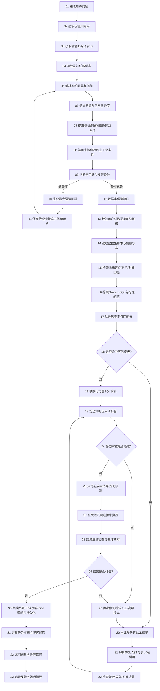
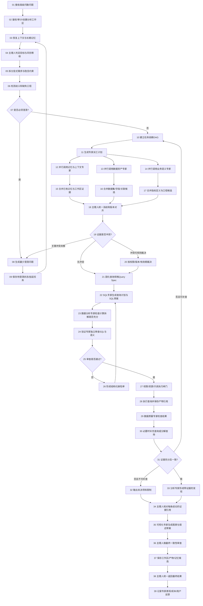
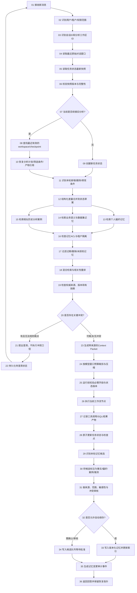
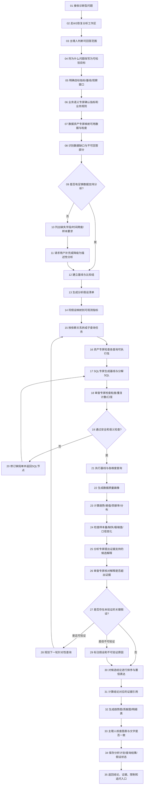
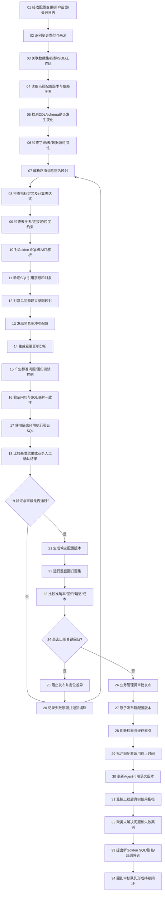
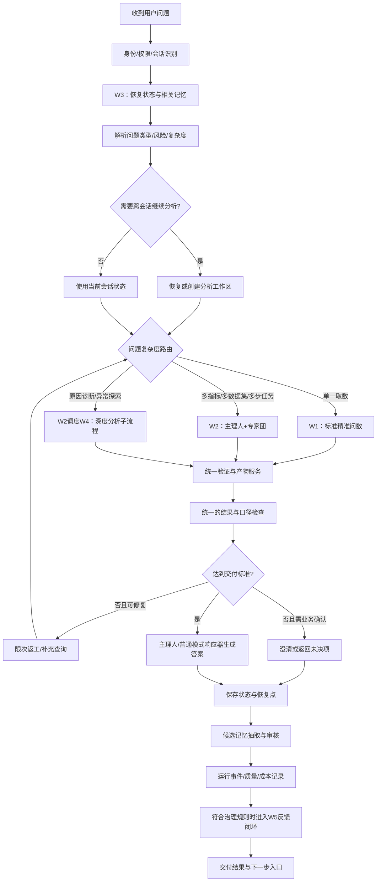

# 智能问数复杂流程设计：五套可落地的工作流

> 目标：在现有“数据集书架”能力之上，设计可以由后端工作流引擎、Agent 编排器和记忆服务实现的智能问数系统。保留“普通问数 / 高级问数”两个用户入口；底层由多条专业工作流按场景调度。
>
> 设计原则：不是为了让流程图看起来复杂而增加步骤。每个节点必须有明确输入、输出、状态变更、超时/失败策略或可观测事件。需要模型判断的节点与确定性程序节点必须分开。

## 0. 先说明对标边界

本设计参考公开文档中已说明的产品能力，不声称复刻任何厂商未公开的内部实现，也不把竞品宣传语等同于技术细节：

- **Quick BI 小 Q**：官方说明支持智能规划模式、多步复杂问题回答和多轮对话；适合作为中文问数交互与规划模式的对标。
- **Microsoft Fabric Data Agent**：官方说明使用所选数据源的 schema、指令和示例查询来构造上下文；示例查询需先通过验证，并可在执行步骤中检查实际检索到了哪些示例。
- **Snowflake Cortex Analyst**：官方提供 Verified Query Repository（自然语言问题与可信 SQL 的配对），并提供基于可信查询的准确性及回归评估；官方文档也说明评估本身存在多轮评估等限制，不能直接当作完整的长期记忆方案。
- **Databricks Genie Agent**：官方提供基于真实问题测试、SQL 与图表复核、用户反馈和 benchmark 的测试监控路径。
- **DataBuddy**：名称可能对应多个产品。若项目要严格对标某个 DataBuddy，执行调研的 AI 必须先确认产品官网、版本、功能页面和证据；未找到可靠公开资料时，应明确标注“无法验证”，不得臆造其内部流程。

参考资料：
1. 阿里云 Quick BI 小 Q 问数：https://help.aliyun.com/zh/quick-bi/user-guide/user-guide-for-smart-q-a
2. Quick BI 智能规划模式与产品能力：https://help.aliyun.com/zh/quick-bi/product-overview/intelligentq
3. Microsoft Fabric Data Agent 概念与上下文配置：https://learn.microsoft.com/en-us/fabric/data-science/concept-data-agent
4. Microsoft Fabric Data Agent 示例查询与验证：https://learn.microsoft.com/en-us/fabric/data-science/data-agent-example-queries
5. Snowflake Verified Query Repository：https://docs.snowflake.com/user-guide/snowflake-cortex/cortex-analyst/verified-query-repository
6. Snowflake Cortex Analyst evaluations：https://docs.snowflake.com/en/user-guide/snowflake-cortex/cortex-analyst-evaluations
7. Databricks Genie Agent 测试和监控：https://docs.databricks.com/aws/en/genie-agents/monitor

---

# 一、五套流程的定位

| 编号 | 流程名称 | 用户可见模式 | 适用问题 | 核心目标 | 典型耗时策略 |
|---|---|---|---|---|---|
| W1 | 标准精准问数 | 普通问数 | 单指标、单数据集、固定维度、常见查询 | 快、稳、可复用、可追溯 | 先匹配可信查询，限制模型调用次数 |
| W2 | 主理人 + 多专家协同问数 | 高级问数 | 多条件、多指标、跨表/跨数据集、复杂提问 | 专家拆解、并行研究、交叉验证、主理人统一交付 | 按任务复杂度动态扩展任务图 |
| W3 | 上下文与跨会话记忆恢复 | 普通和高级共用底座 | 多轮追问、隔天续问、恢复旧分析、纠错后继续 | 条件不丢、口径不乱、可恢复、可纠错 | 每轮必执行，检索预算按问题复杂度调整 |
| W4 | 深度诊断与探索式分析 | 高级问数 | “为什么下降”“异常由什么构成”“下一步查什么” | 证据驱动的多轮分析，不把相关性误写成因果 | 允许有限的自适应查询循环 |
| W5 | 数据集知识治理与质量进化 | 管理后台/自动任务 | 数据集、字典、DDL、Golden SQL、标准题集、用户反馈维护 | 让书架成为可治理的业务语义层，并持续改善准确率 | 事件驱动 + 定期回归评估 |

**重要架构结论：** W1 与 W2 是用户体验上的两种问数模式；W3 是被两种模式共同调用的上下文/记忆基础设施；W4 是高级模式中的专业分析子流程；W5 是配置、反馈、评估和知识更新的闭环。不要把它们设计成五套互不相通的聊天机器人。

---

# 二、W1：标准精准问数流程（普通模式，30 个节点）

## 2.1 目标

让常见问题优先命中已审核的常见问题、Golden SQL、数据集规则和指标定义。仅当确有必要时再生成新 SQL。普通模式不应为简单问题启动完整专家团。

## 2.2 流程图



> 本流程为 33 个节点。图中的回路只允许有限次数；每次重试都需要记录失败类型，不得无限生成 SQL。

## 2.3 节点契约

| 节点 | 输入 | 必须输出/副作用 | 失败处理 |
|---|---|---|---|
| 01–04 接入与状态读取 | 用户身份、会话、问题 | request_id、thread_id、当前 workspace 版本 | 状态库不可用时拒绝执行数据查询，可提示稍后重试 |
| 05–08 意图与条件解析 | 当前问题、近期对话、任务状态 | 结构化 intent、filters、继承/新增/删除的条件差量 | 指代不明不得自行猜关键指标或时间范围 |
| 09–11 澄清 | 缺失字段与可选口径 | 最少问题、pending 状态、待补字段 | 用户未回答前不执行高风险查询 |
| 12–16 资产检索 | intent、权限、业务范围 | 候选数据集、指标定义、字段映射、Golden SQL 候选及版本 | 无权限数据集不得进入后续上下文 |
| 17–19 可信模板选择 | 候选查询、适用条件、口径版本 | 匹配理由、匹配置信依据、参数化 SQL | 不满足模板前置条件时禁止硬套模板 |
| 20–22 SQL 构造与静态分析 | 语义层、schema、查询意图 | SQL AST、引用对象、聚合粒度、时间窗、关联路径 | 表/字段/口径无法解析时返回明确问题，不让模型猜表 |
| 23–26 安全门禁 | SQL、用户权限、限制策略 | 审查报告、估算成本、可执行标记 | 默认拒绝 DDL/DML、多语句、越权字段和无限制全表扫描 |
| 27–29 执行与验证 | 通过审查的 SQL、受控参数 | 执行 ID、结果集引用、质量检查记录 | 超时/连接问题可按策略重试；逻辑错误返回 SQL 修复回路 |
| 30–33 交付与沉淀 | 已验证结果、SQL、上下文 | 图表配置、口径说明、运行日志、反馈入口 | 结果为空也要明确说明，不得用生成内容补数 |

## 2.4 普通模式强制规则

1. 默认先查 Golden SQL / 标准问题，再生成 SQL；但只有匹配到适用条件时才能复用。
2. SQL 生成与执行必须分离。模型输出的 SQL 不能直接绕过解析、安全校验和只读连接。
3. 每个结果都绑定 `query_artifact_id`、数据集版本、指标口径版本、参数和执行时间。
4. 简单取数不启动所有 Agent。只调用路由、语义检索、SQL 构造/验证等必要能力。
5. “结果能执行”不等于“语义正确”。必须检查问题中的日期、维度、过滤值、Top N、排序、单位是否进入 SQL。
6. 结果校验发现错误时最多自动修复 N 次（建议初始值 2），超过次数改为明确失败或建议进入高级模式。

---

# 三、W2：主理人 + 多专家协同问数流程（高级模式，38 个节点）

## 3.1 角色设计

- **主理人 / Supervisor**：唯一对用户负责的交付角色；负责规划、拆解、派工、依赖控制、冲突裁决、风险控制和最终整合。主理人不应亲自包办所有专业分析。
- **记忆与上下文专家**：读取相关工作区、历史纠错、口径版本和长期记忆；只提出记忆变更候选，不能擅自覆盖权威配置。
- **数据资产专家**：识别数据集、字段、表关系、数据时效、权限和可用粒度。
- **业务语义专家**：解释指标、业务术语、时间口径、排除规则和业务边界。
- **SQL 工程专家**：根据确认的查询计划生成 SQL、拆分查询、优化性能。
- **验证与审计专家**：独立检查 SQL、安全规则、统计口径、重复关联、结果质量和证据完整性。
- **数据分析专家**：进行对比、趋势、排名、贡献分析和多步骤证据探索。
- **可视化与表达专家**：选择图表，组织结论、限制说明和下一步追问。

并不是每次都要启动全部专家。主理人根据任务图动态选角；各专家应使用统一的结构化交付协议，而不是互相传递长篇自然语言聊天。

## 3.2 流程图



> 本流程为 39 个节点，带有并行支路、冲突裁决、澄清挂起、缺陷返工和补证回路。

## 3.3 每个 Agent 的标准交付协议

所有专家必须返回可解析的结构化对象，建议统一字段如下：

```json
{
  "run_id": "agent_run_uuid",
  "task_id": "task_uuid",
  "role": "sql_engineer",
  "status": "completed | needs_clarification | blocked | failed",
  "findings": [],
  "evidence_refs": [],
  "assumptions": [],
  "unresolved_questions": [],
  "artifacts": [],
  "risk_flags": [],
  "suggested_next_actions": [],
  "input_context_version": 12,
  "output_version": 1
}
```

字段说明：

- `evidence_refs` 必须指向配置、SQL、执行结果、文档或消息等真实对象，不允许填无法追溯的“证据描述”。
- `assumptions` 必须区分“用户确认”“权威配置”“模型假设”。
- `status=needs_clarification` 时，主理人不能把任务当作成功完成。
- 每个 Agent 的结果必须记录输入上下文版本；如果执行期间工作区已升级到新版本，需要检查是否过期。
- 主理人对冲突作出的裁决也要写明规则和证据，不能只输出“我综合判断”。

## 3.4 主理人调度规则

| 任务信号 | 调度行为 | 不允许的做法 |
|---|---|---|
| 单个已知指标、单数据集 | 走 W1 或只调用少量专家 | 为了“专家团效果”强行并行所有角色 |
| 两个以上指标或多个维度 | 业务语义 + 数据资产 + SQL + 验证 | 指标定义未确认就并行执行取数 |
| 跨数据集关联 | 数据资产专家先确认数据粒度、连接键和关系，再让 SQL 专家构造查询 | 仅凭字段名字相近就直接 JOIN |
| 需要解释“为什么” | 走 W4 诊断流程，分析专家和验证专家协作 | 直接把相关性写成因果关系 |
| 用户提出“继续刚才/昨天分析” | 先走 W3 恢复 workspace，再更新任务图 | 只靠摘要猜测之前的全部筛选条件 |
| 专家输出互相矛盾 | 汇总证据、按权威等级裁决或向用户澄清 | 用多数票决定业务口径 |

## 3.5 主理人最终交付格式

高级问数最终应统一包含：

1. **结论**：直接回答用户目标，区分事实、推断和建议。
2. **关键数据**：结果表、适合的图表以及统计时间范围。
3. **口径与筛选条件**：指标定义、数据集、排除规则、时间边界。
4. **验证状态**：查询是否通过 SQL 静态检查、结果检查和必要的基准核对。
5. **证据链**：主要结论对应的 `query_artifact_id`、执行记录和数据集版本。
6. **限制/未决项**：未验证原因、缺失数据、不可下结论的部分。
7. **后续动作**：一到三个有明确价值的追问或可执行分析方向。

---

# 四、W3：上下文、记忆与跨会话恢复流程（36 个节点）

## 4.1 核心原则

必须把三类对象分开保存：

- **对话 Context**：理解本轮自然语言所需的信息；每次模型调用前动态组装。
- **任务状态 State**：本次分析已确认的指标、日期、筛选、分组、SQL、执行结果引用、当前节点和待办；需要强一致地更新与持久化。
- **长期记忆 Memory**：跨任务复用的偏好、业务知识、被确认的纠错、分析案例等；必须带范围、来源、版本、有效期和状态。

不可以把完整聊天记录当作长期记忆，不可以把推测自动升级成企业口径，也不可以让向量检索结果取代权威配置。

## 4.2 流程图



## 4.3 上下文合并的精确规则

每轮将用户表达转换成差量，而不是重新生成整份上下文：

```json
{
  "state_delta": {
    "add_filters": [{"field_id": "store_status", "operator": "not_equals", "value": "试运行"}],
    "remove_filters": [],
    "replace": {"group_by": ["region", "branch"]},
    "preserve": ["metric_id", "period", "dataset_version"],
    "unresolved": []
  }
}
```

合并准则：

1. 用户本轮明确改写的字段优先更新当前任务状态，但不能绕过权限和安全规则。
2. 本轮未提及、且没有逻辑冲突的条件默认保留，不得被模型静默清空。
3. 如果新增条件与当前口径冲突，标记 unresolved 并澄清，不进行猜测性覆盖。
4. 当前任务状态应比一般长期偏好更具体；但正式企业业务口径仍需遵循数据资产的权威版本。
5. 时间表达必须转换为绝对时间区间，并保存时区、自然月/财务月口径和区间边界。
6. 每次写状态必须包含 `base_version`；若并发更新导致版本已变化，重新读取并合并，不得直接覆盖。

## 4.4 五层上下文包

每次调用模型时，按照相关性动态组装，而非一股脑塞入所有历史：

1. **硬约束**：用户权限、工具允许范围、数据隔离规则、执行策略。
2. **当前任务状态**：已确认指标、时间、维度、过滤条件、未决项、执行节点。
3. **权威数据语义**：数据集配置版本、字典、关联关系、指标定义、适用 Golden SQL。
4. **相关记忆与案例**：带来源和版本的长期偏好、纠错、历史验证案例。
5. **必要的对话原文**：近期原始消息，用于理解“这个、继续刚才、换成另一个”等指代。

上下文压缩必须优先压缩无关闲聊与重复解释。不得删掉：当前有效过滤条件、指标版本、日期边界、未解决歧义、权限约束、当前执行节点、证据引用。

## 4.5 建议记忆数据结构

| 字段 | 作用 |
|---|---|
| `memory_id` | 唯一标识 |
| `memory_type` | user_preference / business_rule / correction / analysis_case / follow_up |
| `scope_type` | user / workspace / dataset / department / tenant |
| `scope_id` | 所属范围 ID |
| `content_structured` | 结构化内容，不能只存一段散文 |
| `source_refs` | 用户消息、配置版本、SQL 产物、审核记录等来源 |
| `trust_level` | user_confirmed / admin_approved / verified_case / inferred |
| `status` | candidate / active / expired / revoked / superseded |
| `valid_from`, `valid_to` | 生效和失效边界 |
| `version` | 记忆版本 |
| `supersedes_memory_id` | 被替代的旧记忆 |
| `access_policy` | 谁可以读、改、批准 |
| `last_used_at` | 最近使用时间 |
| `feedback_refs` | 用户确认、纠错和撤销记录 |

## 4.6 记忆冲突裁决优先级

不能简单按“最新一句话”或“相似度最高”判定真伪。建议规则如下：

1. **权限规则和系统安全策略**永远不可被普通记忆覆盖。
2. **当前用户明确要求**决定当前任务的展示和筛选，但不能自动更改企业级指标定义。
3. **企业/数据集权威配置**决定正式字段、指标、关联和有效版本。
4. **已审批的业务规则**优先于未审批的历史推测。
5. **经过核验的分析案例**可以指导查询方法，但不能替代新数据查询。
6. **个人偏好**仅在不冲突时影响格式和默认选择。
7. **模型推测**只作为临时假设；关键指标歧义必须澄清。
8. 旧记忆必须能被 supersede、expire 或 revoke；检索排序不能让它们重新变成有效知识。

---

# 五、W4：深度诊断与探索式分析流程（35 个节点）

## 5.1 适用边界

适合“为什么下降”“变化来自哪些区域”“异常由哪些因素构成”“下一步该查什么”等任务。系统可以迭代补查询，但每次迭代都要有明确的假设、可观测指标和停止条件。

**重要：** 只有结构化数据时，系统通常能定位变化、分解贡献、验证相关关系；没有因果设计、实验或外部证据时，不应把相关性直接写成根因。应把“事实”“解释假设”“待验证原因”分别表达。

## 5.2 流程图



## 5.3 诊断流程的分析约束

1. 每个假设有 `hypothesis_id`、提出原因、要检验的指标、查询方法、预期区分结果、实际结果、状态和证据引用。
2. 子查询应围绕假设区分能力设计；不要因为“还能查”而无限加维度。
3. 需要进行贡献分析时，定义分母和贡献口径，区分绝对变化、相对变化、总量贡献和增长率贡献。
4. 同比/环比应处理自然日数差异、财务期间、节假日和不完整月份等业务边界。
5. 跨表查询先验证粒度和连接键，避免一对多 JOIN 造成重复计数。
6. 每轮查询之后检查是否有足够证据；默认设置最大分析轮数、最大查询数、总耗时、Token 预算与数据库成本上限。
7. 停止条件示例：主要问题已被已验证数据回答；剩余假设不可被现有数据区分；超过成本预算；关键口径需要人确认；继续查询的边际价值不足。
8. 最终报告用三类标签：**数据直接证明**、**数据支持但不能证明因果**、**待验证假设**。

## 5.4 高级分析交付示例结构

```text
问题：为什么上月订单完成率下降？

一、结论摘要
- 已验证事实：……（附证据引用）
- 主要变化贡献：……（附计算口径）
- 可能解释：……（注明证据强度）

二、观察口径
- 指标及版本：……
- 基线期间/比较期间：……
- 数据集与过滤条件：……

三、证据链
- 查询 Q1：整体趋势
- 查询 Q2：区域贡献
- 查询 Q3：关键子指标
- 每条查询关联 SQL、执行时间、数据集版本与结果引用

四、还不能确定的部分
- 需要哪些补充数据，为什么当前结果不足以证明原因

五、下一步推荐
- 仅给能基于当前证据继续验证的行动
```

---

# 六、W5：数据集知识治理与准确率进化闭环（34 个节点）

## 6.1 为什么需要单独一套治理流程

现有数据集书架中的 DDL/表结构、数据字典、Golden SQL、常见问题、路由词/别名、Agent Prompt、标准题集等资产，必须成为可版本控制、可审核、可回归的语义治理系统。不能只把它们拼接进 Prompt。

用户纠错、SQL 失败、低分反馈可以提出知识更新候选，但不能直接将任意一次模型回答写入生产 Golden SQL。

## 6.2 流程图



## 6.3 知识资产的建议状态机

对于 Golden SQL、指标口径、业务别名等核心资产，建议使用统一的状态机：

`draft → validated → pending_review → approved → active → deprecated → retired`

特殊状态：`rejected`、`blocked`。每次变更都保存修改人、审核人、理由、前后差异、依赖资产和测试结果。

### Golden SQL 必备元数据

- 唯一 ID、名称、自然语言问句、适用意图。
- 数据集 ID 与版本、指标 ID 与版本、表/字段依赖。
- SQL 模板、参数 schema、允许的筛选维度、默认时间规则。
- 不适用条件、已知限制、结果粒度、更新时间。
- 由谁创建、谁验证、谁审核，最后一次成功执行的时间。
- 绑定的回归测试用例与基准结果。

### 用户纠错如何成为知识

用户说“你这个完成率口径错了”，系统应依次：

1. 立即修正当前工作区的口径状态；
2. 标注这是一条用户纠错，而不是已批准的全局业务规则；
3. 追溯到错误回答、SQL、数据集版本和调用过的记忆；
4. 生成可能需要调整的指标定义/Golden SQL 候选；
5. 在隔离环境中运行验证和相关回归测试；
6. 由有权限的业务负责人确认后才能发布正式新版本；
7. 新版本发布后让旧口径失效，并保留审计记录；
8. 对相同意图的后续问题增加专项回归测试。

---

# 七、五套流程之间的系统级路由



## 路由应由明确策略驱动

不要只用模型的一句“我认为问题比较复杂”来切换模式。综合使用：

- 问题中的任务数和动词数（比较、解释、归因、预测、排名等）。
- 涉及数据集数量、指标数量、跨表关联深度。
- 是否需要历史上下文恢复。
- 指标/口径是否有歧义。
- 是否涉及需要多轮取证的诊断分析。
- 估算的查询数、执行成本、权限风险和响应时限。
- 用户明确选择“高级分析”时，允许显式覆盖普通路由，但不得绕过安全门禁。

路由器应记录分类结果、触发理由、策略版本以及用户手动切换的情况，供后续评估误路由率。

---

# 八、共享任务状态与 Agent 交互协议

## 8.1 一个分析工作区应保存什么

建议每次复杂分析有独立 `analysis_workspace_id`，结构至少包含：

```json
{
  "workspace_id": "ws_uuid",
  "thread_id": "thread_uuid",
  "state_version": 18,
  "status": "planning | waiting_user | running | validating | completed | failed | paused",
  "intent": "regional_order_completion_diagnosis",
  "query_spec": {
    "metric_ids": ["order_completion_rate"],
    "periods": [],
    "dimensions": ["region", "branch"],
    "filters": [],
    "comparison": "month_over_month",
    "metric_versions": {},
    "dataset_versions": {}
  },
  "task_graph": [],
  "completed_task_ids": [],
  "pending_task_ids": [],
  "open_questions": [],
  "assumptions": [],
  "evidence_refs": [],
  "artifact_refs": [],
  "memory_refs": [],
  "context_packet_version": 7,
  "created_at": "ISO-8601",
  "updated_at": "ISO-8601"
}
```

这只是逻辑示例。生产设计还需用真实 UUID、时间戳、权限校验、schema version 和数据库事务约束。

## 8.2 每个任务节点的通用字段

`task_id`、`workspace_id`、`node_type`、`agent_role`、`status`、`input_refs`、`output_refs`、`depends_on`、`attempt_count`、`max_attempts`、`timeout_ms`、`cost_budget`、`context_version`、`created_at`、`started_at`、`finished_at`、`error_code`、`error_detail`。

## 8.3 状态更新规则

1. Agent 不直接覆盖整份工作区，只提交结构化状态差量。
2. 所有状态差量都带上 `base_state_version`；版本过期需重新读取、合并或重做。
3. SQL 执行产物必须先持久化，再把它的引用写入工作区。
4. 任务节点的状态使用有限状态机，避免 `running` 永远挂住：需要超时、取消、重试、失败终结和人工介入状态。
5. 任务重试要使用幂等键；对只读查询可以重跑，但对会产生副作用的操作不能简单重复。
6. 新旧数据集版本冲突时，任务应显式固定版本或要求重建计划，不能在执行途中静默切换 schema。

---

# 九、质量、安全和可观测性：不能少于这些闸门

## 9.1 SQL 安全闸门

- 默认只允许 SELECT / 只读查询；拒绝 DDL、DML、多语句、危险函数和不允许的系统表。
- SQL AST 解析后校验引用表、列、函数、Join 路径和聚合粒度。
- 使用数据库层最小权限与行列权限；不能依靠 Prompt 保护权限。
- 对时间序列、明细表和大表查询强制时间范围或结果上限。
- 设置 statement timeout、资源组、扫描上限、最大返回行数和结果脱敏规则。
- 将用户文字中的值作为绑定参数，不把它们直接拼接进 SQL。
- 执行前用 EXPLAIN/成本估算；阈值超出时要求优化或用户确认。
- 审计日志记录操作者、数据集、SQL hash、参数策略、执行状态、耗时和返回量。

## 9.2 结果正确性闸门

- 问句实体映射检查：所有明确提及的地区、门店、产品、月份、Top N、单位和排序都应有对应逻辑。
- 业务语义检查：分子分母、去重主键、时间边界、空值处理、币种/单位和聚合层级。
- 关联质量检查：一对多关系、重复行膨胀、事实表粒度冲突、桥接表去重。
- 结果合理性检查：空结果、行数异常、异常比例、负值/极端值、与可信基准结果差异。
- 多个专家使用相同权威语义版本，不允许一个用自然月、另一个用财务月后直接合并。
- 对推断性答案标注证据强度；不能因为 LLM 自评“置信度高”就省略校验。

## 9.3 日志链要求

每次用户问数可以沿下列链条追溯：

`conversation_id → workspace_id → state_version → context_packet_version → plan_id → task_id → agent_run_id → dataset_version → semantic_version → sql_artifact_id → execution_id → result_artifact_id → response_id → feedback_id`

任何最终结论都应能追溯到至少一个真实结果产物；任何写入长期记忆的内容都应能追溯到来源与批准过程。

---

# 十、验收用例：先证明流程真的工作，再做漂亮演示

## 10.1 普通问数验收

| ID | 场景 | 预期结果 |
|---|---|---|
| T01 | 问标准题集中的已知问题 | 优先命中适用 Golden SQL，记录匹配理由和版本 |
| T02 | 用户提到数据集无权限 | 在执行前拦截；无敏感 schema 或结果泄露 |
| T03 | 问“上个月”且业务有两套时间口径 | 使用配置默认或提出澄清，不静默混用 |
| T04 | 生成 SQL 缺少用户明确写出的区域过滤 | 静态/语义检查拦截并修正 |
| T05 | SQL 运行成功但 JOIN 导致重复计数 | 结果质量检查检测或标记需要验证 |
| T06 | 空结果 | 返回“在当前过滤条件下无数据”，不编造图表数据 |
| T07 | SQL 执行超时 | 记录超时、限次重试或缩小查询，不无限循环 |

## 10.2 多 Agent 验收

| ID | 场景 | 预期结果 |
|---|---|---|
| T08 | 单指标简单问数 | 不启动全体专家，走轻量路径 |
| T09 | 跨数据集问题 | 先验证数据粒度和关联键，再允许 SQL 生成 |
| T10 | 业务语义专家与 SQL 专家冲突 | 主理人依据证据和版本裁决，必要时澄清 |
| T11 | 一个专家超时 | 任务图能标记失败并选择替代路径，主任务可恢复 |
| T12 | 一个 Agent 读取了旧状态版本 | 检测版本过期，禁止旧结果直接覆盖工作区 |
| T13 | 分析专家给出无证据的根因 | 验证专家退回，主理人将其标记为待验证假设 |
| T14 | 同一结论被两个 Agent 重复查询 | 利用任务依赖与产物缓存复用结果，避免重复执行 |

## 10.3 上下文与记忆验收

| ID | 场景 | 预期结果 |
|---|---|---|
| T15 | 三轮连续增加筛选条件 | 未修改的条件全部保留，新增条件能正确合并 |
| T16 | 用户说“把它按区域展开” | 指代明确时继承上个对象；有歧义时询问 |
| T17 | 隔天“继续昨天的分析” | 恢复正确 workspace、状态版本、口径和产物引用 |
| T18 | 用户纠正当前指标口径 | 当前任务立即修正，并产生纠错事件 |
| T19 | 单个用户纠错是否自动改企业口径 | 不允许自动全局发布，需审核 |
| T20 | 旧记忆已经撤销 | 普通检索不得把它当作当前有效规则使用 |
| T21 | 上下文超出 Token 预算 | 优先裁剪无关历史，不丢失关键过滤条件和未决项 |
| T22 | 个人偏好与企业口径冲突 | 业务口径优先；偏好只影响允许的表现层选择 |
| T23 | 跨租户查询相似记忆 | 严格按租户与访问策略隔离 |

## 10.4 深度分析验收

| ID | 场景 | 预期结果 |
|---|---|---|
| T24 | “为什么下降”但只有结果指标 | 返回已知变化与证据不足点，不臆造因果 |
| T25 | 下降贡献率分母未定义 | 先明确贡献口径，避免比例失真 |
| T26 | 多步查询遇到异常值 | 追加可解释的验证查询或显式披露影响 |
| T27 | 超过查询预算 | 停止继续探索，交付现有证据与限制 |
| T28 | 多个假设都能解释现象 | 通过可区分的检验排序；不可区分时保留多假设 |
| T29 | 用户要求预测但当前没有预测配置/模型 | 明确当前能力边界，不冒充描述性分析为预测 |

## 10.5 知识进化验收

| ID | 场景 | 预期结果 |
|---|---|---|
| T30 | 新增 Golden SQL | 必须先验证字段、SQL、问句映射和回归题集 |
| T31 | DDL 字段被删除 | 依赖该字段的资产被标记受影响，禁止盲目发布 |
| T32 | 新版本配置导致老问题退化 | 发布闸门失败，阻止上线并展示回归案例 |
| T33 | 用户点赞但未验证结果 | 可以作为体验反馈，不直接标记 SQL 为可信 |
| T34 | 同一问题有两条冲突 Golden SQL | 发布前检测冲突，要求明确适用条件或合并规则 |

---

# 十一、实施拆分与优先级

## 阶段 A：可观测的基础链路

1. 统一 `conversation_id / workspace_id / request_id / task_id`。
2. 将问数当前条件结构化，不仅存聊天文本。
3. 每次调用、SQL、执行结果和回答建立产物引用。
4. 固化 SQL 安全、权限、结果验证闸门。
5. 补上问数执行轨迹页，能看到节点状态、耗时、失败原因和使用的配置版本。

**验收门槛：** 可以解释一条答案如何得到；可以复现执行参数和配置版本；失败时可定位到具体节点。

## 阶段 B：上下文与记忆底座

1. 实现状态 snapshot 与差量合并。
2. 实现多轮条件继承和指代消解。
3. 实现 workspace 恢复、检查点和版本冲突保护。
4. 实现记忆分类、作用范围、来源、状态、有效期和撤销。
5. 实现混合检索与上下文预算管理。
6. 建立记忆专项回归测试。

**验收门槛：** 多轮和跨会话测试通过；旧记忆、错误记忆、越权记忆不会覆盖当前权威规则。

## 阶段 C：普通问数 W1

1. 接入标准问题和 Golden SQL 命中。
2. 加数据集路由和权威语义检索。
3. SQL AST、安全审查和结果质量检查。
4. 输出图表、口径、SQL 追溯与建议追问。

**验收门槛：** 标准题优先复用可信模板，复杂题不被强行塞入普通路径。

## 阶段 D：高级专家团 W2

1. 先实现主理人、数据资产、业务语义、SQL、验证五类关键角色。
2. 统一 Agent I/O schema 与错误码。
3. 实现依赖 DAG、并行节点、挂起/恢复、限次重试。
4. 增加分析专家和可视化表达专家。
5. 建立专家任务成本、时延、冲突和重复劳动监控。

**验收门槛：** 任务能动态选专家、控制依赖并整合可追溯证据；不能仅凭多个 Agent 说法一致就宣布结果可信。

## 阶段 E：深度诊断 W4 与治理 W5

1. 建立假设与证据管理。
2. 限制自适应查询轮数、时延、Token 和数据库成本。
3. 为 DDL、字典、指标、Golden SQL 建立版本与审批。
4. 自动形成候选回归题集，需验证后才能纳入正式评估集。
5. 监控生产失败案例，定期运行准确性、回归和成本评估。

**验收门槛：** 系统能在明确预算内完成诊断；配置变更不会绕过审批和回归测试。

---

# 十二、建议的架构组件（可按现有技术栈实现）

| 组件 | 主要职责 | 设计建议 |
|---|---|---|
| 问数 API 层 | 认证、请求幂等、流式响应 | 不承载长时间业务逻辑，交给任务服务 |
| 工作流编排服务 | 状态图、任务 DAG、依赖、重试、挂起恢复 | 选支持持久化 checkpoint 的工作流/Agent 框架，避免仅靠内存状态 |
| 主理人服务 | 计划、调度、裁决、最终交付 | 使用结构化计划与规则约束，不能拥有绕过权限的特殊通道 |
| 专家执行服务 | 单一职责 Agent 与受控工具 | 每个 Agent 有工具 allowlist、输入输出 schema 和预算 |
| Context Builder | 从状态、语义、记忆和对话组装上下文 | 按角色和任务分配最小必要上下文 |
| Memory Service | 记忆读写、检索、版本、审核、失效 | 结构化 DB 为事实源，向量索引为检索辅助手段 |
| Semantic Catalog | 数据集、DDL、数据字典、指标、关系、Golden SQL | 复用现有书架配置并做版本化治理，不复制出另一套冲突事实源 |
| SQL Gateway | AST 校验、权限检查、只读执行、成本控制 | 由程序规则和数据库权限兜底，LLM 仅提出 SQL 草案 |
| Artifact Store | SQL、结果摘要、图表配置、分析报告 | 大结果保存引用与访问策略，不塞入提示词或长期记忆正文 |
| Evaluation Service | 标准题、连续对话、记忆与回归测试 | 测语义正确、结果正确、状态继承、时延和成本 |
| Observability | 节点状态、Trace、指标和告警 | 贯通一次问数的全链路 ID 与版本 |

---

# 十三、关键的产品决策

1. **前台只展示两个问数入口：普通 / 高级。** 专家数量、任务图和子流程由系统自动调度；高级模式可以展示可解释的执行阶段，但不要把所有内部日志都默认倾倒给用户。
2. **普通与高级共用同一套语义、权限、SQL Gateway、产物和记忆服务。** 不建立两套会出现口径漂移的底层实现。
3. **先建设状态和记忆，再加专家数量。** 如果共享状态不可靠，Agent 越多越容易产生矛盾。
4. **记忆有可信等级和作用范围。** 单个用户纠错不能无审批地覆盖部门/企业指标；已失效记忆必须可撤销、可追踪。
5. **主理人统一负责最终答案。** 专家只提交 findings、evidence、assumptions 和 unresolved questions；主理人负责合并，不进行无依据的平均或投票。
6. **任何复杂流程都有预算与终止条件。** 明确最大专家调用数、查询数、重试数、总耗时、Token、数据库成本和人工介入条件。
7. **用测试集证明系统在进步。** 不只评估一次 SQL 是否正确，还要评估多轮条件继承、跨会话恢复、专家冲突、知识更新回归和生产成本。

## 最终建议

首期实现顺序：**W3 上下文/状态底座 → W1 普通精准问数 → W2 主理人和关键专家 → W4 深度诊断 → W5 知识治理闭环**。

不要首先投入大量时间写六七个很长的 Agent Prompt。先让状态、证据、权限、版本、工作区恢复和任务执行轨迹可靠，再扩充专家角色。这样才能将“多 Agent 看起来很聪明”转化为“问题能被持续、可控、可验证地解决”。
