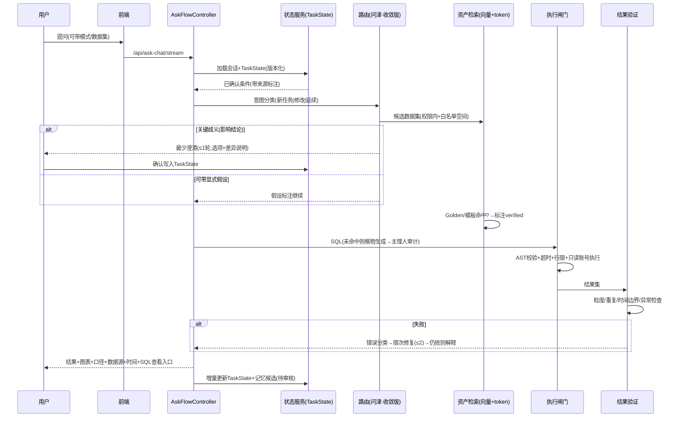
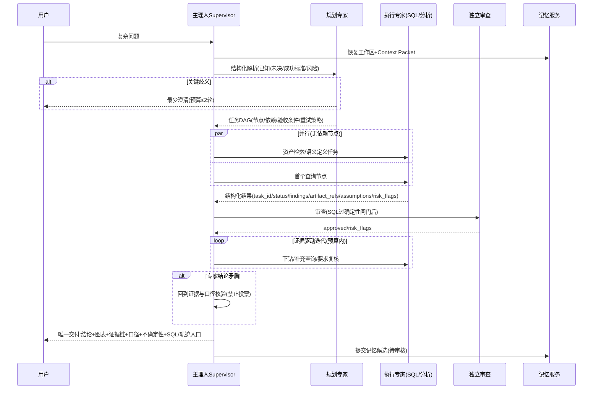

# 智能问数系统流程审计与升级规划报告

- 基准日：2026-10-20 ｜ 审计对象：`datapivot-demo`（DataPulse 脉策问数演示版）
- 配套证据文档：A1_后端问数链路审计.md（17 环节逐项+流程图）、A2_上下文记忆与资产配置审计.md、B_竞品调研.md
- 本阶段纪律：**只审计、调研、设计，未改动任何代码**

---

## 1. 执行摘要与核心结论

**当前系统真实形态**：一套"四 Agent 固定串行流水线（Agent1 路由→Agent2 SQL→Agent3 审计→Agent4 分析）+ 可插拔 advanced 技能层"的 Text-to-SQL 系统，书架七类资产（LLD/字典/DDL/关联/Golden SQL/提示片段/常见问题）已真实注入链路，trace 与日志可观测性较好。它**不是**从零起步的系统，已经有权限闸门、确认卡、解析条修正学习等成品能力。

**五个最关键的问题：**

1. **追问与上下文问题的根因**：系统没有"结构化查询状态"这一层。多轮上下文=前端传消息列表+后端把追问**字符串拼接**进上一题（`short_term_memory.py:95-117`）。条件继承靠"请沿用上一轮口径"这类自然语言叮嘱，无法表达"删掉上一轮某个过滤条件"。这是多轮准确率不稳定的第一根因。
2. **"记忆"的实质**：是消息历史（前端 payload + 进程内 8 轮/2 小时 deque）+ 报告历史 JSON 文件。**没有跨会话长期记忆、没有任务状态持久化**——服务重启即丢，隔日续问靠前端 localStorage。
3. **双模式现状**：`AskFlowController`（ask_flow/controller.py:90）已实现 basic/advanced 分流框架（用户请求>数据集策略>默认；advanced 有角色白名单+开关+出错回退 basic），但 advanced 是"basic 流水线 + skills 叠加层"（datapulse_advanced/service.py:625），**不是主理人+专家编排**。好底子：两模式已共享同一资产/执行/日志底座。
4. **最大安全缺口**：SQL 执行层（`datasource_router.py:192-201`）**无超时、无行数上限、无成本预算**，只读校验是正则级（`ask_engine_sql.py:54`）；业务正确性（粒度/重复计数/时间边界/分子分母）没有任何程序化验证，全押 Agent3 的 LLM 自审。
5. **竞品对标核心结论**（详见 B 文档）：最值得借鉴的三件套——**Snowflake VQR**（问题→已验证 SQL 库，命中复用+命中可见）、**Databricks Benchmarks+Request Review 双闭环**（基准题自动对拍+用户一键复核回流）、**DataBuddy 分析空间=资源白名单+专用工具前置澄清契约**。其中 DataBuddy 身份已核实=腾讯云 DataBuddy（Agent 原生数据智能体工作台，2026-06-05 发布，官方文档 2026-09-11 更新）。不宜照搬：ThoughtSpot 确定性查询编译器、全量多 Agent 编排平台。

---

## 2. 项目结构与技术栈概览

- 后端：Flask 单体（`backend/app.py` 入口，17 个蓝图），PostgreSQL（书架元数据 `bs_*` 表 + 业务数据），ChromaDB 仅 Vanna 遗留链路使用（主链路未用向量召回）。
- 问数主链路：`controllers/ask_chat.py`（接口/权限/守卫）→ `ask_flow/controller.py`（双模式分流）→ `four_agent_ask.py`（basic，10,507 行）/ `datapulse_advanced/service.py`（advanced 技能层）。
- 前端：Vue3 + Element Plus；命令栏式问数界面；解析条/确认卡/纠正卡交互。
- 存储：书架资产在 PG；配置在 `config/*.json`；报告历史 JSON 文件；日志 `system_event_logs` 表 + `logs/*.jsonl`。
- 测试：**backend 无测试目录**，验收靠人工手册。

## 3. 当前普通问数实际流程（代码证据）

见 A1 文档第 1 节流程图与第 2 节十七环节表。主干一句话：

`ask_chat 接口（权限+错字/方向守卫）→ AskFlowController → ask()（追问改写/主体解析/数据集锁定释放）→ Agent1 路由（规则打分+LLM+节点索引，歧义则确认卡）→ _run_pipeline（逐数据集：装载书架资产→实体解析→SQL策略[golden复用/规则构建/LLM]→Agent2→Agent3审计+字段白名单→只读校验→执行→限次修复→Agent4分析）→ trace+日志落库`。

关键特征：①规则与 LLM 深度交织，Agent1 路由规则体量数千行且与特定业务数据集耦合；②Golden SQL 走 token 打分 top5，无语义召回；③无执行资源闸门。

## 4. 当前上下文/记忆实现盘点（代码证据）

见 A2 文档。三句话：消息历史双轨（前端 payload 为主+内存兜底）；追问=启发式识别+字符串拼接改写；持久化产物只有报告历史 JSON（且按 `role:identity` 分桶，有 stale 快照检测 409）。**无结构化任务状态、无跨会话记忆、无检查点。**

## 5. 当前高级/多 Agent 能力盘点（代码证据）

- **四 Agent = 固定串行流水线**，不是并行专家：Agent1 路由中枢→Agent2 SQL 架构师→Agent3 合规审计（fail-close 人设）→Agent4 业务分析官（`agent_registry.py` 默认人设，可配置）。交接靠结构化输出（route JSON、review JSON）+ 程序校验，比"多 Prompt 各答一遍"成熟，但无任务 DAG、无按需调度、无预算管理。
- **advanced = 技能叠加层**：dataset_route/route_guard/golden_sql/planner/sql_quality/self_check/evidence_vote/pandas_analyze/conclusion_advice/answer_contract/template_policy/asset_pack 按配置开关组装（`datapulse_advanced/skills/`），在 basic 结果上做增强与跨数据集对比（`_execute_cross_dataset_compare`）。默认关闭，需超管开启。
- **结论**：升级方向不是推翻，而是把现有四 Agent 流水线"降维"为普通模式的执行引擎，在其上长出真正的主理人编排层——当前代码的资产底座、trace、权限、确认卡都可复用。
- **档位细化（2026-10-20 用户方向确认）**：普通问数=专家团逻辑**蒸馏版**（规则主理人+2 专家+L0 全跑/L1 按需），高级=**完整版**（LLM 主理人+7 专家按需+DAG+L0/L1/L2 三层校验全开），同一套注册表与编排逻辑、仅档位开关不同，详见 **C_专家团蒸馏架构设计.md**。

## 6. 主流产品调研和竞品对比

详见 B 文档（含每条官方链接+更新日期+证据分级）。对比表核心行（节选）：

| 机制 | 最强证据来源 | 对本系统启示 |
|---|---|---|
| Verified Query Repository | Snowflake Cortex Analyst（官方文档） | 把现有 bs_golden_sql_samples 升级为"问题→已验证SQL+verified_by/verified_at+命中标注"，成本最低收益直接 |
| Benchmarks + Request Review | Databricks Genie（GA 公告+官方博客） | 建 20-50 题基准集自动对拍 + 前端"申请复核"入口回流，正好补上无回归测试的短板 |
| 分析空间=资源白名单 | 腾讯云 DataBuddy / Fabric | 用户/治理侧显式圈定可问数据集集合，同时解决自动选源与权限收窄 |
| 专用工具前置澄清契约 | DataBuddy 插件实践 | 归因/预测类复杂分析先校验"合格问题要素"再执行（结构化 intent 必填项检查） |
| 分层指令体系 | Fabric Data Agent / Quick BI | Agent级+数据源级+示例查询三层，纯配置工程 |
| 确定性查询编译 | ThoughtSpot Spotter | 不宜照搬；用"SQL模板化+AST校验+只读执行"近似 |
| 单 Agent 优先原则 | Snowflake 官方编排指南 | 中小系统先用"单主理人+工具路由"，别急着堆多 Agent |

## 7. 当前能力差距矩阵及根因（交付物 D）

> 能力点编号 G-xx 即后续路线图工作项引用。优先级依据：业务价值×质量/安全风险×成本。

| 编号 | 能力点 | 当前实现证据 | 目标能力 | 差距/根因 | 用户影响 | 优先级 | 依赖 | 改造方案 | 验收测试 |
|---|---|---|---|---|---|---|---|---|---|
| G-01 | 执行资源闸门 | 执行层无超时/行数限制（datasource_router.py:192） | 语句超时+行数上限+成本预算+取消 | 执行函数裸调用 read_sql_query | 一条 SQL 可拖垮演示库 | **P0** | 无 | 执行包装器：SET LOCAL statement_timeout / LIMIT 注入 / 取消句柄；配置化阈值 | 构造 `pg_sleep(60)` 与 500万行全表扫描，验证 10s 截断+友好报错 |
| G-02 | 结构化任务状态 | 无；追问靠字符串拼接（short_term_memory.py:95） | 持久化 TaskState（指标/时间/维度/筛选/数据集/口径版本/子任务状态） | 缺存储层与状态模型 | 多轮条件继承错、无法"删除条件" | **P0** | 无 | 新表 `ask_task_state`（session/task/版本号/JSONB 状态/来源标注），ask 入口读、答后增量写 | 多轮场景：①"各战区业绩"→"只看商用"→"去掉商用"——第三步结果含全部战区且无商用过滤残留 |
| G-03 | 跨会话恢复 | 重启即丢（内存 deque）；报告历史 JSON 兜底 | 会话列表+任务工作区可恢复 | 无会话实体 | 隔日无法续问 | **P0** | G-02 | `ask_conversation`/`ask_message` 表+工作区索引；确认会话落库替内存 dict | 创建会话→提问→重启服务→拉取会话→追问——口径与数据集正确继承 |
| G-04 | SQL 安全（AST 级） | 正则只读（ask_engine_sql.py:54） | sqlglot AST 解析：语句类型/单语句/SELECT INTO/函数副作用/方言 | 无 AST 依赖 | 正则可绕过（SELECT INTO、注释注入边缘场景） | **P0** | G-01 | 引入 sqlglot；执行前确定性闸门（模型审查只作补充） | 攻击用例集：SELECT INTO、WITH 内嵌 DML、字符串字面量含 drop、多语句——全部拦截 |
| G-05 | 时间词解析 | 时间词可被当组织节点（dataset 2"上个月"→0行，A1#2/5） | 确定性时间归一化层（今日/上月/环比周期→日期区间），先于实体解析消费 | 解析管线无时间槽位 | 常见时间提问 0 行 | **P0** | G-02 | 时间解析器输出 time_range 槽位写入 TaskState；SQL 生成使用参数化区间 | 数据集2 问"上个月任务达成"返回上月数据而非 0 行；边界（月初/跨年）用例 6 条 |
| G-06 | 结果程序化验证 | 仅 0 行兜底；口径验证全押 Agent3 LLM | 结果闸门：聚合粒度/重复计数/分子分母/时间边界/空值/异常值 确定性检查 | 无独立验证器 | 数字错但"看起来对" | **P1** | G-02 | 新增 `result_validator`：对照 TaskState 期望粒度检查行数异常、单主体多行、分母为 0 等 | 错题注入：重复 join 导致某战区金额翻倍→验证器拦截并触发限次修复 |
| G-07 | Golden SQL 语义召回+命中标注 | token 打分 top5（bookshelf_repository.py:248） | 向量召回（书架资产入 Chroma）+命中即在响应标注"已验证模板" | Chroma 仅遗留链路用 | 高频题复用率低、用户无法区分信任级 | **P1** | 无 | golden_sql skill 扩展：embedding 入库+命中阈值+响应打标 | 20 条高频题换 3 种问法，命中率≥80%；命中响应含 verified 标注 |
| G-08 | 基准回归集 | 无测试（backend 无 tests） | Benchmarks：20-50 题基准集+标准 SQL+CI 定时对拍 | 无评估基础设施 | 改 prompt 不敢发布 | **P1** | G-07 | `tests/benchmarks/` YAML 题库+对拍脚本（结果集精确匹配+Correct/NeedsReview 报告） | 题库随代码入库；回归脚本输出准确率随配置版本对比 |
| G-09 | 反馈→知识回流 | 只有别名反馈表+全量日志（A2#5） | 点赞/点踩→归类→候选→审核→入 Golden/别名/题库 的闭环 | 无审核流与回流通道 | 错题反复犯 | **P1** | G-08 | feedback 表+人工审核台（复用书架界面）；审核通过才写 bs_* | 用户点踩→运营审核→同问题再发问走新 Golden SQL |
| G-10 | 主理人编排（高级模式） | advanced=技能叠加层（service.py:625） | Supervisor+按需专家+任务 DAG+结构化交接协议+预算/停止规则 | 无编排层与任务图 | 复杂问题只能单路径直答 | **P2** | G-02/06 | 新增 `supervisor` 模块： Planner(现有 planner skill 升级)→DAG 执行器(复用 basic 引擎为工具)→独立审查(主理人+evidence_vote)→汇总裁决 | 复杂归因题：验证任务图执行、每步产物可回放、超预算自动停止并交付已得证据 |
| G-11 | 跨数据集/归因/预测 | advanced 有跨数据集对比雏形（_execute_cross_dataset_compare:259） | 贡献分析/波动归因/趋势预测工具（对齐 DataBuddy 四工具） | 无归因算法件 | 高级模式缺分析深度 | **P2** | G-10 | pandas_analyze skill 升级为确定性归因（两期对照+维度贡献+自动下钻），结论强制 caveat"相关≠因果" | 给定时序异动，归因输出维度贡献排序且附 SQL 证据链 |
| G-12 | 长期记忆 | 无（A2#3） | 四层记忆：任务状态/会话记忆/长期记忆(分scope)/语义记忆 + Context Packet | 无记忆服务 | 用户偏好、纠错无法沉淀 | **P3** | G-02/03 | memory 包扩展：长期记忆表（metadata: type/scope/source/status/version/validity/reviewed_by）+检索=结构化过滤+关键词+向量+权限过滤 | 用户说"以后金额都用万元"→下一会话生效且仅本人 scope；配置升级后旧记忆自动失效 |
| G-13 | 数据集配置版本/审核 | LLD 有 version，其余无（A2#4） | 资产 is_reviewed/生效区间/冲突仲裁/数据集级版本号 | 无版本治理 | 配置改了无法回溯 | **P3** | G-09 | bs_* 增加 audit 字段+版本快照表+健康度纳入版本状态 | 改 Golden SQL 后可回滚；两版本冲突时按生效时间+审核优先级仲裁 |
| G-14 | 数据转换进链路 | 转换仅同步链路用（A2#4） | 问数可引用转换产物（物化视图/中间表） | 未接入 | 复杂口径每次现算 | **P3** | G-13 | dataset_transforms 产物登记进书架表清单 | 转换产物可被问数引用且刷新后口径自动更新 |

P4（进阶体验：异常归因可视化、多轮钻取、图表调整、可复现报告导出）依赖 P2/P3 成熟后立项，本报告不展开工作项。

---

## 8. 目标总体架构

```
┌────────────────────────── 共享底座（两模式复用）──────────────────────────┐
│ 资产/语义服务(bs_*+向量召回) │ SQL安全执行闸门(AST+超时+行限+只读账号)      │
│ 质量服务(结果验证+Benchmarks) │ 记忆服务(TaskState/会话/长期/语义+ContextPacket)│
│ 产物存储(报告/SQL/trace)     │ 可观测(执行日志+token+成本)                  │
└──────────────────────────────────────────────────────────────────────────┘
        ▲                                          ▲
┌───────┴──────────┐                    ┌──────────┴─────────────┐
│ 模式A 普通问数    │  自动建议升级       │ 模式B 高级专家团         │
│ 状态感知路由→资产 │ ───────────────▶  │ 主理人(Supervisor)      │
│ 检索→模板优先→澄清│ ◀───────────────  │  Planner+DAG+预算+裁决   │
│ →SQL→闸门→验证→答│   降级(问题简单/超时)│  专家:语义/SQL/审查/分析/ │
│ (现有四Agent引擎  │                    │  可视化(按需调度)        │
│  收敛改造)       │                    │ (现有引擎降为专家工具)    │
└──────────────────┘                    └──────────────────────────┘
```

原则：**一套底座、两个入口**；普通模式是高级模式的"单任务退化形态"；高级模式每步可降级到普通路径执行。

## 9. 普通问数目标流程（交付物 C）



与现状的差异点：①入口先读 TaskState 而非拼消息；②澄清预算 1 轮、可带假设继续；③Golden 命中标注；④执行过闸门；⑤结果过验证；⑥状态增量写回。

## 10. 高级专家团目标流程（交付物 C）

**主理人职责**（与现状 advanced 技能层的本质区别）：唯一权威任务状态持有者、任务 DAG 规划者、澄清决策者、预算/超时/重试管理者、证据汇总与唯一交付者、记忆提交审核者。

**专家角色**（按需启用，可合并；关键能力必须确定性服务承载）：

| 专家 | 职责 | 触发条件 | 复用现状 |
|---|---|---|---|
| 上下文管家 | 指代消解/状态恢复/记忆检索/冲突识别 | 总是（轻量） | TaskState+记忆服务(G-02/12) |
| 资产路由专家 | 数据集/表/字段选择、时效与权限 | 跨域或路由置信度低 | 问津收敛+dataset_route skill |
| 业务语义专家 | 指标/术语/时间口径解释 | 口径存疑时 | 书架资产+LLD |
| 查询规划专家 | 拆子问题、依赖 DAG | 多步骤问题时 | planner skill 升级 |
| SQL 工程专家 | 模板复用/生成/解释 | DAG 中每个查询节点 | 现有格物+规则引擎 |
| 独立审查专家 | 语义/权限/粒度/安全审查（非生成者自审） | 每个查询节点执行前 | 主理人+sql_quality+route_guard |
| 数据分析专家 | 趋势/同比环比/贡献/异常 | 结果需要解读时 | 析微+pandas_analyze |
| 可视化表达专家 | 图表选择/结论组织/下一步建议 | 交付前 | answer_contract+conclusion_advice |



**结构化交接协议**（在现有 review/route JSON 基础上规范化）：
`{task_id, agent_role, status: completed|needs_clarification|blocked|failed, findings[], artifact_refs[], evidence_refs[], assumptions[], unresolved_questions[], risk_flags[], recommended_next_actions[]}`。禁止以模型自报 confidence 作为执行唯一依据。

**停止与降级规则**（全部配置化）：澄清≤2 轮；SQL 修复≤2 次；Agent 调用/token/耗时三预算；权限问题不可绕行；未确认口径不得默默选择；证据不足明说缺口；超时存检查点可恢复；每步输入引用/配置版本/工具调用/输出可回放；判断问题简单→自动降级普通路径。

## 11. 上下文与长期记忆专项设计（交付物 C）

四层模型（存储位置/读写时机/验收见下）：

1. **任务状态（工作记忆）**：`ask_task_state` 表（G-02）。字段覆盖：当前指标/时间范围/维度/筛选(每条标注来源：用户|记忆|配置|模型推断+确认状态)/数据集与口径版本/子任务状态/已执行查询引用/错误/待办/停止条件/context_version。每次追问增量更新+版本号+变更历史；重启恢复；并发用版本号冲突检测。
2. **会话记忆**：`ask_conversation`+`ask_message` 表；保留近期原文+可更新摘要；摘要不替代关键证据。
3. **跨会话长期记忆**：`memory_items` 表，scope 分 user/team/project/dataset/enterprise；类型分偏好/术语口径(引用权威配置)/纠错记录/可复用案例/未完成工作索引/失败案例。元数据：memory_type, scope, content, source_ref, created_at, updated_at, valid_from/to, status, version, confidence, access_policy, supersedes_memory_id, reviewed_by。
4. **语义记忆**：书架 bs_* 保持唯一权威来源，模型推测只进"待验证假设区"，不直接写正式配置（G-13 版本/审核兜底）。

**读写规则**：用户本轮指令即时生效于 TaskState，但≠企业正式规则；正式口径以配置中心有效版本为准；纠错修正当前任务即时生效，推广为长期规则需审核；冲突按 权限>scope>来源可靠性>生效时间>版本 仲裁，无法确定则澄清；失效/撤销条目不再作为事实返回，保留审计；用户可查看/纠正/撤销/清理自有记忆；记忆检索按权限过滤，敏感数据不注入无关 Agent。

**Context Packet**（上下文服务统一产出，各 Agent 按最小必要裁剪）：
`{conversation_id, workspace_id, task_id, context_version, intent, confirmed_conditions[](含来源+确认状态), asset_refs[](含版本), memory_refs[](含有效期), completed_steps[], artifact_refs[], todo[], unresolved_questions[], permission_scope, execution_limits, budgets, stop_conditions, dialogue_summary, recent_raw_spans[]}`。

**记忆检索**：结构化过滤(scope/type/status/validity/权限) → 关键词(BM25) → 向量语义 → 按来源可靠性+时间衰减重排；上下文窗口不足时**优先保留**：当前约束、权威口径、未决问题、执行状态——禁止先删这些。

## 12. SQL/结果验证与安全架构（交付物 C）

12 项闸门逐项目标（当前→目标）：

| # | 闸门 | 现状 | 目标 |
|---|---|---|---|
| 1 | 数据集/表/字段白名单+权限 | 部分（字段/表校验有；库表级靠数据源隔离） | 白名单校验移到 AST 层（解析 from/join 真实表名，含 CTE 别名归一） |
| 2 | 只读约束 | 正则（ask_engine_sql.py:54） | sqlglot AST：仅 SELECT/WITH；拦截 SELECT INTO、多语句、副作用函数；执行账号改只读角色 |
| 3 | AST/方言静态检查 | 无 | sqlglot 方言解析（PG），结构规则（禁止跨库、强制 LIMIT） |
| 4 | Join 粒度/重复计数 | LLM 自审 | 结果验证器+执行计划启发式（基数突变告警） |
| 5 | 时间边界/时区/同环比 | 部分（金额单位继承有；时间词缺陷 G-05） | 确定性时间层：自然月/滚动周期/同环比规则库，参数化写入 |
| 6 | 敏感字段/行列权限 | 数据集级+组织提及拦截有；无列级脱敏 | 字典加 sensitivity 标记；结果集列级脱敏+行列权限规则 |
| 7 | 超时/扫描量/行数/成本 | **全无** | statement_timeout+行限+最大扫描页告警+取消句柄（G-01） |
| 8 | 错误分类/限次修复 | 有限修复(8482)，次数硬编码 | 错误分类表(语法/权限/超时/资源/口径)+限次配置化+达上限解释退出 |
| 9 | 结果结构验证 | 仅 0 行 | 空结果/异常值/重复行/聚合粒度/分母为 0 程序检查（G-06） |
| 10 | 参考 SQL/基准校验 | token 排序 golden top5 | VQR 化：命中即执行+标注+verified 元数据（G-07） |
| 11 | 口径未确认阻断 | 主理人 fail-close 人设 | 程序规则：关键口径字段缺失且无用户确认→阻断并澄清 |
| 12 | 答案可追溯 | trace+日志有；用户侧 SQL 查看入口部分 | 每答必含：口径/数据源/时间范围/筛选/SQL/命中资产版本入口 |

红线重申：模型审查不替代程序化校验；执行成功≠业务正确；多 Agent 一致≠证据。

## 13. 前端交互与运营管理界面建议（交付物 C）

1. **模式切换**：问数框旁模式选择器（普通/高级），系统可按复杂度自动建议"升级高级分析"（可关）；高级模式展示任务图执行态（节点状态/当前专家）。
2. **澄清交互**：确认卡升级为"选项+差异说明+可编辑"；解析条槽位原位编辑（已有）扩展至时间/筛选槽位。
3. **来源/SQL 查看**：每答展开"口径与来源"抽屉：命中资产（Golden 标注 verified/生成）、SQL、执行计划摘要、数据时间、筛选条件。
4. **工作区恢复**：左侧会话列表（跨天）；卡片显示"可恢复分析"；重启后续问提示"继承上次口径？"。
5. **记忆管理**：个人中心"我的记忆"页：查看/纠正/撤销；管理员审核台（反馈→候选知识→审核入库）。
6. **反馈**：答案卡片 👍/👎+原因标签（口径错/数据集错/图表不合适/需补充条件），直接进 G-09 闭环。
7. **运营**：书架健康度增加"版本/审核状态"维度；Benchmarks 报告页（准确率随版本曲线，对齐 Genie Evaluations）。

## 14. 分期升级路线图（交付物 E）

> 工时按 1 名全栈+1 名算法/数据工程师估算的区间；每阶段独立可发布、可回滚（feature flag 包裹）。

**P0：安全与状态底座（2-3 周）** — 目标：先补"会出事故"和"状态丢失"。
- 改动：G-01 执行闸门（datasource_router 包装+配置）、G-04 sqlglot 闸门、G-02 ask_task_state 表+读写、G-05 时间解析层、G-03 会话落库（确认会话先行）。
- API/结构：`ask_task_state`、`ask_confirmation_session` 表；`POST /api/ask-chat/sessions` CRUD；`config/safety.json`。
- 风险：低（纯新增+包装层，不改路由主逻辑）。回滚：flag 关闸门回退正则校验；新表只写不读→读后也无侵入。
- 验收：G-01/04/05 的验收测试用例全过；多轮三场景（见 G-02）通过；服务重启后续问不丢口径。

**P1：普通问数质量（3-4 周）** — 目标：准确率可度量、可信模板优先、错题有闭环。
- 改动：G-07 Golden 向量召回+命中标注、G-06 结果验证器、G-08 Benchmarks 题库+对拍 CI、G-09 反馈回流+审核台。
- 风险：中（G-07 改召回路径，须 A/B：同一题库对比 token vs 向量命中率与准确率，未证明收益则回退）。
- 验收：基准集准确率较基线提升≥10 个百分点（先建基线）；20 高频题三问法命中率≥80%；点踩→审核→复问生效端到端跑通。

**P2：高级专家团（4-6 周）** — 目标：真编排。
- 改动：G-10 supervisor 模块（Planner/DAG 执行器/预算/裁决；四 Agent 引擎封装为工具）、G-11 归因/预测工具件。
- 关键数据结构：`advanced_task_graph` 表（节点/依赖/输入输出引用/验收/重试/状态）；交接协议 Schema 落 contracts.py。
- 风险：中高（ token 成本上升；需消融：对照组=普通模式同题，证明专家团在复杂题集上质量收益>成本增幅，否则降级为"单 Agent+工具路由"——Snowflake 官方也建议单 Agent 优先）。
- 验收：复杂题任务完成率≥80%；无证据结论率=0；专家冲突全部回到证据核验；单任务全程可回放（输入引用/配置版本/工具调用/输出）。

**P3：长期记忆与版本治理（3-4 周）** — G-12 记忆服务+检索、G-13 资产版本/审核/冲突仲裁。
- 验收：G-12 验收用例全过；资产可回滚、冲突可仲裁、审计可查。

**P4：进阶分析体验（按 P2/P3 反馈立项）**：异常归因可视化、跨数据集钻取、图表对话式调整、可复现报告导出。

## 15. 测试集与量化指标（交付物 F）

**测试集**（P1 落地，存 `tests/benchmarks/*.yaml`，人工标注黄金答案）：
单轮基础取数 20 题｜口语别名 10｜指标口径歧义 10｜多轮追加/修改/删除过滤 15｜跨会话续问 5｜纠错即时生效 5｜配置升级后旧记忆失效 3｜跨数据集连接 5｜复杂归因多查询 5｜SQL 失败与超时恢复 5｜Agent 矛盾 3｜权限与敏感字段 8｜长上下文信息保留 3。安全攻击用例 15 条（G-04）。

**指标体系**（先建基线，再设目标；无法自动验证的标注人工评）：

| 指标 | 基线方法 | 目标(P1 末) |
|---|---|---|
| 问题路由准确率 | 基准题标注 dataset_id，自动比对 | ≥90% |
| 指标/时间解析准确率 | 标注 time_range/指标槽位 | ≥90%（时间词类≥95%） |
| SQL 执行成功率 | 日志自动统计 | ≥92% |
| SQL 语义正确率 | 结果集对拍+人工抽评(10%) | 较基线+10pp |
| 澄清命中率/不必要的澄清率 | 人工标注 50 例 | 命中≥85%／不必要的≤15% |
| 多轮条件继承正确率 | 15 题多轮集自动+人工 | ≥85% |
| 记忆召回精确率/召回率 | 注入已知记忆测检索 | ≥85%/≥80% |
| 错误记忆写入率/过期记忆误用率 | 造例测试 | ≤2% / 0 |
| 跨会话状态恢复成功率 | 5 场景自动化 | 100% |
| 高级模式任务完成率/无证据结论率 | P2 复杂题集 | ≥80% / 0 |
| P95 时延/模型调用次数/token 成本 | 日志自动 | 普通≤15s；高级预算内 |
| 权限/安全测试通过率 | 攻击用例集 | 100%（P0 起门禁） |

## 16. 风险、取舍、待确认问题与下一步行动

**取舍**：① 不把 four_agent_ask.py 一万行推倒重写——P0-P1 全部以新增模块+薄包装落地，四 Agent 引擎收敛为"普通模式执行引擎+高级模式工具"；② 向量召回必须先 A/B 证明收益；③ 高级专家团先做消融再扩容，避免"为 Agent 而 Agent"；④ 确定性查询编译（ThoughtSpot 路线）明确不采用。

**待确认问题（需用户拍板）**：① 界面的"标准题集"与 bs_common_questions 的关系（A2#4）；② 报告历史按 role:identity 分桶是否符合正式环境多用户预期；③ 执行只读账号改造是否接受为每个数据源加只读角色；④ LLM 网关现有超时/重试参数（llm_client.py 未细读，P0 前需补查）；⑤ 图表选型逻辑在前端还是后端（本次未证实）。

**下一步最小改造集（P0 第一批，等待确认后开工）**：
1. `backend/safety/executor_guard.py`（新增）：超时/行限包装 `execute_sql_for_source`，`config/safety.json` 配置；
2. `backend/safety/sql_gate.py`（新增）：sqlglot AST 只读/单语句/白名单校验，接入主理人复核之后、执行之前；
3. `backend/migrations/2026102x_task_state.sql`（新增）：ask_task_state/ask_confirmation_session 表；
4. `backend/timeparse/`（新增）：时间归一化层，ask() 入口写入 TaskState；
5. 全部 feature flag 包裹，`DATAPULSE_SAFETY_GATE=on/off` 一键回滚。

## 16.5 设计决策 14 问逐项回答

1. **问数准确率/上下文问题主根因？** 无结构化查询状态层：追问=字符串拼接改写（short_term_memory.py:95-117）、条件继承靠自然语言叮嘱；时间词未被解析管线显式消费（G-05）；路由启发式与特定数据集硬耦合。
2. **当前"记忆"到底是什么？** 消息历史（前端 payload 为主+进程内 8 轮/2h deque）+ 报告历史 JSON。不是摘要系统、不是结构化状态、不是跨会话长期记忆。
3. **双模式触发与切换？** 现状已有三级决策（用户请求 flow>数据集策略>默认，ask_flow/controller.py:90-113）。目标：保留该框架，增加"复杂度评分自动建议升级"（跨数据集信号/归因意图/多步骤词），用户可一键切换或关闭自动建议；高级模式超预算自动降级普通路径。
4. **哪些必须澄清，哪些带假设继续？** 影响结论的硬歧义必须澄清：数据集口径冲突、指标定义多义、组织边界不清、时间范围缺失且默认值会改变结论。可带显式假设继续：输出格式、排序偏好、图表类型、非关键过滤——答案中必须列出假设。
5. **数据集路由如何避免名称/向量误选？** 三路信号融合：确定性（组织树节点→数据集归属、域前缀、路由词/别名）> 结构化（业务域、层级支持度、字段覆盖）> 语义（向量相似，仅作候选排序）；权限白名单先行过滤；置信度低于阈值或 top2 分差小于阈值→确认卡。名称相似永远不是唯一依据。
6. **书架资产排序与冲突处理？** 权威序：数据集元数据/LLD（最新 is_active 版本）> 数据字典/DDL（校验依据）> Golden SQL（命中即复用+标注）> Agent 提示片段（按 agent_no 注入）> 常见问题（引导与打分辅助）。冲突仲裁规则（G-13）：生效时间新者优先、已审核优先于未审核、用户本轮显式确认最高；模型推测永不直接覆盖配置。
7. **主理人何时启动专家，并行/串行？** 规划专家产出 DAG 后：资产检索与语义定义可无依赖并行；每个查询节点内部串行（生成→审查→执行）；数据分析依赖其结果上游。专家不是固定启动，按 DAG 节点类型映射。
8. **Agent 如何共享上下文又互不污染？** 共享唯一权威 TaskState（只经由主理人读写）；各专家只收到 Context Packet 的最小必要切片（权限过滤+敏感字段不注入无关 Agent）；专家输出走结构化协议，不允许直接改状态；状态变更只有主理人能提交并带版本号。
9. **如何确保高级模式不是 LLM 输出拼接？** 三硬约束：任务 DAG 带依赖与验收条件（无 DAG 不执行）；每节点产物落 artifact 存储并带 evidence_refs（结论必须引用产物 ID，禁止凭记忆/常识出数）；停止规则与预算由确定性执行器强制（模型无权自我豁免）。消融测试对照普通路径证明价值。
10. **长期记忆如何保存/检索/去重/失效/纠错/版本/权限隔离？** memory_items 表+第 11 章元数据模型；检索=结构化过滤+关键词+向量+权限过滤+时间衰减重排；去重按 scope+type+content 指纹+supersedes 链；失效=valid_to+配置版本比对（配置升级自动失效旧口径记忆）；纠错=用户可改，改后旧版本 status=superseded 保留审计；权限=scope+access_policy 双层。
11. **口径/偏好/历史结果冲突时以什么为准？** 当前任务用户显式指令 > 权威配置中心有效版本（口径）> 已审核长期记忆（偏好/术语）> 历史结果（仅作构造参考，数值不当实时事实）> 模型推测（仅假设）。冲突无法仲裁→澄清。
12. **如何证明改造真的提高准确性？** Benchmarks 基线先行（G-08）：同一题库每次发布自动对拍，准确率随版本曲线公开；高级模式做消融（同题对照组）；任何 prompt/配置变更必须附带题库通过率差异报告，未通过门禁不合并。
13. **最值得借鉴什么，哪些不照搬？** 借鉴：VQR（G-07）、Benchmarks+Request Review（G-08/09）、分析空间白名单（权限模型）、前置澄清契约（高级模式工具校验）、分层指令体系（书架配置组织方式）。不照搬：确定性查询编译器（重造代价高，用 AST 闸门+模板近似）、全量多 Agent 平台（先单主理人+工具路由，Snowflake 官方同建议）、Deep Research 多假设并行（远期方向）。
14. **第一阶段最少改哪些文件/接口/表，如何小步可回滚？** 见 16 章"下一步最小改造集"：新增 4 个模块（safety/executor_guard、 safety/sql_gate、 timeparse/、 1 张迁移 SQL），接口零 breaking（执行与校验只做包装拦截），全部 feature flag 包裹可一键回滚；四 Agent 引擎本阶段一行不动。

## 17. 官方参考资料

全部竞品官方链接、更新日期与证据摘录见 **B_竞品调研.md**（DataBuddy 身份核验、Quick BI/Genie/Spotter/Cortex/Fabric 分节、对比表、借鉴清单）。代码证据索引见 **A1/A2**（文件:行号）。

---

*报告完。本阶段未修改任何业务代码；如确认进入实施阶段，建议从 P0 第一批 5 项开始，逐批确认。*
